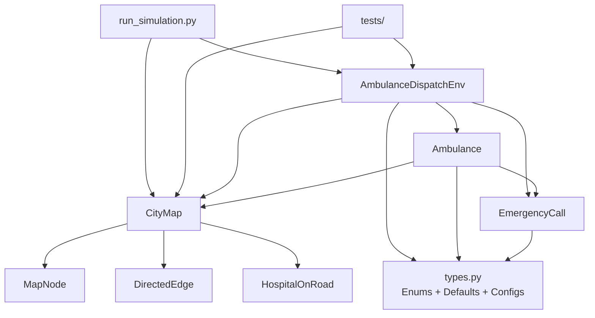
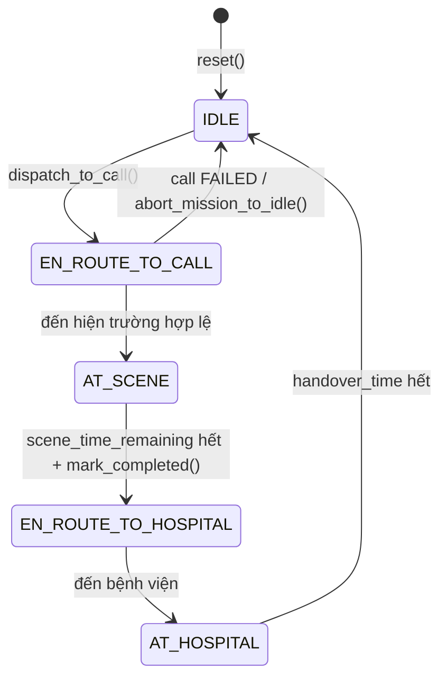
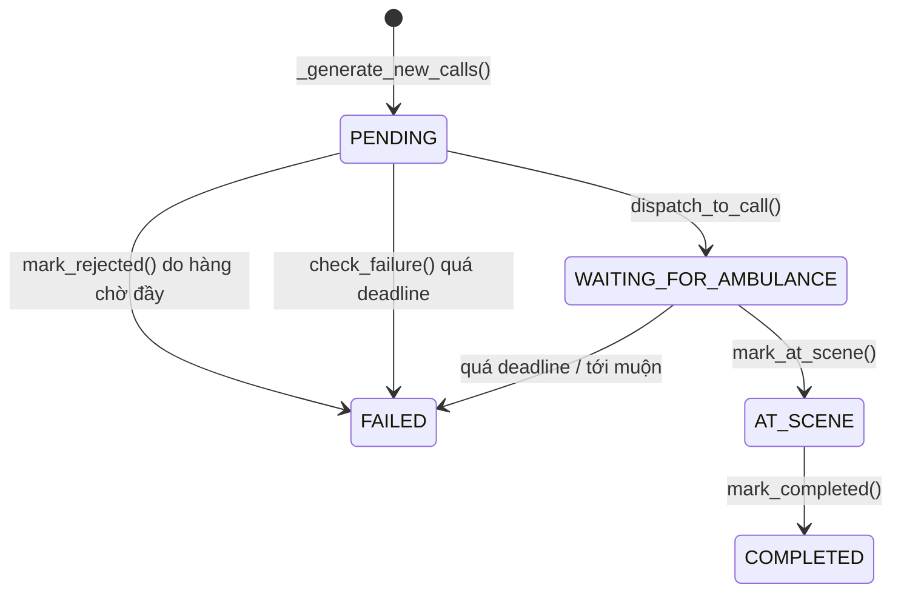

# M1 – BÁO CÁO AUDIT SIMULATION ENVIRONMENT

> **Phạm vi M1:** chỉ đọc và phân tích source code. Không có file source code nào được sửa/tạo/xóa trong phiên M1. Các thay đổi chưa commit đang tồn tại từ trước được giữ nguyên.
>
> **Ghi chú lưu trữ:** nội dung báo cáo này được lưu thành file `.md` theo yêu cầu riêng sau khi M1 hoàn tất; việc tạo file tài liệu này không làm thay đổi source code hay kết quả audit.

---

## 1. Executive Summary

### Thành phần hiện có

Môi trường hiện tại là một **simulation MDP dạng rời rạc theo phút**, gồm:

- Bản đồ đô thị tổng hợp **80 nút**, **86 tuyến hai chiều**, tương ứng **172 cung đường có hướng**.
- **4 bệnh viện** cố định, mỗi bệnh viện nằm trên một cung có hướng.
- **6 xe cứu thương mặc định**, có thể cấu hình qua `num_ambulances`.
- Sinh cuộc gọi Poisson với `lambda = 0.1` cuộc gọi/phút.
- Tối đa **3 cuộc gọi PENDING** mặc định (`max_pending_calls = 3`).
- Action space là tập các cách ghép đồng thời xe ↔ slot cuộc gọi.
- Reward gồm phạt chờ, phạt thất bại, phạt quãng đường và thưởng hoàn thành/hoàn hảo.
- Có action mask hỗ trợ agent chọn hành động hợp lệ.
- Có baseline heuristic trong `run_simulation.py`.
- **Chưa có RL Agent, chưa có pipeline huấn luyện/đánh giá RL hoàn chỉnh.**

### Mức độ hoàn thiện tổng quan

Môi trường đã đủ mạnh để mô phỏng và sinh dữ liệu cho một bài toán điều phối xe cứu thương. Tuy nhiên, để bàn giao cho nhóm RL cần chuẩn hóa thêm:

1. Định nghĩa chính thức state/observation và tính Markov.
2. Hợp đồng xử lý action không hợp lệ.
3. Quy ước terminal/truncation.
4. Chuẩn hóa reward và các mốc hạch toán tại `t=0`, deadline, hoàn thành.
5. API observation/action kiểu Gymnasium nếu muốn tích hợp thư viện RL.

### Điểm quan trọng cần lưu ý

- `COMPLETED` của cuộc gọi xảy ra **khi sơ cứu xong tại hiện trường**, không phải khi bàn giao tại bệnh viện.
- Deadline chỉ gây `FAILED` khi thời gian **vượt quá** deadline; đến đúng deadline vẫn thành công.
- Traffic được cập nhật **sau khi xe di chuyển trong bước**, nên movement trong bước dùng trạng thái giao thông cũ; reroute dùng trạng thái mới.
- Cuộc gọi mới được sinh ở **cuối bước**, tại thời điểm `t+1`, và xuất hiện trong observation trả về.
- `auto_dispatch=True` là **heuristic baseline**, không phải RL Agent.

---

## 2. Environment Architecture

### 2.1. Module và class chính

| Module | Class / thành phần | Trách nhiệm |
|---|---|---|
| `map_env/node.py` | `MapNode`, `IntersectionType` | Nút giao, tọa độ, bậc, loại nút |
| `map_env/edge.py` | `DirectedEdge`, các hằng số `CONGESTION_*`, bảng tốc độ | Cung đường có hướng, tốc độ theo vùng/tắc, Markov transition của giao thông |
| `map_env/hospital.py` | `HospitalOnRoad` | Bệnh viện nằm trên một cung có hướng, vị trí và thời gian bàn giao |
| `map_env/city_map.py` | `CityMap` | Khởi tạo 80 nút, 86 tuyến/172 cung, 4 bệnh viện, traffic, Dijkstra, routing |
| `dispatch_env/types.py` | Enum và hằng số | `AmbulanceStatus`, `CallStatus`, defaults, `SEVERITY_CONFIG`, `REWARD_CONFIG`, `DISTANCE_PENALTY_PER_KM` |
| `dispatch_env/call.py` | `EmergencyCall` | Vòng đời cuộc gọi, deadline, wait time, failure, perfect |
| `dispatch_env/ambulance.py` | `Ambulance` | Vòng đời xe, di chuyển liên tục, chọn bệnh viện, reroute |
| `dispatch_env/environment.py` | `AmbulanceDispatchEnv` | MDP environment: reset, slot, action mask, decode/encode, step, reward, observation, log |
| `run_simulation.py` | `run_experiment()` | Chạy baseline heuristic, ghi log, thống kê |
| `tests/` | Unit tests | Kiểm thử map và environment |

### 2.2. Quan hệ phụ thuộc

- `dispatch_env.environment` phụ thuộc `CityMap`, `EmergencyCall`, `Ambulance`, các cấu hình trong `types.py`.
- `dispatch_env.ambulance` phụ thuộc `types.py`, `call.py`, `CityMap`.
- `dispatch_env.call` phụ thuộc `types.py`.
- `map_env.city_map` phụ thuộc `node.py`, `edge.py`, `hospital.py`.
- `run_simulation.py` phụ thuộc `CityMap`, `AmbulanceDispatchEnv` và các defaults.

### 2.3. Sơ đồ kiến trúc



### 2.4. Luồng khởi tạo chính

1. `run_experiment()` tạo `CityMap(seed=seed)`.
2. `CityMap.__init__()` gọi:
   - `_build_80_nodes()`,
   - `_build_roads()`,
   - `_place_hospitals()`,
   - `randomize_traffic(initial=True)`.
3. `run_experiment()` tạo `AmbulanceDispatchEnv(city_map=..., ...)`.
4. `AmbulanceDispatchEnv.__init__()`:
   - tạo `self.rng`,
   - lưu tham số,
   - lấy danh sách `edge_keys`,
   - xây `potential_actions`,
   - gọi `reset()`.
5. `reset()` khởi tạo lại trạng thái episode, tạo xe, sinh cuộc gọi ban đầu nếu có, trả observation.

---

## 3. Ambulance Lifecycle

### 3.1. Trạng thái

Định nghĩa tại `dispatch_env/types.py:10-15`:

- `IDLE` – Rảnh
- `EN_ROUTE_TO_CALL` – Đang đến cuộc gọi
- `AT_SCENE` – Xử lý tại cuộc gọi
- `EN_ROUTE_TO_HOSPITAL` – Đang tới bệnh viện
- `AT_HOSPITAL` – Xử lý tại bệnh viện

### 3.2. Sơ đồ trạng thái



### 3.3. Điều kiện chuyển trạng thái

| Chuyển trạng thái | Điều kiện | Vị trí code |
|---|---|---|
| `IDLE → EN_ROUTE_TO_CALL` | `env.step()` giải mã action hợp lệ và gọi `Ambulance.dispatch_to_call()` | `environment.py:751-762`, `ambulance.py:135-156` |
| `EN_ROUTE_TO_CALL → AT_SCENE` | Xe tới vị trí cuộc gọi và `arrival_time <= call.deadline + 1e-6` | `ambulance.py:275-311` |
| `EN_ROUTE_TO_CALL → IDLE` | Cuộc gọi đã `FAILED`, hoặc xe tới muộn sau deadline | `ambulance.py:266-269`, `ambulance.py:289-298`, `ambulance.py:312-323` |
| `AT_SCENE → EN_ROUTE_TO_HOSPITAL` | `scene_time_remaining` về 0; gọi `call.mark_completed()` rồi `select_best_hospital_and_route()` | `ambulance.py:350-363`, `call.py:130-138`, `ambulance.py:175-207` |
| `EN_ROUTE_TO_HOSPITAL → AT_HOSPITAL` | Xe tới cổng bệnh viện | `ambulance.py:369-417` |
| `AT_HOSPITAL → IDLE` | `hospital_time_remaining` về 0; gọi `abort_mission_to_idle()` | `ambulance.py:419-431` |

### 3.4. Các biến quan trọng

Từ `Ambulance` dataclass và `to_dict()`:

- `ambulance_id`
- `current_edge` – cung có hướng hiện tại `(u, v)`
- `distance_from_start` – vị trí trên cung, km
- `status`
- `current_call_id`
- `target_type`: `"call"`, `"hospital"` hoặc `None`
- `target_id`
- `target_edge`
- `target_dist`
- `target_name`
- `route_edges` – danh sách cung còn lại
- `scene_time_remaining`
- `hospital_time_remaining`
- `assigned_hospital_id`
- `total_distance_traveled`
- `last_step_distance`
- `reroute_count`
- `last_rerouted_this_step`

### 3.5. Nhận nhiệm vụ và di chuyển

- Xe chỉ nhận nhiệm vụ khi đang `IDLE` và `current_call_id is None`.
- `dispatch_to_call()` đặt:
  - `status = EN_ROUTE_TO_CALL`,
  - `current_call_id`,
  - `target_type = "call"`,
  - `target_edge`, `target_dist`,
  - tuyến đường qua `CityMap.route_from_road_to_road()`.
- Cuộc gọi chuyển sang `WAITING_FOR_AMBULANCE` và nhận `assigned_ambulance_id` (`ambulance.py:144-145`).

### 3.6. Xử lý tại hiện trường

- Khi đến hiện trường:
  - `status = AT_SCENE`,
  - `call.mark_at_scene(arrival_time)`,
  - `scene_time_remaining = call.processing_time`.
- `processing_time` lấy từ `SEVERITY_CONFIG`: mức 1 = 4 phút, mức 2 = 6 phút, mức 3 = 8 phút.
- `step_continuous()` giảm `scene_time_remaining` theo thời gian còn lại trong bước.

### 3.7. Chuyển bệnh viện và bàn giao

- Khi sơ cứu xong, `call.mark_completed()` được gọi ngay.
- Xe chọn bệnh viện bằng ETA ngắn nhất trong 4 bệnh viện.
- `status = EN_ROUTE_TO_HOSPITAL`.
- Khi tới bệnh viện:
  - `status = AT_HOSPITAL`,
  - `hospital_time_remaining = hospital.handover_time`.
- Sau khi bàn giao xong, xe trở về `IDLE`.

---

## 4. Emergency Call Lifecycle

### 4.1. Trạng thái

Định nghĩa tại `dispatch_env/types.py:18-23`:

- `PENDING`
- `WAITING_FOR_AMBULANCE`
- `AT_SCENE`
- `COMPLETED`
- `FAILED`

### 4.2. Sơ đồ trạng thái



### 4.3. Sinh cuộc gọi

Tại `_generate_new_calls()` – `environment.py:607-663`:

1. Nếu `current_minute >= max_time`, không sinh thêm.
2. Số cuộc gọi mới:
   - `num_new_calls = rng.poisson(lam=poisson_lambda)`.
3. Vị trí:
   - chọn ngẫu nhiên một cung có hướng từ `city_map.edges.keys()`,
   - chọn khoảng cách đều trong `[0.1, max(0.2, edge.length - 0.1)]`,
   - làm tròn 2 chữ số.
4. Severity:
   - `rng.choice([1, 2, 3], p=[0.40, 0.35, 0.25])`.
5. Tạo `EmergencyCall` với `created_time = current_minute`.
6. Nếu số cuộc gọi `PENDING` hiện tại đã đạt `max_pending_calls`:
   - gọi `mark_rejected()`,
   - đặt `status = FAILED`, `failure_type = "queue_overflow"`,
   - tăng `failed_calls_count`,
   - thêm vào `calls_failed_this_step`.
7. Ngược lại, đặt `status = PENDING`.
8. Lưu vào `self.calls`.

### 4.4. Vị trí và severity

- Vị trí cuộc gọi nằm trên **một cung có hướng duy nhất**, không phải trên toàn bộ tuyến hai chiều.
- Tọa độ được nội suy tuyến tính từ `from_node` đến `to_node`.
- Severity được lấy mẫu độc lập với vị trí và thời gian.

### 4.5. Deadline và perfect threshold

Tại `EmergencyCall` – `dispatch_env/call.py`:

- `failure_time` và `processing_time` được gán trong `__post_init__()` từ `SEVERITY_CONFIG`.
- `deadline = created_time + failure_time` – `call.py:86-89`.
- `perfect_threshold = created_time + 0.5 * failure_time` – `call.py:91-94`.

Cấu hình hiện tại:

| Severity | Failure time | Processing time | Perfect threshold |
|---|---:|---:|---:|
| 1 | 60 phút | 4 phút | created + 30 phút |
| 2 | 40 phút | 6 phút | created + 20 phút |
| 3 | 30 phút | 8 phút | created + 15 phút |

### 4.6. Thời gian chờ

- `wait_time` khởi tạo bằng 0.
- Trong `step()`, chỉ các cuộc gọi đang `PENDING` hoặc `WAITING_FOR_AMBULANCE` tại đầu bước được tính chờ – `environment.py:767-798`.
- Nếu xe đến hiện trường giữa bước:
  - `delta_w = max(0, min(1, arrived_at_scene_time - t0))`.
- Nếu chưa đến:
  - cộng đủ `1.0` phút.
- `update_wait_time()` chỉ tăng khi trạng thái là `PENDING` hoặc `WAITING_FOR_AMBULANCE` – `call.py:96-99`.
- Cuộc gọi đã `AT_SCENE` không còn bị tính chờ.

### 4.7. Phân công xe

- Cuộc gọi `PENDING` được đưa vào slot FIFO theo `(created_time, call_id)` – `environment.py:231-248`.
- Action hợp lệ chỉ được phân công nếu slot chứa cuộc gọi `PENDING` và xe `IDLE`.
- Khi dispatch, cuộc gọi chuyển sang `WAITING_FOR_AMBULANCE`.

### 4.8. Hoàn thành

- `mark_completed()` được gọi khi sơ cứu xong tại hiện trường – `ambulance.py:356-360`.
- `status = COMPLETED`, `completed_time` được ghi nhận.
- `is_perfect = True` nếu `completed_time <= perfect_threshold` – `call.py:130-138`.
- Reward hoàn thành được ghi nhận một lần trong `step()` khi quét các cuộc gọi `COMPLETED` chưa có `completion_rewarded` – `environment.py:813-825`.

### 4.9. Thất bại

Có 2 con đường chính:

1. **Bị từ chối do quá tải PENDING**
   - `_generate_new_calls()` gọi `mark_rejected()`.
   - `failure_type = "queue_overflow"`.

2. **Quá deadline**
   - `check_failure(current_time)` chỉ xét `PENDING`/`WAITING_FOR_AMBULANCE`.
   - Chỉ thất bại khi `current_time > deadline + 1e-6`.
   - `failure_type = "timeout"`.
   - Nếu xe đang `EN_ROUTE_TO_CALL`, xe bị đưa về `IDLE` – `environment.py:800-811`.

3. **Xe tới muộn sau deadline**
   - Trong `Ambulance.step_continuous()`, nếu tính được `arrival_time > deadline + 1e-6`, cuộc gọi bị đánh `FAILED` trực tiếp và xe abort về `IDLE`.

---

## 5. `reset()` và `step()`

## 5.1. `reset()`

Vị trí: `dispatch_env/environment.py:117-213`.

### Thứ tự thực hiện

1. **Xử lý seed và traffic map**
   - Nếu `seed is not None`:
     - `self.seed = seed`,
     - `self.rng = np.random.default_rng(seed)`,
     - `city_map.reset_traffic(seed=seed)`.
   - Nếu `seed is None` và `episode_count >= 1`:
     - sinh `episode_map_seed` từ `self.rng.integers(...)`,
     - `city_map.reset_traffic(seed=episode_map_seed)`.
   - Nếu là episode đầu tiên:
     - chỉ đồng bộ `city_map.time_step = 0`, `city_map.traffic_time_step = 0`;
     - không reset traffic ở nhánh này.

2. **Tăng `episode_count`**.

3. **Reset thời gian và trạng thái episode**
   - `current_minute = 0`
   - `traffic_time_step = 0`
   - `next_call_id = 1`
   - xóa `calls`, các danh sách event, counters, reward, `is_truncated`.

4. **Tạo xe cứu thương**
   - Chọn `num_ambulances` cung ngẫu nhiên không lặp.
   - Chọn vị trí ngẫu nhiên trên cung.
   - Tạo `Ambulance` với `IDLE`, `route_edges=[edge_key]`.

5. **Sinh cuộc gọi ban đầu**
   - Nếu `generate_initial_calls=True`, gọi `_generate_new_calls()`.
   - Nếu có cuộc gọi bị từ chối tại `t=0`, áp dụng ngay phạt thất bại vào:
     - `last_step_reward`,
     - `total_reward`,
     - `last_reward_breakdown`.
   - Đây là **ngoại lệ so với quy trình step thông thường**.

6. **Khởi tạo metadata action**
   - `last_action_id = 0`
   - `last_decoded_action = []`
   - `last_valid_action_count = sum(get_action_mask())`
   - `last_slot_summary = format_call_slots()`

7. **Trả về `get_observation()`**.

### Observation trả về

`get_observation()` – `environment.py:507-580` trả về dictionary gồm:

- `episode`, `current_minute`, `traffic_time_step`
- `edge_congestion_vector` – vector `np.int32` theo thứ tự `edge_keys`
- `call_slots` – danh sách độ dài `max_pending_calls`, mỗi phần tử là dict cuộc gọi hoặc `None`
- `action_mask` – mảng boolean kích thước `num_potential_actions`
- `ambulances` – dict từ `Ambulance.to_dict()`
- `edges`, `edges_by_id`, `edge_congestion`, `edge_congestion_by_id`
- `edge_id_to_nodes`, `nodes_to_edge_id`
- `pending_call_count`
- `active_calls`
- `served_calls`, `failed_calls`, `perfect_calls` – **số nguyên đếm**
- `total_reward`, `last_step_reward`

## 5.2. `step()`

Vị trí: `dispatch_env/environment.py:666-905`.

### Thứ tự thực thi thực tế

1. **Đầu bước – chuẩn bị**
   - `t0 = current_minute`
   - xóa `calls_failed_this_step`, `calls_completed_this_step`
   - ghi `last_slot_summary`
   - tính `mask_at_t0`
   - lưu `last_valid_action_count`

2. **Xử lý action**
   - Nếu `action is not None`: `decode_action(action, from_slots)`.
   - Nếu `action is None` và `auto_dispatch=True`: chạy heuristic.
   - Heuristic:
     - lấy danh sách xe `IDLE`,
     - sort cuộc gọi `PENDING` theo `(-severity, created_time, call_id)`,
     - với từng cuộc gọi, chọn xe có ETA nhỏ nhất,
     - encode candidate pairs sang action_id rồi decode lại qua slot/mask.

3. **Lưu action đã giải mã**
   - `last_action_id = encode_action(valid_dispatch_pairs)`
   - `last_decoded_action = sorted(...)`

4. **Dispatch**
   - Duyệt từng cặp `(amb_id, call_id)`.
   - Chỉ dispatch nếu xe vẫn `IDLE` và cuộc gọi vẫn `PENDING`.
   - Gọi `amb.dispatch_to_call(call, city_map)`.

5. **Ghi nhận các cuộc gọi đang chờ tại `t0`**
   - Lấy các cuộc gọi `PENDING` hoặc `WAITING_FOR_AMBULANCE` sau khi dispatch.
   - Danh sách này dùng để tính `ΔW`.

6. **Di chuyển và xử lý sự kiện trong `[t0, t0+1)`**
   - Duyệt tất cả xe theo thứ tự dict `1..N`.
   - Gọi `amb.step_continuous(dt=1.0, current_minute=t0, ...)`.
   - Bên trong mỗi xe, xử lý tuần tự:
     - di chuyển đến cuộc gọi,
     - đến hiện trường,
     - sơ cứu,
     - chọn bệnh viện,
     - di chuyển đến bệnh viện,
     - bàn giao.

7. **Cập nhật wait time và kiểm tra failure**
   - Duyệt các cuộc gọi trong snapshot ở bước 5.
   - Nếu xe đã đến hiện trường giữa bước: tính `delta_w` một phần.
   - Nếu chưa đến: cộng đủ `1.0`.
   - Nếu cuộc gọi `FAILED` hoặc `check_failure(t0 + 1.0)` trả `True`:
     - đánh dấu `failure_penalized` nếu chưa,
     - tăng `failed_calls_count`,
     - thêm vào `calls_failed_this_step`,
     - abort xe đang `EN_ROUTE_TO_CALL`.

8. **Ghi nhận completion bonus**
   - Quét tất cả cuộc gọi `COMPLETED` chưa `completion_rewarded`.
   - Tăng `served_calls_count`.
   - Nếu `is_perfect`, tăng `perfect_calls_count` và dùng `perfect_reward`.
   - Ngược lại dùng `complete_reward`.

9. **Tăng thời gian và cập nhật traffic**
   - `current_minute += 1`
   - `traffic_time_step += 1`
   - gọi `city_map.step_traffic()`
   - đồng bộ lại `traffic_time_step`

10. **Reroute**
    - Duyệt tất cả xe, gọi `amb.reroute_if_beneficial(city_map)`.
    - Chỉ xe đang `EN_ROUTE_TO_CALL` hoặc `EN_ROUTE_TO_HOSPITAL` mới được reroute.

11. **Sinh cuộc gọi mới**
    - Gọi `_generate_new_calls()` tại thời điểm `t+1`.
    - Cuộc gọi bị từ chối do quá tải cũng được thêm vào `calls_failed_this_step`.

12. **Tính reward**
    - `failure_penalty = sum(fail_penalty for calls_failed_this_step)`
    - `step_distance = sum(amb.last_step_distance)`
    - `distance_penalty = DISTANCE_PENALTY_PER_KM * step_distance`
    - `step_reward = -wait_penalty - failure_penalty - distance_penalty + completion_bonus`
    - cập nhật `last_step_reward`, `total_reward`, `last_reward_breakdown`.

13. **Kiểm tra kết thúc**
    - Nếu `current_minute >= max_time` và:
      - không còn `active_calls`,
      - tất cả xe `IDLE`,
      - thì `done = True`.
    - Nếu chưa done và `current_minute >= max_time + max_overtime`:
      - `done = True`,
      - `is_truncated = True`.

14. **Trả về**
    - `get_observation()`, `step_reward`, `done`, `info`.

### Reward được tạo như thế nào

Công thức thực tế:

\[
r_t = -\sum_c w_c \Delta W_{c,t}
      - \sum_{c \in F_t} p_c
      - 0.05 \sum_i \Delta d_{i,t}
      + \sum_{c \in C_t} b_c
\]

Trong đó:

- `ΔW` được tính cho các cuộc gọi chờ tại đầu bước.
- `F_t` gồm cuộc gọi quá hạn trong bước và cuộc gọi bị từ chối do đầy hàng chờ khi sinh cuộc gọi mới ở cuối bước.
- `Δd` lấy từ `Ambulance.last_step_distance`, được cập nhật ở cuối `step_continuous()`.
- `C_t` gồm cuộc gọi vừa `COMPLETED` và chưa được thưởng.
- Điểm hoàn hảo thay thế điểm hoàn thành thường, không cộng thêm.

### Observation tiếp theo

Observation trả về sau `step()` phản ánh trạng thái `S_{t+1}`:

- thời gian đã tăng,
- traffic đã cập nhật,
- xe đã di chuyển/xử lý xong bước,
- cuộc gọi mới ở `t+1` đã được sinh,
- action mask được tính lại theo slot/trạng thái mới.

---

## 6. Event Ordering và Time Progression

### 6.1. Độ dài một bước

- Mỗi `step()` mô phỏng đúng **1 phút**: `[t, t+1)`.
- `current_minute` là số nguyên và tăng 1 mỗi bước.
- Thời gian sự kiện bên trong bước là số thực, ví dụ:
  - `arrival_time = current_minute + (dt_minute - time_budget)`,
  - `complete_time = current_minute + (...)`.
- `Ambulance.step_continuous()` dùng `while time_budget > 1e-6` để xử lý nhiều sự kiện trong cùng một phút.

### 6.2. Sự kiện đầu bước, trong bước, cuối bước

| Thời điểm | Sự kiện |
|---|---|
| Đầu bước `t0` | Đọc slot/mask; decode action; dispatch xe |
| Trong `[t0, t0+1)` | Xe di chuyển; đến hiện trường; sơ cứu; chọn bệnh viện; đến bệnh viện; bàn giao |
| Sau movement, trước `t+1` | Cập nhật wait time; kiểm tra failure; ghi nhận completion |
| Cuối bước / `t+1` | Tăng thời gian; cập nhật traffic; reroute; sinh cuộc gọi mới; tính reward |

### 6.3. Thứ tự khi nhiều sự kiện xảy ra

- Các xe được xử lý tuần tự theo thứ tự dict `ambulances` (`1..N`).
- Trong mỗi xe, state machine xử lý liên tục đến khi hết `time_budget`.
- Sau khi tất cả xe di chuyển xong, mới quét wait/failure.
- Completion bonus được quét sau wait/failure.
- Traffic chỉ được cập nhật **sau** movement.
- Cuộc gọi mới chỉ được sinh **sau** traffic và reroute.

Do các xe độc lập và không tương tác trực tiếp, thứ tự duyệt xe nhìn chung không ảnh hưởng đến kết quả từng xe. Tuy nhiên thứ tự này ảnh hưởng đến thứ tự append event và log.

### 6.4. Trường hợp xe đến đúng deadline

- Trong `Ambulance.step_continuous()`:
  - `if arrival_time <= call.deadline + 1e-6`: thành công.
- Trong `EmergencyCall.check_failure()`:
  - chỉ fail khi `current_time > deadline + 1e-6`.
- **Kết luận:** đến đúng deadline được tính là **thành công**.

### 6.5. Trường hợp xe dự kiến đến muộn hơn deadline

Có 2 nhánh:

1. Nếu xe thực sự đến muộn trong bước:
   - `Ambulance.step_continuous()` đánh `FAILED`,
   - abort xe về `IDLE`.
2. Nếu cuối bước xe vẫn chưa đến và `t0+1 > deadline`:
   - vòng kiểm tra wait/failure gọi `check_failure(t0+1)`,
   - đánh `FAILED`,
   - abort xe nếu đang `EN_ROUTE_TO_CALL`.

Điểm cần lưu ý: code **không abort sớm dựa trên ETA dự kiến**; xe vẫn tiếp tục di chuyển trong bước hiện tại trước khi failure được kiểm tra.

### 6.6. Sự kiện tại `t=0`

- `reset()` có thể sinh cuộc gọi ngay tại `t=0`.
- Nếu số cuộc gọi vượt `max_pending_calls`:
  - cuộc gọi bị `mark_rejected()`,
  - `failure_penalized = True`,
  - phạt thất bại được cộng ngay vào `last_step_reward` và `total_reward` trong `reset()`.
- `step()` đầu tiên **clear `calls_failed_this_step`**, nên các failure tại `t=0` không xuất hiện lại trong `info["reward_breakdown"]` của step đầu, dù tổng reward đã bị trừ.
- `wait_time` của cuộc gọi `PENDING` tại `t=0` được tính trong step đầu tiên.

### 6.7. Điểm biên tiềm ẩn

- Cuộc gọi có deadline rơi vào giữa phút nhưng không có xe đến vẫn bị cộng đủ `1.0` phút chờ, rồi mới bị `check_failure(t0+1)` đánh fail. Đây là hệ quả của kiểm tra failure rời rạc theo bước.
- Traffic trong bước được dùng cho movement là traffic **trước** khi `step_traffic()` chạy.
- Reroute dùng traffic **sau** cập nhật, nên tuyến mới chỉ có hiệu lực từ bước sau.
- Cuộc gọi bị từ chối khi sinh ở cuối bước được tính vào reward của bước hiện tại, không phải bước sau.

---

## 7. Movement, Traffic và Hospital

## 7.1. Cấu trúc graph

Từ `map_env/city_map.py`:

- `self.nodes: Dict[int, MapNode]` – 80 nút.
- `self.edges: Dict[Tuple[int,int], DirectedEdge]` – 172 cung có hướng.
- `self.edges_by_id: Dict[int, DirectedEdge]` – 172 cung theo ID 1..172.
- `self.edge_to_id`, `self.id_to_edge` – ánh xạ hai chiều.
- `self.adj: Dict[int, List[DirectedEdge]]` – danh sách kề có hướng.
- `self.road_pairs` – 86 cặp đường vô hướng.

Mỗi tuyến hai chiều tạo 2 directed edge:

- `(u, v)` và `(v, u)`.
- Hai cung có congestion **độc lập**.
- `is_center = (u <= 20 and v <= 20)`.

### 7.2. Khoảng cách

- Độ dài cung = khoảng cách Euclid giữa tọa độ hai nút, làm tròn 2 chữ số:
  - `math.hypot(node_u.x - node_v.x, node_u.y - node_v.y)`.
- Đơn vị: km.

### 7.3. Tìm đường và ETA

`CityMap.shortest_path()` – `city_map.py:554-595`:

- Dijkstra trên directed graph.
- Chi phí:
  - `travel_time_minutes` nếu `by_travel_time=True`,
  - `length` nếu `False`.
- Trả về `path` nút và tổng chi phí.

`CityMap.route_from_road_to_road()` – `city_map.py:635-714`:

- Nhận vị trí trên cung bắt đầu và cung đích.
- Nếu cùng cung và `start_dist <= dest_dist`:
  - đi thẳng, ETA dựa trên phần còn lại.
- Ngược lại:
  - đi đến cuối cung hiện tại (`v_start`),
  - Dijkstra từ `v_start` đến `u_dest`,
  - đi thêm `dest_dist` trên cung đích.
- ETA = thời gian phần còn lại cung đầu + thời gian các cung trung gian + thời gian đoạn đầu cung đích.
- Hàm không tìm kiếm toàn bộ tổ hợp “đi ngược/lùi” trên cung hiện tại; nó dùng quy tắc đi tới cuối cung rồi routing.

`CityMap.route_to_hospital()` – `city_map.py:597-633`:

- Đi đến `from_node` của bệnh viện,
- cộng thêm thời gian đi `distance_from_start` trên cung chứa bệnh viện.

### 7.4. Tốc độ

Từ `map_env/edge.py`:

| Vùng | Thông thoáng | Bình thường | Tắc |
|---|---:|---:|---:|
| Trung tâm | 40 km/h | 25 km/h | 12 km/h |
| Ngoại ô | 60 km/h | 40 km/h | 20 km/h |

- `travel_time_minutes = length / speed * 60`.
- Tốc độ phụ thuộc `congestion` và `is_center`.
- Xe đang dừng (`IDLE`, `AT_SCENE`, `AT_HOSPITAL`) có tốc độ hiện tại 0.

### 7.5. Traffic state và cập nhật

- Mỗi directed edge có `congestion ∈ {1, 2, 3}`.
- Khởi tạo:
  - `randomize_traffic(initial=True)` với xác suất `[0.60, 0.30, 0.10]`.
- Mỗi bước:
  - `CityMap.step_traffic()` cập nhật từng cung.
  - `DirectedEdge.update_congestion_markov()` dùng bảng chuyển hard-code.
- Rush hour:
  - `rush_hour = 10 <= (traffic_time_step % 40) <= 25` – `city_map.py:472-473`.
- Ma trận chuyển cho 4 chế độ nằm tại `edge.py:109-136`:

**Trung tâm, cao điểm:**

\[
\begin{bmatrix}
0.30 & 0.40 & 0.30\\
0.10 & 0.45 & 0.45\\
0.02 & 0.28 & 0.70
\end{bmatrix}
\]

**Trung tâm, bình thường:**

\[
\begin{bmatrix}
0.45 & 0.35 & 0.20\\
0.20 & 0.50 & 0.30\\
0.05 & 0.35 & 0.60
\end{bmatrix}
\]

**Ngoại ô, cao điểm:**

\[
\begin{bmatrix}
0.55 & 0.30 & 0.15\\
0.25 & 0.45 & 0.30\\
0.10 & 0.45 & 0.45
\end{bmatrix}
\]

**Ngoại ô, bình thường:**

\[
\begin{bmatrix}
0.70 & 0.22 & 0.08\\
0.35 & 0.45 & 0.20\\
0.20 & 0.50 & 0.30
\end{bmatrix}
\]

- Hàng = mức hiện tại `1/2/3`.
- Cột = mức kế tiếp `1/2/3`.

### 7.6. Ảnh hưởng của traffic

Traffic ảnh hưởng đến:

1. **Tốc độ di chuyển thực tế** của xe.
2. **Chi phí Dijkstra** vì Dijkstra dùng `travel_time_minutes`.
3. **Reroute** sau mỗi bước.

Reroute:

- `Ambulance.reroute_if_beneficial()` – `ambulance.py:209-238`.
- Chỉ áp dụng khi xe đang `EN_ROUTE_TO_CALL` hoặc `EN_ROUTE_TO_HOSPITAL`.
- Tính lại tuyến từ vị trí hiện tại đến target.
- Nếu danh sách cung mới khác tuyến cũ:
  - cập nhật `route_edges`,
  - tăng `reroute_count`,
  - đặt `last_rerouted_this_step = True`.

Traffic **không** trực tiếp thay đổi vị trí cuộc gọi, severity hay bệnh viện.

---

## 8. Hospital và Service Process

### 8.1. Danh sách bệnh viện

Từ `_place_hospitals()` – `city_map.py:351-426`:

| ID | Cung có hướng | Vị trí từ `from_node` | Handover time |
|---|---|---:|---:|
| 1 | `(19, 3)` | 0.80 km | 3 phút |
| 2 | `(4, 9)` | 1.00 km | 4 phút |
| 3 | `(21, 24)` | 1.80 km | 5 phút |
| 4 | `(62, 65)` | 1.80 km | 4 phút |

### 8.2. Lựa chọn bệnh viện

`Ambulance.select_best_hospital_and_route()` – `ambulance.py:175-207`:

- Duyệt cả 4 bệnh viện.
- Tính ETA từ vị trí hiện tại đến từng bệnh viện bằng `route_from_road_to_road`.
- Chọn bệnh viện có `total_time_minutes` nhỏ nhất.
- Nếu hòa, giữ bệnh viện đầu tiên gặp do dùng so sánh `<`.
- Không có capacity, không có bệnh viện “không khả dụng”.
- Agent không có action chọn bệnh viện; môi trường tự quyết định.

### 8.3. Di chuyển đến bệnh viện và bàn giao

- Sau khi chọn bệnh viện:
  - `status = EN_ROUTE_TO_HOSPITAL`,
  - `target_edge`, `target_dist`, `route_edges` được cập nhật.
- Khi đến:
  - `status = AT_HOSPITAL`,
  - `hospital_time_remaining = hospital.handover_time`.
- Trong `AT_HOSPITAL`:
  - giảm `hospital_time_remaining`,
  - khi hết thì `abort_mission_to_idle()`.
- Nếu `assigned_hospital_id` không có khi tới bệnh viện, code dùng fallback bệnh viện 1 (`ambulance.py:382`, `ambulance.py:392`). Trong luồng bình thường, ID đã được gán trước đó.

---

## 9. Randomness và Reproducibility

### 9.1. Bảng nguồn randomness

| Nguồn | Phân phối / quy tắc | Tham số | Vị trí code | RNG |
|---|---|---|---|---|
| Số cuộc gọi mới | Poisson | `poisson_lambda = 0.1` | `environment.py:618` | `env.rng` |
| Vị trí cung của cuộc gọi | Uniform rời rạc trên danh sách directed edges | – | `environment.py:624` | `env.rng` |
| Khoảng cách trên cung của cuộc gọi | Uniform liên tục | `[0.1, max(0.2, length-0.1)]` | `environment.py:627` | `env.rng` |
| Severity cuộc gọi | Categorical | `[0.40, 0.35, 0.25]` | `environment.py:637` | `env.rng` |
| Cung khởi tạo của xe | Chọn không lặp | `size=num_ambulances` | `environment.py:173` | `env.rng` |
| Vị trí khởi tạo của xe | Uniform liên tục | `[0.1, max(0.2, length-0.1)]` | `environment.py:178` | `env.rng` |
| Traffic ban đầu | Categorical | `[0.60, 0.30, 0.10]` | `city_map.py:435` | `city_map.rng` |
| Traffic chuyển trạng thái | Markov categorical theo vùng/giờ | Bảng tại `edge.py:109-136` | `edge.py:138` | `city_map.rng` |
| Seed traffic cho episode mới | Uniform integer | `[0, 2^31-1]` | `environment.py:138` | `env.rng` |

### 9.2. Seed và khả năng tái lập

- `AmbulanceDispatchEnv.__init__()` tạo `np.random.default_rng(seed)` – `environment.py:55`.
- `CityMap.__init__()` tạo `np.random.default_rng(seed)` – `city_map.py:42`.
- Đây là **hai generator độc lập**, dù có thể được khởi tạo cùng seed.
- `reset(seed=...)`:
  - reset `env.rng`,
  - gọi `city_map.reset_traffic(seed=...)` để reset `city_map.rng`.
- `reset()` không truyền seed:
  - giữ luồng `env.rng` tiến lên,
  - với episode sau episode đầu, sinh seed mới cho traffic map từ `env.rng`.
- Episode đầu tiên khi khởi tạo:
  - `__init__()` gọi `reset()` không seed,
  - nhánh `episode_count == 0` không reset traffic,
  - traffic ban đầu là kết quả của `CityMap.__init__()`.

**Kết luận:** cùng seed + cùng chuỗi `reset()`/`step()` + cùng chuỗi action có thể tái lập được kết quả, vì toàn bộ randomness đi qua hai `numpy.Generator` xác định. Tuy nhiên, chỉ có tham số seed **không đủ** để khẳng định hai thí nghiệm giống nhau nếu:

- thứ tự gọi `reset()` khác nhau,
- số episode khác nhau,
- action sequence khác nhau,
- truyền hoặc không truyền `seed` khác nhau,
- dùng `CityMap` được tạo bên ngoài với seed khác.

Không thấy sử dụng `random` module, thời gian thực hay `time.time()` trong logic mô phỏng; `time.time()` chỉ dùng để đo thời gian chạy trong `run_simulation.py`.

---

## 10. Heuristic Baseline

### 10.1. Cách chạy một episode

`run_simulation.py:34-130`:

1. Tạo `CityMap(seed=seed)`.
2. Tạo `AmbulanceDispatchEnv(city_map=..., num_ambulances=..., ...)`.
3. Ghi log trạng thái `t=0`.
4. Lặp:
   - `obs, reward, done, info = env.step(auto_dispatch=True)`,
   - ghi log,
   - in tiến độ mỗi 30 bước.
5. Ghi toàn bộ log ra file.
6. In thống kê tổng kết.

### 10.2. Cơ chế `auto_dispatch`

Trong `environment.py:712-745`:

1. Lấy danh sách xe đang `IDLE` và không có `current_call_id`.
2. Sort cuộc gọi `PENDING` theo:
   - severity giảm dần,
   - `created_time` tăng dần,
   - `call_id` tăng dần.
3. Với từng cuộc gọi:
   - nếu không còn xe rảnh thì dừng,
   - chọn xe có ETA nhỏ nhất đến cuộc gọi,
   - thêm cặp `(amb_id, call_id)`,
   - loại xe khỏi danh sách rảnh.
4. Encode các cặp thành action_id theo slot.
5. Decode lại để đảm bảo đi qua cơ chế slot và mask.

### 10.3. Bản chất

Đây là **heuristic baseline**:

- Ưu tiên severity.
- Sau đó ưu tiên cuộc gọi cũ hơn.
- Chọn xe gần nhất theo ETA.
- Không học, không exploration, không value function.
- Không quyết định bệnh viện hay tuyến đường; môi trường tự chọn.
- Không có lookahead.

`run_simulation.py` chỉ chạy baseline này; không phải RL Agent.

### 10.4. Thống kê thu thập

Cuối episode, `run_simulation.py` in:

- tổng thời gian mô phỏng,
- trạng thái kết thúc bình thường/truncated,
- thời gian chạy thực tế,
- tổng số cuộc gọi,
- số thành công và tỷ lệ,
- số hoàn hảo,
- số thất bại và tỷ lệ,
- tổng reward,
- thống kê từng xe: quãng đường, số lần reroute, vị trí cuối, trạng thái.

Log từng phút gồm:

- cuộc gọi sinh ra,
- slot,
- action,
- trạng thái từng xe,
- biến thiên traffic,
- số thành công/thất bại,
- reward breakdown,
- lý do thất bại,
- reroute,
- backlog nếu truncated.

---

## 11. Open Questions

| Vấn đề | Bằng chứng hiện có | Điều chưa rõ | Mức độ ảnh hưởng |
|---|---|---|---|
| Định nghĩa state/observation chính thức cho MDP | `get_observation()` trả nhiều trường; `Ambulance.to_dict()` và `EmergencyCall.to_dict()` khá đầy đủ | Observation hiện tại đã đủ Markov chưa? Có cần thêm `next_call_id`, seed phase, hoặc chuẩn hóa ID/slot không? | Cao |
| Bảng reward chuẩn | `REWARD_CONFIG` đang chạy; `BAO_CAO_MDP.md` còn nhắc bảng đề xuất khác | Chốt bảng nào là chuẩn nghiên cứu: bảng code hiện tại hay bảng đề xuất? | Cao |
| Hợp đồng action không hợp lệ | `decode_action()` lọc bỏ cặp sai; `is_action_valid()` trả `False`; int ngoài range trả `[]` | Agent gửi action sai thì nên raise lỗi, trả action rỗng, hay partial decode? | Trung bình |
| Thời điểm “hoàn thành” dùng cho KPI | `mark_completed()` chạy khi sơ cứu xong, trước khi tới bệnh viện | KPI/reward nên tính tại sơ cứu xong hay tại bàn giao bệnh viện? | Cao |
| Terminal và truncation | `done=True` cho cả kết thúc tự nhiên và truncated; `info["truncated"]` phân biệt | API RL nên tách `terminated` và `truncated` như Gymnasium không? | Trung bình |
| Hành vi `reset()` không seed | Episode đầu không reset traffic; episode sau lấy seed traffic từ `env.rng` | Đây là chủ ý tạo diversity hay cần cơ chế seed riêng cho traffic? | Trung bình |
| Lựa chọn bệnh viện | Luôn chọn ETA nhỏ nhất, không capacity | Có cần mô hình hóa capacity/khả dụng bệnh viện hoặc cho agent chọn bệnh viện không? | Trung bình |
| Hạch toán timeout giữa phút | `check_failure(t0+1)` và cộng đủ 1.0 phút chờ nếu chưa đến | Có cần nội suy chính xác thời điểm fail trong phút để tính wait/reward không? | Trung bình |
| Reroute và traffic timing | Traffic cập nhật sau movement; reroute dùng traffic mới | Có cần đổi thứ tự để movement dùng traffic mới ngay trong bước? | Thấp–Trung bình |
| Tài liệu lỗi thời | `map_env/__init__.py:2` ghi “20 nút”; `map_env/node.py:30` ghi “1..20”; `map_env/hospital.py:18` ghi “1 hoặc 2” | Có nên đồng bộ các docstring này với thực tế 80 nút/4 bệnh viện không? | Thấp |
| Mẫu observation trong README | README minh họa `served_calls`, `failed_calls`, `perfect_calls` như danh sách | Code trả về số nguyên đếm | Thấp |
| API Gymnasium | Chưa có `action_space`/`observation_space` chuẩn | Có cần wrapper Gymnasium trước khi bàn giao RL không? | Cao |

---

## 12. Đề xuất công việc M2

Chỉ đề xuất, **không thực hiện trong M1**:

1. **Chốt đặc tả MDP**
   - Định nghĩa `S_t` và `O_t`.
   - Xác định observation nào là bắt buộc để đủ Markov.
   - Chuẩn hóa representation cho slot, ID cuộc gọi, xe và traffic.

2. **Chốt action contract**
   - Action ID hay tập cặp?
   - Xử lý action sai: raise lỗi, mask-only, hay partial decode?
   - Đảm bảo action mask và decode/encode thống nhất.

3. **Chốt reward specification**
   - Xác nhận bảng hệ số cuối cùng.
   - Đặc tả rõ hạch toán `t=0`, timeout giữa phút, rejected calls, và completion.
   - Quyết định completion tính tại sơ cứu xong hay bàn giao.

4. **Chốt terminal/truncation**
   - Tách `terminated` và `truncated` nếu dùng Gymnasium.
   - Đặc tả episode kết thúc khi nào.

5. **Chuẩn hóa reproducibility**
   - Quy định seed cho env, map, traffic.
   - Quy định chuỗi reset và episode.
   - Tách RNG nếu cần so sánh nhiều policy.

6. **Quyết định phạm vi mô hình**
   - Có cho agent chọn bệnh viện không?
   - Có mô hình hóa capacity bệnh viện không?
   - Có thay đổi thứ tự traffic/movement/reroute không?

7. **Đồng bộ tài liệu**
   - Sửa các docstring lỗi thời về số nút/số bệnh viện.
   - Đồng bộ mẫu observation trong README.
   - Ghi rõ baseline heuristic không phải RL.

8. **Bổ sung test đặc tả**
   - Test action invalid.
   - Test deadline trước/đúng/sau.
   - Test reward tại `t=0`.
   - Test completion trước/sau perfect threshold.
   - Test termination vs truncation.

---

## Git Status

- Branch hiện tại: `environment`
- M1 không tạo thêm thay đổi nào.
- Các file đang có thay đổi chưa commit từ trước được giữ nguyên:

```text
 M BAO_CAO_MDP.md
 M README.md
 M dispatch_env/ambulance.py
 M dispatch_env/call.py
 M dispatch_env/environment.py
 M map_env/city_map.py
 M map_env/edge.py
 M run_simulation.py
 M tests/test_dispatch_env.py
```

Không có commit, push, merge, checkout branch khác hoặc cài thư viện trong phiên M1 này.

Sau M1, file báo cáo này được tạo mới theo yêu cầu lưu trữ:

```text
?? M1_AUDIT_SIMULATION_ENVIRONMENT.md
```
