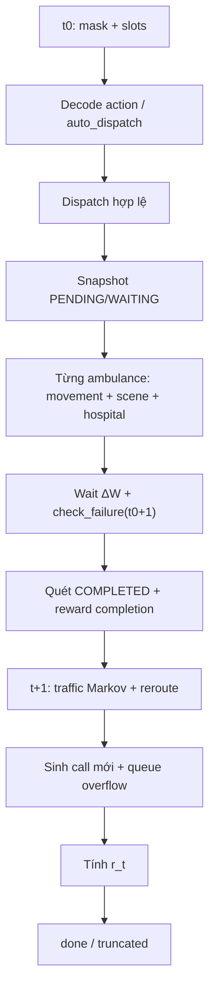

# M2 – MDP SPECIFICATION

**Dự án:** Ambulance Dispatch Simulation  
**Repository:** `E:\ambulance_dispatch`  
**Branch tại thời điểm thực hiện:** `environment`  
**Tài liệu đầu vào:** `M1_AUDIT_SIMULATION_ENVIRONMENT.md`, `BAO_CAO_MDP.md`, `README.md`, source code trong `dispatch_env/`, `map_env/`, `tests/`  
**Phạm vi M2:** đặc tả MDP và hợp đồng Environment–Agent từ hành vi source code hiện tại. **Không sửa source code, không sửa README/BAO_CAO_MDP, không tạo RL Agent, không tạo Gymnasium wrapper, không chạy training.**

### Quy ước trạng thái kết luận

| Nhãn | Ý nghĩa |
|---|---|
| **V** | Verified in source trong M2 |
| **M1** | Được báo cáo trong M1 và không mâu thuẫn với source đã đọc lại |
| **P** | Proposed – khuyến nghị, chưa được phê duyệt |
| **U** | Unresolved – chưa đủ bằng chứng hoặc cần người phụ trách quyết định |

---

## 1. Executive Summary

Environment hiện tại là một **MDP thời gian rời rạc, hữu hạn theo episode, bước quyết định 1 phút**, được cài đặt trực tiếp bằng Python/numpy, không phải Gymnasium environment.

Mô hình hình thức:

\[
M = \langle S, A, P, R, \gamma \rangle
\]

Trong code hiện tại:

- **S**: trạng thái nội bộ đầy đủ gồm thời gian, traffic, toàn bộ ambulance, toàn bộ cuộc gọi, `next_call_id`, các cờ/counter nội bộ và cấu hình bản đồ.
- **A**: tập action ID ánh xạ tới các cách ghép đồng thời ambulance ↔ call slot.
- **P**: hàm chuyển trạng thái có cả phần xác định (di chuyển, xử lý, deadline, routing) và phần ngẫu nhiên (Poisson call arrival, Markov traffic).
- **R**: reward theo công thức phạt chờ, phạt thất bại, phạt quãng đường và thưởng hoàn thành/hoàn hảo.
- **γ**: **không được định nghĩa trong Environment**; chỉ xuất hiện trong tài liệu `BAO_CAO_MDP.md` như một tham số huấn luyện chưa chốt.

### 1.1. Các kết luận đã xác nhận từ source

1. **V** Một `step()` mô phỏng đúng `[t, t+1)`, với `current_minute` tăng 1 mỗi bước – `dispatch_env/environment.py:666-905`, đặc biệt `830-837`.
2. **V** Action space tiềm năng với `N` xe và `K` slot:
   \[
   |A_{\text{potential}}|
   =\sum_{k=0}^{\min(N,K)}\binom{N}{k}\frac{K!}{(K-k)!}
   =\sum_{k=0}^{\min(N,K)}\binom{N}{k}\binom{K}{k}k!
   \]
   Với `N=6, K=3`: `1 + 18 + 90 + 120 = 229`; với `N=4, K=3`: `1 + 12 + 36 + 24 = 73` – `dispatch_env/environment.py:262-290`, `tests/test_dispatch_env.py:501-529`.
3. **V** Reward đang thực thi đúng bảng trong `REWARD_CONFIG`: wait `0.5/1.0/1.5`, fail `30/60/120`, complete `50/65/70`, perfect `70/80/100`, distance `0.05/km` – `dispatch_env/types.py:44-65`, `dispatch_env/environment.py:851-867`.
4. **V** Cuộc gọi chuyển `COMPLETED` khi **sơ cứu xong tại hiện trường**, trước khi xe tới bệnh viện – `dispatch_env/ambulance.py:350-363`, `dispatch_env/call.py:130-138`.
5. **V** Đến đúng deadline được tính là thành công; chỉ thất bại khi `current_time > deadline + 1e-6` – `dispatch_env/call.py:101-123`, `dispatch_env/ambulance.py:279-323`.
6. **V** Traffic được cập nhật **sau** movement trong bước; reroute dùng traffic mới; call mới sinh tại `t+1` – `dispatch_env/environment.py:830-845`.
7. **V** `COMPLETED`/`FAILED` không còn nằm trong `active_calls`; observation chỉ có call đang `PENDING`, `WAITING_FOR_AMBULANCE`, `AT_SCENE` cùng các counter tổng – `dispatch_env/environment.py:220-226`, `507-584`.
8. **V** `reset(seed=...)` reset cả `env.rng` và traffic map; `reset()` không seed sau episode đầu tiếp tục luồng RNG và sinh seed traffic mới từ `env.rng` – `dispatch_env/environment.py:132-143`.
9. **V** `done=True` dùng chung cho kết thúc tự nhiên và truncated; `info["truncated"]` phân biệt – `dispatch_env/environment.py:874-903`.
10. **V** Không có `gamma`, `action_space`, `observation_space`, `terminated`, `truncated` tách rời hay Gymnasium wrapper trong source Python – tìm kiếm toàn bộ `*.py` không có các định nghĩa này.

### 1.2. Các điểm cần người phụ trách xác nhận

- Observation hiện tại đã đủ Markov hay chưa; đặc biệt với `next_call_id`, cấu hình tĩnh (bệnh viện, `max_time`) và chính sách có dùng raw call ID hay không.
- Hợp đồng invalid action: hiện code lọc bỏ cặp sai và có thể thực thi **một phần** action; chưa có quyết định strict error / no-op / partial.
- Bảng reward chuẩn: code đang dùng bảng hiện tại, còn `BAO_CAO_MDP.md` có nhắc một bảng đề xuất cũ khác.
- Completion KPI: code tính hoàn thành tại hiện trường, không phải tại bệnh viện.
- Có cần Gymnasium wrapper và tách `terminated`/`truncated` hay không.
- Giá trị `γ` và cách hạch toán khoản phạt phát sinh tại `t=0` trong objective huấn luyện.

### 1.3. Sai lệch tài liệu đáng chú ý

| Nội dung | Source hiện tại | Tài liệu | Trạng thái |
|---|---|---|---|
| Observation có timer sơ cứu/bàn giao và target fields | Có, qua `Ambulance.to_dict()` – `dispatch_env/ambulance.py:96-133` | `BAO_CAO_MDP.md` bản M2 nói còn thiếu; M4 đã đồng bộ | **Đã sửa ở M4** |
| `served_calls`, `failed_calls`, `perfect_calls` | Là số nguyên đếm – `dispatch_env/environment.py:589-591` | README bản M2 minh họa dạng list; M4 đã sửa thành `int` | **Đã sửa ở M4** |
| Số test | M3 chạy **37/37**; M4 xác nhận 37 test method trong `tests/` | README bản M2 ghi 34; `BAO_CAO_MDP.md` bản M2 ghi 31/31 | **Đã đồng bộ ở M4** |
| Bảng reward cũ | Code dùng bảng hiện tại tại `REWARD_CONFIG` | `BAO_CAO_MDP.md` chỉ nhắc bảng đề xuất `1/2/4` như cấu hình **không được dùng** | **Đã làm rõ ở M4** |

---

## 2. MDP Overview

### 2.1. Thành phần MDP

| Thành phần | Định nghĩa trong bài toán | Nguồn/trạng thái |
|---|---|---|
| **S** | Trạng thái nội bộ đầy đủ tại đầu bước quyết định: thời gian, traffic, ambulance, call, counter/cờ, `next_call_id`, cấu hình tĩnh | **V** `dispatch_env/environment.py:63-113`; `map_env/city_map.py:40-82` |
| **O** | Dictionary do `get_observation()` trả về, là ảnh của S qua một ánh xạ quan sát | **V** `dispatch_env/environment.py:507-584` |
| **A** | Tập action ID tiềm năng; mỗi ID là một joint action ghép ambulance với slot | **V** `dispatch_env/environment.py:262-290`, `379-448` |
| **A(s)** | Tập action ID hợp lệ tại trạng thái hiện tại, xác định bởi action mask | **V** `dispatch_env/environment.py:292-322`, `494-497` |
| **P** | Kernel chuyển trạng thái; một phần xác định, một phần ngẫu nhiên do RNG | **V** `dispatch_env/environment.py:666-905`; `dispatch_env/ambulance.py:240-433` |
| **R** | Reward một bước theo công thức thực tế | **V** `dispatch_env/environment.py:851-867` |
| **γ** | Hệ số chiết khấu cho objective huấn luyện | **U** không có trong Environment; chỉ có trong `BAO_CAO_MDP.md:37-55` |
| **ρ₀** | Phân phối trạng thái đầu episode do `reset()` tạo | **V** `dispatch_env/environment.py:117-213` |
| **T** | Episode hữu hạn, kết thúc tự nhiên hoặc truncation | **V** `dispatch_env/environment.py:874-884` |

### 2.2. Mục tiêu MDP

Nếu dùng reward không chiết khấu:

\[
G = \sum_{t=0}^{T-1} r_t
\]

Nếu dùng chiết khấu, nhóm RL có thể tối đa hóa:

\[
J(\pi)=\mathbb E_{\rho_0,\pi,P}\left[\sum_{t=0}^{T-1}\gamma^t r_t\right]
\]

Tuy nhiên **Environment hiện tại không dùng γ** và **chưa chọn γ**. M2 không tự quyết định γ.

### 2.3. Vòng lặp MDP hiện tại


---

## 3. State và Observation

### 3.1. Trạng thái nội bộ đầy đủ của chương trình

Có thể mô tả trạng thái chương trình tại đầu bước quyết định như sau:

\[
S_t^{\text{prog}}=
\left(
t,\tau_t,G_t,\{X_i^A\}_{i=1}^{N},\{X_c^C\}_{c\in\mathcal C_t},
\zeta_t,RNG_t;\theta
\right)
\]

Trong đó:

- \(t\): `current_minute`.
- \(\tau_t\): `traffic_time_step`.
- \(G_t=(g_{e,t})_{e\in E}\): mức tắc của 172 cung có hướng.
- \(X_i^A\): toàn bộ trường của ambulance \(i\).
- \(X_c^C\): toàn bộ trường của cuộc gọi \(c\), gồm cả cuộc gọi đã `COMPLETED`/`FAILED`.
- \(\zeta_t\): `next_call_id`, counter, cờ reward, event list, `is_truncated`, metadata action gần nhất.
- \(RNG_t\): trạng thái hai generator `env.rng` và `city_map.rng` (nếu cần tái lập chính xác từng mẫu).
- \(\theta\): cấu hình tĩnh gồm graph 80 nút/172 cung, 4 bệnh viện, `max_time`, `max_overtime`, `poisson_lambda`, `max_pending_calls`, `num_ambulances`.

**V** Nguồn state: `dispatch_env/environment.py:63-113`; `map_env/city_map.py:40-82`.

#### Bảng biến trạng thái và ảnh hưởng

| Nhóm | Biến | Ảnh hưởng tới transition/reward | Có trong observation? | Nguồn |
|---|---|---|---|---|
| Thời gian | `current_minute` | Quyết định call arrival, deadline, terminal | Có (`current_minute`) | `environment.py:66`, `563-566` |
| Thời gian | `traffic_time_step` | Quyết định rush hour, Markov transition | Có | `environment.py:67`, `566` |
| Traffic | `edge.congestion` cho 172 cung | Tốc độ, ETA, routing | Có (`edge_congestion_vector`, `edges_by_id`, ...) | `edge.py:56`, `environment.py:530-561` |
| Ambulance | `status` | Quyết định state machine di chuyển | Có | `ambulance.py:41`, `111` |
| Ambulance | `current_edge`, `distance_from_start` | Vị trí thực, ETA | Có | `ambulance.py:39-40`, `112-115` |
| Ambulance | `current_call_id` | Liên kết xe–call | Có | `ambulance.py:42`, `118` |
| Ambulance | `target_type`, `target_id`, `target_edge`, `target_dist` | Đích di chuyển | Có | `ambulance.py:44-47`, `119-124` |
| Ambulance | `route_edges` | Tuyến còn lại | Có (`route`, `route_edge_ids`); từ M3 `route` là bản copy snapshot | `ambulance.py:50`, `130-131` |
| Ambulance | `scene_time_remaining` | Khi nào hoàn thành sơ cứu | Có | `ambulance.py:51`, `128` |
| Ambulance | `hospital_time_remaining` | Khi nào xe rảnh lại | Có | `ambulance.py:52`, `129` |
| Ambulance | `assigned_hospital_id` | Bệnh viện đích, handover time | Có | `ambulance.py:53`, `126` |
| Ambulance | `total_distance_traveled` | Quãng đường tích lũy | Có | `ambulance.py:54`, `132` |
| Ambulance | `last_step_distance` | Thành phần reward distance | **Không** | `ambulance.py:55`, `433` |
| Ambulance | `reroute_count` | Thống kê/log; không đổi transition | **Không** | `ambulance.py:56` |
| Ambulance | `last_rerouted_this_step` | Log; không đổi transition | **Không** | `ambulance.py:57` |
| Call | `call_id` | Định danh, sort slot, log | Có với active calls | `call.py:32`, `65-66` |
| Call | `edge`, `edge_id`, `distance_from_start` | Vị trí, routing | Có | `call.py:33-35`, `68-71` |
| Call | `severity`, `created_time`, `failure_time`, `processing_time` | Deadline, reward, processing | Có | `call.py:36-39`, `74-77` |
| Call | `wait_time` | Reward wait | Có (round 2 chữ số) | `call.py:40`, `80` |
| Call | `status` | Transition, filter active | Có | `call.py:41`, `73` |
| Call | `assigned_ambulance_id` | Liên kết xe–call | Có | `call.py:42`, `77` |
| Call | `arrived_at_scene_time` | Tính wait chính xác giữa bước | Có | `call.py:43`, `78` |
| Call | `completed_time`, `is_perfect` | Reward perfect | Có với active/completed tại thời điểm quan sát | `call.py:44-45`, `79-83` |
| Call | `failure_type`, `failure_reason` | Log/debug | **Không** trong observation | `call.py:46-47` |
| Call | `completion_rewarded` | Chống cộng reward trùng | **Không** | `call.py:48`, `environment.py:816-825` |
| Call | `failure_penalized` | Chống trừ penalty trùng | **Không** | `call.py:49`, `environment.py:802-805` |
| Call | Toàn bộ `calls` history | Chỉ terminal history; không ảnh hưởng transition tương lai trực tiếp | Chỉ active calls + counters | `environment.py:75-76`, `525-528` |
| ID | `next_call_id` | Định danh call tương lai | **Không** | `environment.py:69`, `648` |
| Episode | `episode_count` | Chỉ metadata | Có (`episode`) | `environment.py:63`, `564` |
| Reward | `served_calls_count`, `failed_calls_count`, `perfect_calls_count` | KPI, reward đã phát sinh | Có, dạng int | `environment.py:88-90`, `579-581` |
| Reward | `last_step_reward`, `total_reward` | Tín hiệu reward | Có | `environment.py:91-92`, `582-583` |
| Reward | `last_reward_breakdown` | Chi tiết reward | **Không** trong obs; có trong `info` của `step` | `environment.py:93-99`, `900` |
| Event | `calls_generated_this_step`, `calls_failed_this_step`, `calls_completed_this_step` | Log/reward của bước hiện tại | **Không** trong obs | `environment.py:79-85` |
| Terminal | `is_truncated` | Phân biệt truncated | **Không** trong obs; có trong `info` | `environment.py:70`, `901` |

### 3.2. Cấu trúc Observation hiện tại

`get_observation()` trả về dictionary với các khóa sau – **V** `dispatch_env/environment.py:507-584`:

| Khóa | Kiểu | Ý nghĩa | Ghi chú |
|---|---|---|---|
| `episode` | `int` | Số episode hiện tại | Chỉ metadata |
| `current_minute` | `int` | Thời điểm quyết định `t` | Có |
| `traffic_time_step` | `int` | Bước traffic | Thường bằng `current_minute` sau step |
| `edge_congestion_vector` | `np.ndarray[int32]` shape `(172,)` | Mức tắc theo thứ tự `edge_keys` | Thứ tự sorted `(u,v)`; trùng thứ tự `edge_id` |
| `call_slots` | `list` độ dài `K` | Slot 0..K-1; mỗi phần tử là dict call `PENDING` hoặc `None` | Call dict có thêm khóa `slot` |
| `action_mask` | `np.ndarray[bool]` shape `(num_potential_actions,)` | Action ID hợp lệ tại state hiện tại | Mask được tính lại sau step |
| `ambulances` | `dict[int, dict]` | `ambulance_id -> Ambulance.to_dict()` | Có đầy đủ vị trí, target, route, timer |
| `edges` | `dict[(u,v), dict]` | Chi tiết 172 cung | Có length/speed/congestion |
| `edges_by_id` | `dict[int, dict]` | Chi tiết theo `edge_id` 1..172 | Cùng nội dung với `edges` |
| `edge_congestion` | `dict[(u,v), int]` | Mức tắc theo cặp nút | Có |
| `edge_congestion_by_id` | `dict[int, int]` | Mức tắc theo `edge_id` | Có |
| `edge_id_to_nodes` | `dict[int, (u,v)]` | Ánh xạ `edge_id -> cung` | Có |
| `nodes_to_edge_id` | `dict[(u,v), int]` | Ánh xạ cung -> `edge_id` | Có |
| `pending_call_count` | `int` | Số call `PENDING` | Có |
| `active_calls` | `list[dict]` | Call đang `PENDING`, `WAITING_FOR_AMBULANCE`, `AT_SCENE` | Không gồm `COMPLETED`/`FAILED` |
| `served_calls` | `int` | Số call đã hoàn thành sơ cứu | **Không phải list** |
| `failed_calls` | `int` | Số call thất bại | **Không phải list** |
| `perfect_calls` | `int` | Số call hoàn hảo | **Không phải list** |
| `total_reward` | `float` | Reward tích lũy | Có |
| `last_step_reward` | `float` | Reward bước gần nhất | Có; tại `reset()` có thể là penalty `t=0` |

#### Trường trong `ambulances`

Từ `Ambulance.to_dict()` – **V** `dispatch_env/ambulance.py:96-133`:

`id`, `ambulance_id`, `status`, `current_edge`, `current_edge_id`, `distance_from_start`, `coord`, `current_speed`, `road_speed`, `current_call_id`, `target_type`, `targer_type` (alias), `target_id`, `target_edge`, `target_edge_id`, `target_dist`, `target_name`, `assigned_hospital_id`, `hospital_handover_time`, `scene_time_remaining`, `hospital_time_remaining`, `route`, `route_edge_ids`, `total_distance_traveled`.

**Lưu ý quan trọng:** từ M3, `route` được trả bằng bản copy `list(self.route_edges)` – `dispatch_env/ambulance.py:130`. Observation cũ không còn bị thay đổi bởi reroute hoặc movement sau đó; có test hồi quy `test_observation_route_is_snapshot`. M2 trước đây ghi nhận đây là mutable reference; M3 đã sửa MUST FIX này.

#### Trường trong `call_slots` / `active_calls`

Từ `EmergencyCall.to_dict()` – **V** `dispatch_env/call.py:58-84`:

`id`, `call_id`, `severity`, `edge`, `edge_id`, `dist`, `distance_from_start`, `coord`, `status`, `created_time`, `failure_time`, `processing_time`, `assigned_ambulance_id`, `arrived_at_scene_time`, `completed_time`, `wait_time`, `deadline`, `perfect_threshold`, `is_perfect`.

- `call_slots` thêm `slot`.
- `active_calls` không thêm `slot`.
- `failure_type`, `failure_reason`, `completion_rewarded`, `failure_penalized` không được trả về.

### 3.3. Thông tin bị ẩn khỏi Agent

| Thông tin | Vì sao có thể quan trọng | Trạng thái |
|---|---|---|
| `next_call_id` | ID call tương lai; nếu policy dùng raw ID làm feature thì ảnh hưởng Markov | **U/P** |
| Toàn bộ history call `COMPLETED`/`FAILED` | Chỉ cần cho phân tích offline/history; không ảnh hưởng trực tiếp transition tương lai | **V** không cần cho transition |
| `failure_type`, `failure_reason` | Debug/KPI; không cần cho hành động | **V** |
| `completion_rewarded`, `failure_penalized` | Chống cộng/trừ trùng; reward đã được trả về | **V** không cần nếu agent dùng reward trả về |
| `last_step_distance` | Thành phần distance penalty; reward đã trả về | **V** không cần cho transition |
| `last_reward_breakdown` | Phân tích reward; có trong `info` | Có sau step |
| `is_truncated` | Phân biệt terminal/truncation; có trong `info` | Có sau step |
| Cấu hình `max_time`, `max_overtime`, `poisson_lambda`, `seed` | Terminal timing, phân phối call | **U** nếu cấu hình thay đổi và agent cần thích nghi |
| Cấu hình 4 bệnh viện (vị trí, handover time) | Chọn bệnh viện tự động, ETA, reward gián tiếp | **U** nếu bài toán yêu cầu agent chọn/ dự đoán bệnh viện |
| `RNG` state | Tái lập chính xác từng mẫu | **V** không cần cho MDP stochastic; cần cho replay |
| `city_map` object đầy đủ | Cấu hình tĩnh | Chỉ một phần được đưa vào obs qua `edges` |

### 3.4. Đánh giá Markov property

#### Kết luận có căn cứ

1. **V** Nếu \(S_t\) là **trạng thái nội bộ đầy đủ của chương trình** (gồm RNG hoặc coi RNG là nguồn ngẫu nhiên ngoài), thì quá trình là Markov theo cách cài đặt: mọi transition chỉ đọc state hiện tại, action và các mẫu ngẫu nhiên mới.
2. **V** Observation hiện tại đã bao phủ phần lớn trạng thái **đang hoạt động** cần cho transition:
   - toàn bộ ambulance status/position/target/route/timer;
   - toàn bộ traffic của 172 cung;
   - call `PENDING` trong slot;
   - call `WAITING_FOR_AMBULANCE` và `AT_SCENE` trong `active_calls`;
   - `current_minute`, `traffic_time_step`;
   - action mask.
3. **U** Chưa có chứng minh hình thức rằng \(O_t\) là sufficient statistic cho \(S_t\). Các điểm cần kiểm chứng:
   - `next_call_id` không có trong observation;
   - cấu hình bệnh viện và các ngưỡng thời gian không có trong observation;
   - các cờ reward không có trong observation;
   - policy có dùng raw `call_id` hay không.
4. **V** `BAO_CAO_MDP.md` bản M2 nói observation còn thiếu timer sơ cứu/bàn giao và target fields là **không còn đúng với source hiện tại**; các trường đó đã có trong `Ambulance.to_dict()` và được test tại `tests/test_dispatch_env.py:703-816`. M4 đã đồng bộ lại `BAO_CAO_MDP.md`. Tuy vậy, kết luận “chưa chứng minh đủ Markov” vẫn có thể đúng vì các lý do khác.

#### Phân loại Markov gaps

| Loại | Nội dung | Ảnh hưởng |
|---|---|---|
| **Đã xác nhận từ code** | Ambulance state, traffic, active calls, slot, timer, action mask đều có trong obs | Nền tảng tốt cho Markov |
| **Có khả năng ảnh hưởng** | `next_call_id`; raw call ID; cấu hình `max_time`; cấu hình bệnh viện | Cần chốt policy feature và config contract |
| **Chưa đủ bằng chứng** | Observation có đủ cho mọi policy tối ưu hay không; RNG state có cần cho replay | Cần test/đặc tả thêm |

#### Khuyến nghị (P)

- Nếu cấu hình bản đồ/bệnh viện/`max_time` là **cố định cho mọi experiment**, công bố rõ đó là tham số \(\theta\) bên ngoài observation; không cần đưa toàn bộ vào obs.
- Nếu agent được phép dùng raw `call_id`, cần thêm `next_call_id` hoặc chuẩn hóa ID theo slot/created order để tránh phụ thuộc vào history không quan sát được.
- `route` đã là snapshot từ M3; nếu mở rộng observation với các list lồng nhau khác, tiếp tục copy để giữ tính bất biến.
- Không cần đưa toàn bộ `calls` history, `failure_reason`, counter nội bộ vào observation nếu không phục vụ policy; chỉ thêm khi có test chứng minh cần.

---

## 4. Action Space

### 4.1. Định nghĩa action

Tại đầu mỗi phút, một action là một **joint assignment**:

\[
a_t=\left((i_1,j_1),(i_2,j_2),\ldots,(i_k,j_k)\right)
\]

Trong đó:

- \(i\): `ambulance_id` trong `1..N`.
- \(j\): `slot_idx` trong `0..K-1`.
- Mỗi ambulance xuất hiện tối đa một lần.
- Mỗi slot xuất hiện tối đa một lần.
- \(0\le k\le \min(N,K)\).
- Action rỗng `()` là không phân công.

**V** `dispatch_env/environment.py:262-290`; test `tests/test_dispatch_env.py:501-529`.

### 4.2. Số lượng action tiềm năng

Công thức chính xác:

\[
|A_{\text{potential}}|
=\sum_{k=0}^{\min(N,K)}
\binom{N}{k}\frac{K!}{(K-k)!}
=\sum_{k=0}^{\min(N,K)}
\binom{N}{k}\binom{K}{k}k!
\]

Với `K=3`:

| Cấu hình | k=0 | k=1 | k=2 | k=3 | Tổng |
|---|---:|---:|---:|---:|---:|
| `N=6`, `K=3` | 1 | \(6 \times 3=18\) | \(15 \times 6=90\) | \(20 \times 6=120\) | **229** |
| `N=4`, `K=3` | 1 | \(4 \times 3=12\) | \(6 \times 6=36\) | \(4 \times 6=24\) | **73** |

- **V** Source comment và code xác nhận 229/73 – `dispatch_env/environment.py:270-278`.
- **V** Test 4 xe/3 slot xác nhận 73 – `tests/test_dispatch_env.py:501-529`.
- **V** Action 0 luôn là action rỗng; `potential_actions[0] == ()`.

### 4.3. Action ID, encode và decode

| Thành phần | Hành vi hiện tại | Nguồn |
|---|---|---|
| `potential_actions` | List các tuple `((amb_id, slot_idx), ...)`, sắp xếp theo `amb_id`; `k` từ 0 đến `min(N,K)` | `environment.py:262-290` |
| `action_id` | Chỉ số trong `potential_actions`, `0..num_potential_actions-1` | `environment.py:103-107` |
| `get_action_mask()` | Mảng bool cùng kích thước; `mask[0] = True`; action hợp lệ nếu mọi amb `IDLE` và mọi slot chứa call `PENDING` | `environment.py:292-322` |
| `is_action_valid()` | Nhận int hoặc cặp/list; int kiểm tra range + mask; cặp/list kiểm tra xe/call/slot và duplicate | `environment.py:324-377` |
| `decode_action()` | Int -> lấy `potential_actions[id]`; pair/list -> hiểu target là `call_id` mặc định, hoặc `slot_idx` nếu `from_slots=True`; lọc bỏ cặp không hợp lệ | `environment.py:379-448` |
| `encode_action()` | Nhận cặp `(amb_id, call_id)`, map call hiện tại sang slot, sắp xếp theo amb, trả action ID; không khớp -> 0 | `environment.py:450-492` |
| `get_valid_action_ids()` | Danh sách ID có `mask[id] == True` | `environment.py:494-497` |
| `get_valid_actions()` | Danh sách action đã decode thành `[(amb_id, call_id), ...]`, gồm `[]` | `environment.py:499-505` |

**Quan trọng:** Action ID có ý nghĩa cố định theo `slot_idx`, nhưng **slot_idx trỏ tới call nào thay đổi theo state**. Slot được sắp xếp canonical theo `(created_time, call_id)` – **V** `environment.py:231-248`. Vì vậy cùng một `action_id` ở hai thời điểm có thể phân công cho hai call khác nhau.

### 4.4. Các dạng action mà `step()` chấp nhận

| Dạng | Ví dụ | Cách hiểu mặc định | Ghi chú |
|---|---|---|---|
| `None` | `step()` | Không phân công; nếu `auto_dispatch=True` thì dùng heuristic | `environment.py:708-745` |
| `int` | `step(42)` | Action ID trong `potential_actions` | Int luôn được decode theo slot |
| Một cặp tuple | `step((1, 10))` | Xe 1 nhận call ID 10 | `from_slots=False` mặc định |
| Danh sách cặp | `step([(1, 10), (3, 12)])` | Xe 1 nhận call 10, Xe 3 nhận call 12 | Không nhất thiết theo slot |
| Cặp slot | `step([(1, 0), (3, 1)], from_slots=True)` | Xe 1 nhận call ở Slot 0, Xe 3 nhận call ở Slot 1 | Phải bật `from_slots=True` |
| `auto_dispatch=True` | `step(auto_dispatch=True)` | Heuristic baseline, không phải agent | Chỉ dùng khi `action is None` |

**V** `step()` signature – `dispatch_env/environment.py:666-671`; decode – `708-711`; auto – `712-745`.

### 4.5. Điều kiện action hợp lệ

Một action ID hợp lệ khi và chỉ khi:

1. `0 <= action_id < num_potential_actions`.
2. `action_mask[action_id] == True`.
3. Mọi cặp trong action có ambulance đang `IDLE` và `current_call_id is None`.
4. Mọi slot trong action đang chứa call `PENDING`.
5. Không trùng ambulance, không trùng slot (đã đảm bảo bởi construction của potential action).

**V** `dispatch_env/environment.py:292-322`.

Số xe được dispatch đồng thời tối đa là \(\min(N,K)\); trên thực tế còn bị giới hạn bởi số xe `IDLE` và số slot có call `PENDING` tại state đó.

### 4.6. Hành vi với invalid action

| Tình huống | Hành vi hiện tại | Nguồn |
|---|---|---|
| Action ID ngoài range | `decode_action()` trả `[]`; `is_action_valid()` trả `False` | `environment.py:403-406`, `336-340` |
| Action ID trong range nhưng mask `False` | `decode_action()` vẫn lấy potential action, sau đó lọc từng cặp; có thể trả **một phần** action hợp lệ | `environment.py:403-448` |
| Action chứa cặp xe bận | Cặp đó bị bỏ qua; các cặp khác có thể vẫn được thực thi | `environment.py:425-446`; `751-762` |
| Action chứa call không `PENDING` | Cặp đó bị bỏ qua | `environment.py:439-440` |
| Action trùng xe/call | Cặp trùng bị bỏ qua | `environment.py:426-446` |
| Action `None`, `auto_dispatch=False` | Không phân công, step vẫn chạy | `environment.py:708-712` |
| Action `None`, `auto_dispatch=True` | Heuristic chọn cặp; encode/decode qua slot/mask | `environment.py:712-745` |
| `action` không phải `None` và `auto_dispatch=True` | Action được dùng; auto bị bỏ qua | `environment.py:709-712` |

**Kết luận V:** `step()` **không raise lỗi** và **không bắt buộc mask phải đúng**. Nó giải mã rồi chỉ dispatch các cặp còn hợp lệ. Vì vậy một joint action bị mask `False` vẫn có thể được thực thi một phần nếu một số cặp trong đó hợp lệ.

### 4.7. Invalid Action Contract – hiện tại và đề xuất

| Khía cạnh | Hiện tại (V) | Đề xuất (P), chưa phê duyệt |
|---|---|---|
| Action sai | Lọc bỏ cặp sai, có thể partial | Chọn một trong: raise `ValueError`, coi toàn bộ là no-op, hoặc partial có warning |
| Mask | Agent tự đọc; env không enforce | Trong training/eval nên enforce mask hoặc validate trước khi thực thi |
| Action ngoài range | Trả `[]` | Có thể raise để phát hiện bug agent |
| Action ID không hợp lệ | Partial decode | Nên định nghĩa rõ để tránh học từ hành vi ngoài ý muốn |
| `from_slots` | Mặc định `False` | Cần tài liệu hóa rõ; nếu agent dùng slot phải bật `True` |

---

## 5. Transition Function

### 5.1. Công thức tổng quát

\[
S_{t+1}=f(S_t,A_t,\xi_t;\theta)
\]

Trong đó \(\xi_t\) là các mẫu ngẫu nhiên mới:

- số call mới và thuộc tính call mới;
- chuyển trạng thái traffic Markov.

**V** `dispatch_env/environment.py:607-664`, `830-845`; `map_env/city_map.py:459-506`.

### 5.2. Thứ tự sự kiện thực tế trong một `step()`

| Bước | Thời điểm | Sự kiện | Nguồn |
|---:|---|---|---|
| 1 | Đầu bước `t0` | Clear `calls_failed_this_step`, `calls_completed_this_step`; ghi slot summary; tính mask; lưu `valid_action_count` | `environment.py:696-703` |
| 2 | `t0` | Decode action hoặc chạy `auto_dispatch`; lưu `last_action_id`, `last_decoded_action` | `environment.py:708-749` |
| 3 | `t0` | Dispatch đồng thời các cặp hợp lệ; call chuyển `WAITING_FOR_AMBULANCE`; ambulance chuyển `EN_ROUTE_TO_CALL` | `environment.py:751-762`; `ambulance.py:135-156` |
| 4 | `t0` sau dispatch | Snapshot các call `PENDING`/`WAITING_FOR_AMBULANCE` để tính wait | `environment.py:767-771` |
| 5 | Trong `[t0,t0+1)` | Từng ambulance chạy `step_continuous`; di chuyển, đến hiện trường, sơ cứu, chọn bệnh viện, tới bệnh viện, bàn giao | `environment.py:773-779`; `ambulance.py:240-433` |
| 6 | Sau movement | Cập nhật wait time; kiểm tra failure; abort xe đang `EN_ROUTE_TO_CALL` nếu call fail | `environment.py:781-811` |
| 7 | Sau failure | Quét call `COMPLETED` chưa reward; cộng served/perfect/completion bonus | `environment.py:813-825` |
| 8 | `t0+1` | Tăng `current_minute` và `traffic_time_step`; đồng bộ map time; `step_traffic()` | `environment.py:830-837` |
| 9 | `t0+1` | Reroute tất cả ambulance đang di chuyển | `environment.py:839-841` |
| 10 | `t0+1` | Sinh call mới nếu `current_minute < max_time`; xử lý queue overflow | `environment.py:843-845`; `607-664` |
| 11 | Sau tất cả | Tính reward `r_t`; cập nhật total/breakdown | `environment.py:851-867` |
| 12 | Sau reward | Kiểm tra natural done / overtime truncation; tạo `info`; trả obs mới | `environment.py:874-905` |

### 5.3. Các thành phần transition

#### 5.3.1. Dispatch

- Call `PENDING` được gán cho ambulance `IDLE`.
- Call chuyển `WAITING_FOR_AMBULANCE`, lưu `assigned_ambulance_id`.
- Ambulance chuyển `EN_ROUTE_TO_CALL`, lưu `current_call_id`, target và route.
- Route được tính bằng `route_from_road_to_road(..., by_travel_time=True)`.

**V** `ambulance.py:135-156`.

#### 5.3.2. Ambulance movement

- Mỗi ambulance xử lý `step_continuous(dt_minute=1.0, ...)`.
- `while time_budget > 1e-6` cho phép nhiều sự kiện trong cùng một phút.
- Tốc độ tuyến: `edge.speed / 60.0` km/phút – `ambulance.py:271-272`, `371-372`.
- Nếu hết cung trung gian, pop `route_edges[0]`, chuyển sang cung kế tiếp, dùng thời gian còn lại.
- Nếu tới đích cuối, ghi `arrival_time`, kiểm tra deadline, chuyển trạng thái.
- `last_step_distance = total_distance_traveled - start_total_dist` ở cuối – `ambulance.py:433`.

**V** `ambulance.py:240-433`.

#### 5.3.3. Call arrival

- `N_t \sim \operatorname{Poisson}(\lambda)`, mặc định `λ = 0.1`.
- Vị trí: chọn ngẫu nhiên một directed edge, sau đó uniform trên `[0.1, max(0.2, length-0.1)]`, làm tròn 2 chữ số.
- Severity: categorical `[0.40, 0.35, 0.25]` cho mức `1,2,3`.
- Sinh tại `t=0` trong `reset()` (nếu `generate_initial_calls=True`) và tại `t+1` cuối mỗi step nếu `current_minute < max_time`.
- Không sinh call khi `current_minute >= max_time`.

**V** `environment.py:607-664`, `189-191`, `843-845`.

#### 5.3.4. Deadline và timeout

- \( \text{deadline} = \text{created\_time} + \text{failure\_time} \).
- \( \text{perfect\_threshold} = \text{created\_time} + 0.5 \times \text{failure\_time} \).
- Đến đúng deadline là thành công: `arrival_time <= deadline + 1e-6`.
- `check_failure(current_time)` chỉ fail khi `current_time > deadline + 1e-6`.
- Khi call đã `AT_SCENE`, deadline không còn hiệu lực.

**V** `call.py:86-123`; `ambulance.py:279-323`.

**Caveat V:** trong vòng wait/failure, nếu call chưa tới hiện trường, code cộng đủ `1.0` phút chờ **trước** khi gọi `check_failure(t0 + 1.0)`. Vì vậy một call có deadline rơi giữa phút có thể bị tính thêm tối đa gần 1 phút chờ so với thời điểm timeout chính xác. Đây là hành vi hiện tại, không phải lỗi đã sửa.

#### 5.3.5. Treatment tại hiện trường

- Khi tới hiện trường: `status = AT_SCENE`, `arrived_at_scene_time`, `scene_time_remaining = processing_time`.
- Processing time theo severity: `4/6/8` phút.
- Khi `scene_time_remaining` về 0:
  - gọi `call.mark_completed(complete_time)`;
  - call chuyển `COMPLETED`;
  - nếu `complete_time <= perfect_threshold` thì `is_perfect = True`;
  - chọn bệnh viện và chuyển ambulance sang `EN_ROUTE_TO_HOSPITAL`.

**V** `ambulance.py:350-363`; `call.py:125-138`.

#### 5.3.6. Hospital routing và handover

- `select_best_hospital_and_route()` duyệt 4 bệnh viện, tính ETA bằng `route_from_road_to_road(..., by_travel_time=True)`, chọn ETA nhỏ nhất.
- Tie-break: giữ bệnh viện gặp đầu tiên do dùng `<`.
- Không có capacity, không có bệnh viện unavailable.
- Khi tới bệnh viện: `status = AT_HOSPITAL`, `hospital_time_remaining = handover_time`.
- Khi handover xong: `abort_mission_to_idle()`; ambulance về `IDLE`.
- Call đã `COMPLETED` từ trước; handover **không** đổi trạng thái call và **không** tạo thêm completion reward.

**V** `ambulance.py:175-207`, `369-431`; `city_map.py:597-633`.

#### 5.3.7. Traffic transition

- Mỗi bước, tất cả 172 directed edge cập nhật độc lập theo Markov chain.
- `rush_hour = 10 <= (traffic_time_step % 40) <= 25` – `city_map.py:472-473`.
- Ma trận chuyển phụ thuộc `is_center` và `rush_hour` – `edge.py:109-136`.
- Hàng là mức hiện tại `1/2/3`, cột là mức kế tiếp `1/2/3`.

**Trung tâm, cao điểm:**

\[
\begin{bmatrix}
0.30&0.40&0.30\\
0.10&0.45&0.45\\
0.02&0.28&0.70
\end{bmatrix}
\]

**Trung tâm, bình thường:**

\[
\begin{bmatrix}
0.45&0.35&0.20\\
0.20&0.50&0.30\\
0.05&0.35&0.60
\end{bmatrix}
\]

**Ngoại ô, cao điểm:**

\[
\begin{bmatrix}
0.55&0.30&0.15\\
0.25&0.45&0.30\\
0.10&0.45&0.45
\end{bmatrix}
\]

**Ngoại ô, bình thường:**

\[
\begin{bmatrix}
0.70&0.22&0.08\\
0.35&0.45&0.20\\
0.20&0.50&0.30
\end{bmatrix}
\]

**V** `edge.py:98-140`; `city_map.py:459-506`.

#### 5.3.8. Rerouting

- Sau khi traffic cập nhật, mỗi ambulance đang `EN_ROUTE_TO_CALL` hoặc `EN_ROUTE_TO_HOSPITAL` được tính lại tuyến.
- Nếu danh sách cung mới khác tuyến hiện tại, cập nhật `route_edges`, tăng `reroute_count`, đặt `last_rerouted_this_step = True`.
- Không so sánh chi phí cũ/mới; chỉ so sánh danh sách cung. Vì vậy tên “beneficial” không có nghĩa là luôn rẻ hơn theo một metric ngoài route hiện tại.
- Reroute không đổi bệnh viện đã chọn.

**V** `ambulance.py:209-238`, `environment.py:839-841`.

#### 5.3.9. Queue overflow

- Tại thời điểm sinh call, nếu số call `PENDING` hiện tại đã đạt `max_pending_calls` (mặc định 3):
  - call mới bị `mark_rejected()`;
  - `status = FAILED`, `failure_type = "queue_overflow"`;
  - `failure_penalized = True`;
  - `failed_calls_count += 1`;
  - thêm vào `calls_failed_this_step`;
  - vẫn được lưu vào `self.calls`.
- Nếu nhiều call mới trong cùng một lần sinh, xử lý tuần tự; các call sau có thể bị từ chối khi hàng chờ đã đầy.

**V** `environment.py:650-662`; `call.py:140-144`.

### 5.4. Transition xác định và ngẫu nhiên

| Thành phần | Loại | Ghi chú |
|---|---|---|
| Dispatch | Xác định | Phụ thuộc action và state hợp lệ |
| Movement | Xác định | Tốc độ theo traffic hiện tại; không random trong bước |
| Deadline/timeout | Xác định | Theo thời gian và deadline |
| Treatment | Xác định | Theo `processing_time` |
| Hospital selection | Xác định | Min ETA; tie-break theo thứ tự dict |
| Handover | Xác định | Theo `handover_time` |
| Traffic transition | Ngẫu nhiên | Markov, dùng `city_map.rng` |
| Call arrival | Ngẫu nhiên | Poisson + uniform + categorical, dùng `env.rng` |
| Reroute | Xác định theo traffic mới | Không random trực tiếp |
| Queue overflow | Xác định theo capacity | Không random trực tiếp |

### 5.5. Điểm thứ tự quan trọng

1. **V** Movement dùng traffic **trước** khi `step_traffic()` chạy – `environment.py:773-779` trước `830-837`.
2. **V** Hospital selection xảy ra trong movement, trước traffic update; reroute sau traffic update.
3. **V** Traffic update xảy ra trước reroute và trước sinh call mới – `830-845`.
4. **V** Call mới sinh tại `t+1`, không phải trong `[t,t+1)`.
5. **V** Wait/failure được xử lý sau movement, trước completion scan.
6. **V** Completion scan diễn ra trước traffic update và trước call mới.
7. **V** Reward được tính sau call mới; call bị từ chối do overflow ở cuối bước được tính vào reward của bước hiện tại.
8. **V** `traffic_time_step` sau step bằng `t+1`; rush hour dùng giá trị mới này.

### 5.6. Sơ đồ transition



---

## 6. Reward Function

### 6.1. Công thức thực tế

\[
r_t =
-\sum_{c} w_c \Delta W_{c,t}
-\sum_{c\in F_t} p_c
-0.05\sum_i \Delta d_{i,t}
+\sum_{c\in C_t} b_c
\]

Trong đó:

| Ký hiệu | Ý nghĩa | Nguồn |
|---|---|---|
| \(\Delta W_{c,t}\) | Thời gian call \(c\) thực sự chờ trong bước, phút | `environment.py:781-798` |
| \(w_c\) | Wait penalty theo severity | `types.py:44-63` |
| \(F_t\) | Call thất bại/từ chối được ghi nhận trong bước | `environment.py:800-811`, `650-657` |
| \(p_c\) | Failure penalty theo severity | `types.py:44-63` |
| \(\Delta d_{i,t}\) | `ambulance.last_step_distance` trong bước, km | `ambulance.py:433`; `environment.py:855` |
| \(C_t\) | Call vừa `COMPLETED` và chưa được thưởng | `environment.py:813-825` |
| \(b_c\) | Completion hoặc perfect reward theo severity | `types.py:44-63` |

### 6.2. Bảng reward đang thực thi

**V** `dispatch_env/types.py:44-63`; `dispatch_env/environment.py:851-867`:

| Severity | Wait penalty/phút \(w_c\) | Failure penalty \(p_c\) | Completion \(b_c\) | Perfect \(b_c\) |
|---:|---:|---:|---:|---:|
| 1 | 0.5 | 30 | 50 | 70 |
| 2 | 1.0 | 60 | 65 | 80 |
| 3 | 1.5 | 120 | 70 | 100 |

Distance penalty: **0.05 điểm/km** – `types.py:65`.

**V** Perfect reward thay thế completion reward, không cộng thêm – `environment.py:820-825`.

### 6.3. Thời điểm hạch toán reward

| Sự kiện | Cách hạch toán | Nguồn |
|---|---|---|
| **Tại `t=0` trong `reset()`** | Nếu call bị từ chối do overflow khi sinh initial calls, trừ `p_c` ngay vào `last_step_reward` và `total_reward` | `environment.py:189-206` |
| **Mỗi step** | Wait penalty cho call `PENDING`/`WAITING` tại `t0`; full 1.0 phút nếu chưa tới, partial nếu tới giữa bước | `environment.py:781-798` |
| **Timeout trong step** | Trừ `p_c` một lần nếu call `FAILED` hoặc `check_failure(t0+1)`; đánh `failure_penalized` | `environment.py:800-811` |
| **Xe tới muộn** | `ambulance.step_continuous()` đánh `FAILED`; sau đó vòng failure trừ penalty nếu chưa `failure_penalized` | `ambulance.py:289-323`; `environment.py:800-805` |
| **Queue overflow cuối bước** | Trừ `p_c` trong reward của chính bước đó | `environment.py:650-657`, `851-854` |
| **Completion tại hiện trường** | Thưởng `b_c` trong completion scan sau movement, trước traffic update | `environment.py:813-825` |
| **Perfect** | Dùng `perfect_reward` thay vì `complete_reward` nếu `is_perfect=True` | `environment.py:820-825` |
| **Handover tại bệnh viện** | Không thưởng thêm; call đã `COMPLETED` từ trước | `ambulance.py:419-431` |
| **Distance** | Trừ `0.05 * sum(last_step_distance)` mỗi step, gồm mọi quãng đường đã đi trong bước | `environment.py:855-856` |

### 6.4. Dedup – một call chỉ bị phạt/thưởng một lần

- `failure_penalized`: chống trừ failure penalty lặp lại – `call.py:49`, `environment.py:592-594`, `802-805`.
- `completion_rewarded`: chống cộng completion reward lặp lại – `call.py:48`, `environment.py:816-817`.
- `calls_failed_this_step` và `calls_completed_this_step` được clear ở đầu mỗi step – `environment.py:697-698`.
- `penalize_call_failure()` là helper độc lập, không được gọi bởi vòng failure chính trong `step()`; test trực tiếp hàm này – `environment.py:586-605`; `tests/test_dispatch_env.py:818-880`.

### 6.5. Reward tại `t=0` – điểm cần đặc biệt lưu ý

**V** `reset()` có thể cộng khoản phạt overflow vào `last_step_reward` và `total_reward` – `environment.py:189-206`. Tuy nhiên:

- `reset()` **không trả reward**; chỉ trả observation.
- `step()` đầu tiên **clear `calls_failed_this_step`** – `environment.py:697`.
- Vì vậy khoản phạt `t=0`:
  - có trong `total_reward` và `obs["last_step_reward"]` tại thời điểm reset;
  - **không** xuất hiện trong `reward` trả về của step đầu tiên;
  - **không** xuất hiện trong `info["reward_breakdown"]` của step đầu tiên.

Đây là hành vi hiện tại, ảnh hưởng trực tiếp đến cách tính return nếu nhóm RL dùng tổng các `reward` từ `step()`.

### 6.6. So sánh với tài liệu

| Nguồn | Bảng reward | Trạng thái |
|---|---|---|
| Code `dispatch_env/types.py:44-63` | wait `.5/1/1.5`; fail `30/60/120`; complete `50/65/70`; perfect `70/80/100`; distance `.05` | **Đang thực thi (V)** |
| `README.md:199-219` | Giống bảng code | **Khớp (V)** |
| `BAO_CAO_MDP.md:270-278` | Giống bảng code | **Khớp (V)** |
| `BAO_CAO_MDP.md:280` | Nhắc bảng đề xuất cũ: wait `1/2/4`, complete `80`, perfect `100` cho mọi mức | **Chưa áp dụng (U)** |

**Kết luận:** bảng đang thực thi là bảng trong `REWARD_CONFIG`. Bảng `1/2/4`/`80`/`100` chỉ là đề xuất cũ được ghi nhận trong tài liệu; chưa có trong code. Cần người phụ trách xác nhận nếu muốn đổi.

### 6.7. Completion KPI – hiện trạng

- **V** Completion được đánh dấu khi sơ cứu xong tại hiện trường – `ambulance.py:350-363`.
- **V** `arrived_at_scene_time` là thời điểm tới hiện trường; `completed_time` là thời điểm xong sơ cứu.
- **V** Xe vẫn còn di chuyển tới bệnh viện và bàn giao sau khi call đã `COMPLETED`.
- **V** `served_calls_count` tăng khi call `COMPLETED`, không phải khi handover xong.
- **U** Chưa chốt KPI nghiệp vụ nên dùng thời điểm nào: xong sơ cứu hay xong bàn giao. Cần quyết định nếu báo cáo “thời gian phục vụ” hoặc so sánh policy.

---

## 7. Initial State và Episode

### 7.1. Cấu hình tĩnh

**V** `CityMap.__init__()` – `map_env/city_map.py:40-82`:

- 80 nút, id `1..80`.
- 86 tuyến hai chiều tương ứng 172 cung có hướng.
- `edge_id` gán 1..172 theo thứ tự sorted `(u,v)` – `city_map.py:340-346`.
- 4 bệnh viện cố định – `city_map.py:351-426`.
- `is_center = (u <= 20 and v <= 20)` – `city_map.py:316`.

### 7.2. Traffic ban đầu

**V** `CityMap.__init__()` gọi `randomize_traffic(initial=True)` – `city_map.py:82`.

- Xác suất mức `1/2/3`: `[0.60, 0.30, 0.10]` – `city_map.py:431-436`.
- Traffic dùng `city_map.rng`.

### 7.3. Ambulance ban đầu

**V** `reset()` – `environment.py:168-187`:

- Chọn `num_ambulances` cung **không lặp** từ danh sách tất cả directed edge.
- Vị trí ban đầu: `round(uniform(0.1, max(0.2, edge.length - 0.1)), 2)`.
- Trạng thái ban đầu: `IDLE`, `current_call_id=None`, `route_edges=[edge_key]`.
- `ambulance_id` từ `1..N`.

### 7.4. Initial calls

**V** `reset()` – `environment.py:189-191`; `_generate_new_calls()` – `607-664`:

- Nếu `generate_initial_calls=True`, sinh call tại `t=0`.
- Số lượng theo `Poisson(lambda)`, mặc định `lambda=0.1`.
- Vị trí và severity như Mục 5.3.3.
- Nếu vượt `max_pending_calls`, call bị từ chối ngay và bị phạt tại `t=0` – `environment.py:192-206`.

### 7.5. `reset()` và seed

| Trường hợp | Hành vi | Nguồn |
|---|---|---|
| `reset(seed=x)` | `env.rng = default_rng(x)`; `city_map.reset_traffic(seed=x)`; reset toàn bộ episode | `environment.py:132-135` |
| `reset()` lần đầu trong `__init__` | `episode_count=0`, không reset traffic; chỉ đồng bộ time step về 0; traffic lấy từ `CityMap.__init__` | `environment.py:136-143` |
| `reset()` sau episode đầu | Sinh `episode_map_seed` từ `env.rng`; `city_map.reset_traffic(seed=episode_map_seed)`; tiếp tục `env.rng` | `environment.py:136-139` |
| Mọi `reset()` | `episode_count += 1`; clear calls/events/reward; tạo lại ambulance; sinh initial calls; reset metadata action | `environment.py:145-213` |

**V** `reset()` không reset `episode_count`; vì vậy hai lần `reset(seed=x)` cho cùng kịch bản nhưng `obs["episode"]` khác nhau.

### 7.6. Rejected calls tại `t=0`

- **V** Call vượt capacity bị `mark_rejected()` và `failure_penalized=True` – `environment.py:654-657`.
- **V** `reset()` tính tổng `fail_penalty` và gán vào `last_step_reward`, `total_reward`, `last_reward_breakdown` – `environment.py:193-206`.
- **V** Các call này vẫn nằm trong `self.calls`; `failed_calls_count` đã tăng.
- **V** Step đầu tiên clear `calls_failed_this_step`; không trừ lại penalty – `environment.py:697`, `802-805`.

---

## 8. Terminal và Truncation

### 8.1. Điều kiện kết thúc tự nhiên

**V** `environment.py:874-879`:

Sau mỗi step, nếu:

\[
\texttt{current\_minute} \ge \texttt{max\_time}
\]

và:

1. `active_calls` rỗng, trong đó `active_calls` gồm `PENDING`, `WAITING_FOR_AMBULANCE`, `AT_SCENE`;
2. tất cả ambulance đều `IDLE` (bao gồm đã xong `EN_ROUTE_TO_HOSPITAL`/`AT_HOSPITAL`);

thì `done = True`.

- **V** `active_calls` không gồm `EN_ROUTE_TO_HOSPITAL`/`AT_HOSPITAL`, nhưng điều kiện `all ambulance IDLE` bao phủ các trạng thái đó.
- **V** Call `COMPLETED`/`FAILED` không cản trở done.
- **V** Trước `max_time`, dù không còn call/active, episode vẫn tiếp tục vì điều kiện yêu cầu `current_minute >= max_time`.

### 8.2. Truncation

**V** `environment.py:881-884`:

Nếu chưa done tự nhiên và:

\[
\texttt{current\_minute} \ge \texttt{max\_time} + \texttt{max\_overtime}
\]

thì:

- `done = True`;
- `is_truncated = True`.

Mặc định `max_time=360`, `max_overtime=300`, nên ngưỡng là phút 660.

- **V** Việc dừng do giới hạn kỹ thuật không đồng nghĩa mọi ca đã phục vụ.
- **V** `info["backlog"]` chỉ có khi `is_truncated=True`; nội dung gồm call `PENDING`, `WAITING`, `AT_SCENE`, ambulance `EN_ROUTE_TO_HOSPITAL`, `AT_HOSPITAL` – `environment.py:1028-1050`.
- **V** `is_truncated` không tự reset ngoài `reset()`.

### 8.3. `done`, `is_truncated`, `info["truncated"]`

| Tín hiệu | Ý nghĩa | Nguồn |
|---|---|---|
| `done=True` | Episode kết thúc, dù tự nhiên hay truncated | `environment.py:874-884` |
| `env.is_truncated` | Cờ nội bộ, giữ trạng thái truncated | `environment.py:70`, `884` |
| `info["truncated"]` | Bản sao của `is_truncated` | `environment.py:901` |
| `info["backlog"]` | Backlog nếu truncated, ngược lại `None` | `environment.py:902` |

### 8.4. API hiện tại và API Gymnasium đề xuất

**Hiện tại (V):**

```python
obs = env.reset(seed=42)
obs, reward, done, info = env.step(action)
```

**Gymnasium đề xuất (P), chưa triển khai:**

```python
obs, info = env.reset(seed=42, options=...)
obs, reward, terminated, truncated, info = env.step(action)
```

- Hiện tại chưa có `action_space`, `observation_space`, `render`, `close`.
- `done` gộp cả hai khái niệm; `info["truncated"]` là cách phân biệt.
- M2 không tạo wrapper.

---

## 9. Discount Factor

### 9.1. Kết quả kiểm tra source

- **V** Không có biến `gamma`, `discount`, `GAMMA`, `DISCOUNT` trong bất kỳ file Python nào.
- **V** Environment không dùng gamma để tính reward hay transition.
- **V** `reward` trả về là reward một bước, không chiết khấu.
- **V** `total_reward` là tổng cộng dồn, không chiết khấu.
- **V** Gamma chỉ xuất hiện trong `BAO_CAO_MDP.md:37-55`, như một tham số của objective huấn luyện và được ghi rõ là **chưa chọn**.

### 9.2. Phân loại

| Câu hỏi | Kết luận |
|---|---|
| Gamma được định nghĩa ở đâu? | Không có trong Environment; chỉ trong tài liệu MDP |
| Có giá trị mặc định không? | **Không** |
| Environment có dùng gamma để tính reward không? | **Không** |
| Gamma thuộc Environment hay Agent/Training? | **Agent/Training**; Environment chỉ cung cấp reward từng bước |
| Có cần gamma cho MDP hiện tại? | Không bắt buộc; episode hữu hạn nên có thể dùng return không chiết khấu |
| Giá trị đề xuất? | **Không tự quyết định**; nhóm RL cần công bố khi chọn thuật toán |

### 9.3. Lưu ý với objective có chiết khấu

- Nếu dùng `gamma < 1`, reward muộn có trọng số nhỏ hơn; cần báo cáo cả KPI không chiết khấu.
- Khoản phạt tại `t=0` trong `reset()` không được trả về như một step reward; nếu agent/training chỉ cộng `reward` từ `step()`, khoản này bị thiếu trong return. Cần chốt cách hạch toán ở M3.
- Gamma không nên được thêm vào Environment nếu chỉ phục vụ training; có thể để trong config của agent/trainer.

---

## 10. Randomness và Reproducibility

### 10.1. Hai RNG độc lập

| RNG | Tạo ở đâu | Dùng cho | Nguồn |
|---|---|---|---|
| `env.rng` | `AmbulanceDispatchEnv.__init__` | Poisson call count, call edge, call distance, severity, ambulance initial edge, initial distance, episode traffic seed | `environment.py:55`; `173-178`, `618-637`, `138` |
| `city_map.rng` | `CityMap.__init__` | Initial traffic, Markov traffic transition | `city_map.py:42`; `431-436`, `487` |

**V** Hai generator độc lập, dù có thể được khởi tạo cùng seed. Cùng seed không làm hai luồng mẫu giống nhau sau khi số lần gọi khác nhau.

### 10.2. Bảng phân phối randomness

| Nguồn | Phân phối/quy tắc | Tham số | Nguồn |
|---|---|---|---|
| Số call mới | Poisson | `λ=0.1` | `environment.py:618` |
| Directed edge của call | Uniform rời rạc | Danh sách `city_map.edges.keys()` | `environment.py:624` |
| Vị trí trên cung của call | Uniform liên tục | `[0.1, max(0.2, length-0.1)]` | `environment.py:627` |
| Severity | Categorical | `[0.40,0.35,0.25]` | `environment.py:637` |
| Cung khởi tạo ambulance | Chọn không lặp | `size=N` | `environment.py:173` |
| Vị trí khởi tạo ambulance | Uniform liên tục | `[0.1, max(0.2, length-0.1)]` | `environment.py:178` |
| Traffic ban đầu | Categorical | `[0.60,0.30,0.10]` | `city_map.py:433-436` |
| Traffic transition | Markov categorical | Bảng `edge.py:109-136` | `edge.py:138` |
| Seed traffic episode mới | Uniform integer | `[0,2^31-1]` | `environment.py:138` |

### 10.3. Quy tắc seed và reset

| Tình huống | `env.rng` | `city_map.rng` / traffic | Kết quả |
|---|---|---|---|
| Khởi tạo `AmbulanceDispatchEnv(seed=s)` với `city_map=None` | seed `s` | `CityMap(seed=s)` khởi tạo traffic | Episode 1 dùng traffic từ CityMap, ambulance/call từ env |
| `reset(seed=x)` | reset về `x` | `reset_traffic(seed=x)` | Tái lập cả hai luồng cho episode mới |
| `reset()` lần đầu trong `__init__` | không reset | không reset; chỉ đồng bộ time step | Traffic lấy từ CityMap constructor |
| `reset()` sau episode đầu | tiếp tục tiến | sinh seed mới từ `env.rng`, reset traffic | Kịch bản mới; không tái lập chỉ bằng seed ban đầu |
| `reset_traffic(seed=None)` | không đổi env | tiếp tục `city_map.rng` | Traffic mới nhưng không reset seed |
| `reset_traffic(seed=x)` | không đổi env | reset map rng | Traffic tái lập theo `x` |

**V** `environment.py:132-143`; `city_map.py:438-457`.

### 10.4. Quy tắc tái lập một episode

Để tái lập chính xác một episode đã chạy, cần giữ:

1. Cùng version source code.
2. Cùng cấu hình: `num_ambulances`, `max_time`, `max_overtime`, `poisson_lambda`, `max_pending_calls`.
3. Cùng seed và cùng cách reset:
   - Nếu tạo env với seed `s`, lưu ý `__init__` đã gọi `reset()` một lần.
   - Tốt nhất gọi `reset(seed=s)` trước episode cần tái lập.
4. Cùng `generate_initial_calls`.
5. Cùng chuỗi action hoặc cùng chuỗi `auto_dispatch` (heuristic deterministic theo state/traffic).
6. Không truyền `city_map` bên ngoài có seed khác, trừ khi kiểm soát riêng.
7. Bỏ qua `episode` khi so sánh observation, vì `episode_count` tăng sau mỗi reset.

**Lưu ý:** cùng seed **không đủ** nếu:
- số lần reset khác nhau;
- action sequence khác nhau;
- policy tiêu thụ RNG khác nhau (dù env không dùng RNG theo action, traffic/call stream vẫn phụ thuộc thời điểm);
- `city_map` được tạo bên ngoài với seed khác;
- một phần thí nghiệm dùng `reset()` không seed.

### 10.5. RNG state trong observation

- **V** RNG state **không** có trong observation.
- Với MDP stochastic, không cần đưa RNG state vào observation.
- Với replay chính xác từng mẫu, cần kiểm soát seed/reset như Mục 10.4, không cần agent thấy RNG.

---

## 11. Environment–Agent Contract

### 11.1. Bảng hợp đồng API hiện tại

| Thành phần | Input | Output | Trách nhiệm | Nguồn |
|---|---|---|---|---|
| `reset` | `seed: Optional[int] = None`, `generate_initial_calls: bool = True` | `observation: dict` | Khởi tạo episode mới; có thể sinh call tại `t=0` | `environment.py:117-213` |
| `step` | `action: Optional[int \| tuple \| sequence] = None`, `auto_dispatch: bool = False`, `from_slots: bool = False` | `(observation, reward, done, info)` | Chuyển trạng thái một phút, tính reward, kiểm tra kết thúc | `environment.py:666-905` |
| `get_observation` | – | `dict` | Trả snapshot observation hiện tại | `environment.py:507-584` |
| `get_action_mask` | – | `np.ndarray[bool]` shape `(num_potential_actions,)` | Đánh dấu action ID hợp lệ tại state hiện tại | `environment.py:292-322` |
| `get_call_slots` | – | `List[Optional[EmergencyCall]]` | Canonical FIFO slot của call `PENDING` | `environment.py:231-248` |
| `get_valid_action_ids` | – | `List[int]` | Danh sách action ID có mask `True` | `environment.py:494-497` |
| `get_valid_actions` | – | `List[List[Tuple[int,int]]]` | Danh sách action đã decode thành cặp `(amb_id, call_id)`, gồm `[]` | `environment.py:499-505` |
| `encode_action` | `dispatch_pairs: cặp hoặc list cặp (amb_id, call_id)` | `int` action ID; 0 nếu không khớp | Mã hóa cặp phân công sang action ID theo slot hiện tại | `environment.py:450-492` |
| `decode_action` | `action`, `from_slots: bool = False` | `List[Tuple[int,int]]` cặp `(amb_id, call_id)` | Giải mã và lọc cặp hợp lệ | `environment.py:379-448` |
| `is_action_valid` | `action`, `from_slots: bool = False` | `bool` | Kiểm tra action có hợp lệ ở state hiện tại | `environment.py:324-377` |
| `get_backlog` | – | `dict` | Thống kê backlog khi truncated | `environment.py:1028-1050` |
| `format_log_step` | – | `str` | Log text của bước hiện tại | `environment.py:907-1026` |

**Không có API hiện tại:** `action_space`, `observation_space`, `close`, `render`, `seed()` kiểu Gymnasium, `terminated`, `truncated` tách rời.

### 11.2. Hợp đồng hành động

- Agent nên đọc `obs["action_mask"]`.
- Chọn một `action_id` trong các vị trí `True`.
- Gọi `env.step(action_id)`.
- Nếu agent muốn dùng cặp `(amb_id, call_id)`, có thể gọi `env.step([(amb_id, call_id), ...])`.
- Nếu dùng slot index, phải truyền `from_slots=True`.
- Action `0` là không phân công.
- `auto_dispatch=True` chỉ dùng cho baseline; không phải hành động học.

### 11.3. Ví dụ luồng

```python
obs = env.reset(seed=42)

while True:
    mask = obs["action_mask"]
    valid_ids = [i for i, ok in enumerate(mask) if ok]

    # action 0 là không phân công; chọn một action hợp lệ
    action_id = choose_valid_action(valid_ids)

    obs, reward, done, info = env.step(action_id)

    if done:
        obs = env.reset()
```

Luồng logic:

1. Agent nhận `observation` từ `reset()` hoặc `step()`.
2. Agent đọc `action_mask` và `call_slots`/`ambulances`.
3. Agent chọn `action_id` hợp lệ.
4. Environment thực thi dispatch, movement, wait/failure, completion, traffic, reroute, call mới.
5. Agent nhận `observation` tiếp theo, `reward`, `done`, `info`.
6. Nếu chưa `done`, lặp; nếu `done`, `reset()` episode mới.

---

## 12. Open Decisions

| ID | Vấn đề | Hiện trạng code | Các phương án | Khuyến nghị (P) | Cần xác nhận |
|---|---|---|---|---|---|
| **D-01** | Markov property / observation sufficiency | Observation có active state, traffic, timer, mask; thiếu `next_call_id`, cấu hình bệnh viện/`max_time`; `route` đã là snapshot từ M3 | (a) coi cấu hình là θ cố định và policy không dùng raw ID; (b) thêm field cần thiết; (c) công bố POMDP | Làm rõ θ và test policy có ID-invariant; chỉ thêm field có bằng chứng cần | Có |
| **D-02** | Invalid action contract | Decode lọc cặp sai; có thể partial; không raise; mask không enforce | (a) strict raise; (b) no-op toàn action; (c) partial + warning; (d) mask-only | Chọn một contract và test; không đổi code trong M2 | Có |
| **D-03** | Reward table | Code dùng bảng `.5/1/1.5`, `30/60/120`, `50/65/70`, `70/80/100` | (a) giữ bảng code; (b) áp dụng bảng đề xuất cũ `1/2/4`, `80`, `100`; (c) bảng khác | Giữ bảng code cho đến khi người phụ trách chốt; ghi rõ version thí nghiệm | Có |
| **D-04** | Completion KPI | `COMPLETED` khi xong sơ cứu, trước handover | (a) KPI tại xong sơ cứu; (b) KPI tại handover; (c) báo cáo cả hai | Báo cáo cả hai nếu cần KPI nghiệp vụ; không đổi code | Có |
| **D-05** | Terminal/truncation API | `done` gộp; `info["truncated"]` phân biệt | (a) giữ API hiện tại; (b) Gymnasium 5-tuple wrapper; (c) thêm `terminated`/`truncated` | Gym wrapper ở M3 nếu dùng thư viện RL | Có |
| **D-06** | Gamma | Không có trong Environment; docs nói chưa chọn | (a) `γ=1.0`; (b) `γ<1`; (c) tuning | Nhóm RL quyết định; Environment không nên hard-code | Có |
| **D-07** | Hospital capacity/choice | Tự chọn min ETA; 4 bệnh viện luôn available; agent không chọn | (a) giữ; (b) thêm capacity; (c) cho agent chọn bệnh viện | Giữ ngoài scope M2; nếu thêm là thay đổi MDP | Có |
| **D-08** | Timeout giữa phút | `check_failure(t0+1)` và cộng đủ 1.0 phút chờ nếu chưa tới | (a) giữ discrete; (b) nội suy chính xác thời điểm fail; (c) tách wait khỏi penalty | Đặc tả rõ; test trước/đúng/sau deadline | Có |
| **D-09** | Traffic update ordering | Movement dùng traffic cũ; reroute dùng traffic mới | (a) giữ; (b) update traffic trước movement; (c) update sau reroute | Giữ nếu muốn tái lập kết quả hiện tại; nếu đổi phải version hóa | Có |
| **D-10** | Gymnasium compatibility | Không có spaces/wrapper | (a) giữ API nội bộ; (b) wrapper Gymnasium; (c) custom adapter | Wrapper ở M3, không sửa core | Có |
| **D-11** | Reward `t=0` | `reset()` trừ penalty overflow nhưng không trả reward | (a) giữ; (b) trả trong `info` reset; (c) cộng vào step đầu; (d) bỏ penalty `t=0` | Chốt để return của training khớp; test hồi quy | Có |
| **D-12** | Observation immutability | M3 đã sửa: `route` trả `list(self.route_edges)`, có test hồi quy | (a) giữ bản copy; (b) deepcopy toàn obs nếu mở rộng list lồng nhau | Giữ bản copy; chỉ deepcopy khi thực sự cần | Không |
| **D-13** | Raw call ID / `next_call_id` | `next_call_id` không có trong obs; call ID tăng dần | (a) policy không dùng ID; (b) thêm `next_call_id`; (c) chuẩn hóa slot/ID | Ưu tiên policy ID-invariant; thêm field nếu cần | Có |
| **D-14** | Static config observability | `hospitals`, `max_time`, `max_overtime`, `seed` không có trong obs | (a) coi là θ cố định; (b) đưa vào obs; (c) truyền qua `options` | Công bố θ cố định cho experiment hiện tại | Có |
| **D-15** | Test/doc consistency | M3 chạy 37/37; M4 đã đồng bộ README/BAO_CAO và số test | (a) giữ đồng bộ khi thêm test; (b) không đổi | Cập nhật docs cùng commit với test mới | Không |

---

## 13. Recommendations for M3

Các đề xuất dưới đây **không phải quyết định đã phê duyệt** và **không được thực hiện trong M2**.

1. **Chốt MDP contract trước khi code**
   - Xác nhận `S_t`, `O_t`, action contract, reward table, completion KPI, terminal/truncation.
   - Quyết định các mục D-01 đến D-15.

2. **Chuẩn hóa invalid action**
   - Chọn strict/no-op/partial.
   - Nếu training dùng mask, enforce mask hoặc ít nhất log cảnh báo khi action ngoài mask.
   - Thêm test cho action ngoài range, action mask sai, partial decode.

3. **Chốt reward và hạch toán `t=0`**
   - Giữ hoặc đổi bảng reward.
   - Quyết định khoản penalty `t=0` được trả về qua đâu để return của training khớp.
   - Thêm test hồi quy cho overflow tại `t=0`, timeout, perfect completion.

4. **Làm rõ completion KPI**
   - Tách “xong sơ cứu” và “xong bàn giao” nếu cần báo cáo nghiệp vụ.
   - Ghi rõ reward completion dùng mốc nào.

5. **Chuẩn hóa observation**
   - Copy `route_edges` để snapshot bất biến.
   - Cân nhắc thêm `next_call_id` hoặc cam kết policy không dùng raw ID.
   - Công bố cấu hình tĩnh (bệnh viện, `max_time`) là θ hoặc đưa vào obs.

6. **Terminal/Gymnasium**
   - Nếu dùng thư viện RL, viết wrapper tách `terminated`/`truncated`, `reset -> (obs, info)`.
   - Không thay đổi core environment nếu không cần.

7. **Reproducibility**
   - Quy định seed cho env và map, cách reset, episode counter.
   - Thêm test so sánh observation với `reset(seed=...)` (bỏ qua `episode`).
   - Ghi rõ `reset()` không seed không tái lập chỉ bằng seed ban đầu.

8. **Đồng bộ tài liệu**
   - Sửa các mô tả observation lỗi thời trong `BAO_CAO_MDP.md`.
   - Sửa README nếu cần: `served_calls`/`failed_calls`/`perfect_calls` là int.
   - Thống nhất số test thực tế.

9. **Mở rộng MDP có kiểm soát**
   - Hospital capacity, agent chọn bệnh viện, thay đổi traffic/movement ordering chỉ nên làm sau khi chốt baseline và có version riêng.

---

## 14. Source References

### 14.1. Source code

| File / thành phần | Nội dung được xác nhận | Line reference |
|---|---|---|
| `dispatch_env/types.py` | Defaults, severity config, reward config, distance penalty | `26-31`, `33-37`, `44-63`, `65` |
| `dispatch_env/call.py` – `EmergencyCall` | Fields, deadline, perfect threshold, wait, failure, mark completed/rejected | `12-50`, `52-56`, `58-84`, `86-94`, `96-99`, `101-123`, `125-144` |
| `dispatch_env/ambulance.py` – `Ambulance` | Fields, `to_dict`, dispatch, abort, hospital selection, reroute, `step_continuous` | `38-57`, `96-133`, `135-156`, `158-173`, `175-207`, `209-238`, `240-433` |
| `dispatch_env/environment.py` – `AmbulanceDispatchEnv` | State, reset, slot, potential action, mask, encode/decode, observation, generate calls, step, reward, done, backlog | `44-115`, `117-213`, `231-290`, `292-322`, `324-377`, `379-448`, `450-505`, `507-584`, `586-664`, `666-905`, `1028-1050` |
| `map_env/city_map.py` – `CityMap` | 80 nodes/172 edges/4 hospitals, traffic, routing, hospitals | `40-82`, `87-179`, `184-346`, `351-426`, `431-457`, `459-506`, `554-595`, `597-633`, `635-714` |
| `map_env/edge.py` – `DirectedEdge` | Speeds, travel time, Markov matrices | `31-44`, `56-85`, `98-140` |
| `map_env/node.py` – `MapNode` | Node fields/degree | `26-75` |
| `map_env/hospital.py` – `HospitalOnRoad` | Hospital on directed edge, handover time | `14-64` |
| `run_simulation.py` | Heuristic baseline, default config, run loop | `40-71`, `81-102` |
| `tests/test_dispatch_env.py` | Action count, mask, invalid action behavior, observation fields, t=0 penalty, reset diversity, truncation | `501-529`, `531-579`, `581-601`, `644-701`, `703-816`, `818-880`, `359-389` |
| `tests/test_map.py` | Map structure/traffic tests | Toàn bộ file |

### 14.2. Tài liệu

| File | Nội dung được đối chiếu | Line reference |
|---|---|---|
| `M1_AUDIT_SIMULATION_ENVIRONMENT.md` | Audit M1, lifecycle, event ordering, randomness, open questions | Toàn bộ file |
| `BAO_CAO_MDP.md` | MDP notation, gamma chưa chọn, state/action/transition/reward, reset, terminal, open issues | `37-55`, `63-125`, `127-157`, `159-184`, `249-282`, `288-316`, `347-356` |
| `README.md` | Defaults, observation sample, action formula, reward table, baseline | `15-22`, `93-195`, `199-219`, `224-244` |

### 14.3. Các sai lệch đã ghi nhận

1. **Đã đồng bộ ở M4:** `BAO_CAO_MDP.md` nói observation thiếu timer/target fields; source `Ambulance.to_dict()` đã trả các trường này – `dispatch_env/ambulance.py:96-133`.
2. **Đã đồng bộ ở M4** README minh họa `served_calls`, `failed_calls`, `perfect_calls` như list; code trả `int` – `dispatch_env/environment.py:589-591`.
3. **Đã đồng bộ ở M4:** `BAO_CAO_MDP.md` và README từng ghi 31/34 test; M3 chạy 37/37 và M4 xác nhận 37 test method.
4. **Đã làm rõ ở M4:** `BAO_CAO_MDP.md` chỉ nhắc bảng reward đề xuất cũ `1/2/4`, complete `80`, perfect `100` như cấu hình **không được dùng**; code hiện tại dùng `REWARD_CONFIG` – `dispatch_env/types.py:44-63`.
5. **M1/U** Một số open question của M1 vẫn chưa chốt: Markov property, invalid action, terminal/truncation, Gymnasium, completion KPI, gamma.

---

## Kết luận M2

- Tài liệu này đặc tả **hành vi hiện tại** của Environment, không thay đổi hành vi.
- Các kết luận quan trọng đều có file/function/line reference.
- Các đề xuất được đánh dấu **P** và không được coi là quyết định đã phê duyệt.
- Các điểm chưa đủ bằng chứng được đánh dấu **U**.
- Không có source code nào bị sửa trong M2; chỉ tạo file `M2_MDP_SPECIFICATION.md`.

