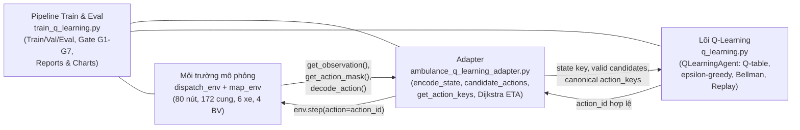
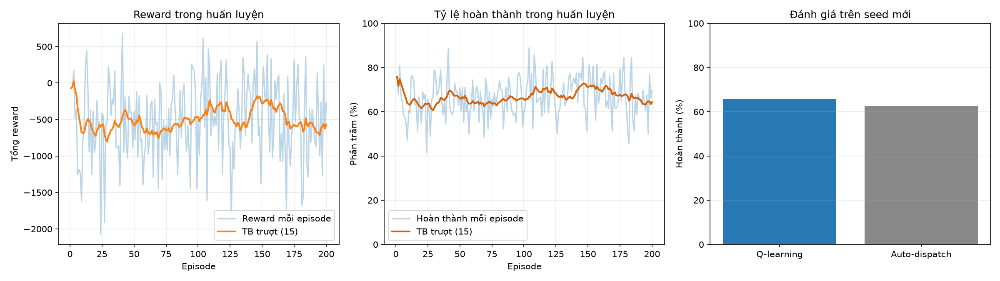
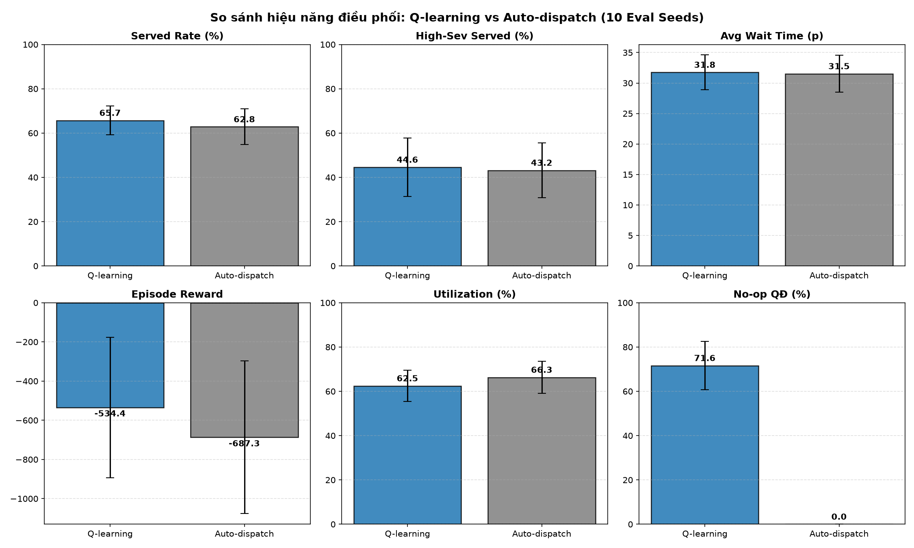

# Báo Cáo Đánh Giá & Kiểm Chứng Q-Learning — Dự Án Ambulance Dispatch Simulation

- **Dự án:** Mô phỏng Điều phối Xe Cứu thương Đô thị (`ambulance_dispatch`)
- **Phiên bản kết quả trọng tâm:** `results/q_learning_final_v2/` (commit hiện tại: `dd0af60`)
- **Ngày lập báo cáo:** 25/11/2026

---

## 1. Tóm Tắt & Kết Luận Nhanh

| Tiêu chí kiểm tra | Kết luận | Tóm tắt bằng chứng |
| :--- | :---: | :--- |
| **Thuật toán Q-learning đúng chuẩn** | **Đạt** | Cài đặt chuẩn Tabular Q-learning (Semi-MDP $\gamma^{\text{steps}}$, terminal state, adaptive $\alpha$, replay buffer, epsilon-greedy); **11/11 unit tests PASS**. |
| **Kết nối với môi trường mô phỏng** | **Đạt (trong pipeline RL)** | Tách sạch 3 lớp (`q_learning.py` – `ambulance_q_learning_adapter.py` – `train_q_learning.py`), chỉ dùng public API của `AmbulanceDispatchEnv`, không sửa đổi môi trường (**Gate G1–G7: 8/8 PASS**). *Lưu ý: Web/Desktop GUI và `run_simulation.py` chưa tích hợp Q-learning.* |
| **Agent đã học qua các lần chạy** | **Đạt (đã học thật)** | Trên 10 seed mới (`200042..200051`), Q-learning đạt **65.71%** hoàn thành / reward **-534.44**, vượt cả **Q-table rỗng chưa học** (`59.90%` / `-900.68`) lẫn heuristic **`Auto-dispatch`** (`62.82%` / `-687.26`). |
| **Mức độ sẵn sàng báo cáo / sử dụng** | **Đạt chuẩn** | Đủ điều kiện báo cáo và đối chiếu baseline; có 1 điểm cần trình bày minh bạch (reward shaping khi train) và một số điểm có thể tối ưu thêm ở Mục 6. |

---

## 2. Kiến Trúc Kết Nối Giữa Q-Learning Và Môi Trường

### 2.1. Luồng tương tác giữa các thành phần



### 2.2. Vai trò các file chính trong dự án

| File | Vai trò | Trạng thái tích hợp Q-learning |
| :--- | :--- | :--- |
| [`q_learning.py`](../q_learning.py) | Lõi Tabular Q-learning độc lập (không import `dispatch_env` hay `map_env`). | Cốt lõi RL |
| [`ambulance_q_learning_adapter.py`](../ambulance_q_learning_adapter.py) | Chuyển đổi `obs`, `action_mask` sang state key gọn và canonical action key bất biến theo hoán vị ID xe. | Cầu nối RL ↔ Env |
| [`train_q_learning.py`](../train_q_learning.py) | Huấn luyện (200 ep), validation checkpoint, đánh giá so sánh với `Auto-dispatch`, kiểm định G1–G7, xuất log/CSV/biểu đồ/báo cáo. | Entry point RL chính |
| [`dispatch_env/environment.py`](../dispatch_env/environment.py) | Môi trường MDP chuẩn (`6` xe, `3` slot PENDING, `229` potential actions, `max_time=360`, `max_overtime=300`, `poisson_lambda=0.1`). | Không bị can thiệp nội bộ |
| [`tests/test_q_learning.py`](../tests/test_q_learning.py) | Bộ 11 unit test cho lõi Q-learning, adapter và Correctness Gate. | 11/11 PASS |
| [`run_simulation.py`](../run_simulation.py) | Script mô phỏng đơn lẻ xuất `simulation.log`. | **Chưa tích hợp** (chỉ chạy `auto_dispatch=True`) |
| [`web_gui.py`](../web_gui.py), [`gui_app.py`](../gui_app.py) | Giao diện Web Dashboard & Desktop Tkinter trực quan. | **Chưa tích hợp** (chỉ chạy `auto_dispatch=True` hoặc phân công thủ công) |

---

## 3. Chi Tiết Thuật Toán, Biểu Diễn Trạng Thái & Xử Lý WAIT Loop

### 3.1. Lõi thuật toán (`QLearningAgent`)
- **Cập nhật Bellman hỗ trợ Semi-MDP nhiều bước:**
  $$Q(s, k) \leftarrow Q(s, k) + \alpha_{\text{eff}}(s, k)\left[r_{\text{macro}} + \gamma^{\max(1, \Delta t)} \max_{k' \in \mathcal{K}(s')} Q(s', k') - Q(s, k)\right]$$
  Khi `done=True` (trạng thái kết thúc), giá trị tương lai được gán bằng `0.0`.
- **Tham số huấn luyện bản `q_learning_final_v2`:**
  - Số episode train: `200` (seeds `42..241`), validation: `10` seeds (`50042..50051`, kiểm tra mỗi `40` ep), evaluation: `10` seeds (`200042..200051`).
  - Tốc độ học thích ứng kiểu Robbins-Monro: $\alpha_0 = 0.12$, $\alpha_{\min} = 0.015$, `alpha_decay = 0.04` (`adaptive_alpha=True`).
  - Hệ số chiết khấu: $\gamma = 0.96$.
  - Khám phá $\varepsilon$-greedy: giảm mũ từ `0.80` xuống `0.02` trong 80% số episode đầu.
  - Experience Replay: `capacity = 15,000`, `batch_size = 128` (ôn tập sau mỗi episode train để lan truyền reward trễ).

### 3.2. Trừu tượng hóa trạng thái & hành động (`AmbulanceDispatchAdapter`)
- **State key (`encode_state`):** `(env_signature, idle_bucket, call_features, has_top1_conflict)`
  - `env_signature`: mã băm SHA-256 (16 ký tự) của cấu hình tĩnh MDP (bản đồ, số xe, số slot, bảng reward, vận tốc) giúp tự tách namespace Q-table khi đổi cấu hình nhưng vẫn khái quát hóa qua mọi `seed`.
  - `idle_bucket`: số xe rảnh gom nhóm `1`, `2`, `3+`.
  - `call_features`: cho từng slot `0..2`, lưu `(severity, eta_feasibility)` với:
    - `0`: `best_eta <= 0.6 * remaining_time` (rất khả thi / có cơ hội hoàn hảo),
    - `1`: `0.6 * remaining_time < best_eta <= remaining_time` (kịp giờ),
    - `2`: `best_eta > remaining_time` (không kịp giờ).
  - `has_top1_conflict`: cờ nhị phân báo hiệu có từ 2 slot trở lên cùng chia sẻ chung xe nhanh nhất (top-1).
- **Lọc hành động & gom nhóm đối xứng (`candidate_actions`, `get_action_keys`):**
  - Luôn tuân thủ tuyệt đối `action_mask`, luôn giữ lại `action_id = 0` (`WAIT`), lọc các phân công trong nhóm Top-K (`K = 2`) xe có ETA ngắn nhất tới từng slot.
  - Mã hóa hành động sang `canonical_key` theo thứ hạng ETA của từng slot (hệ cơ số 5: `0` = không giao, `1..4` = thứ hạng ETA), nhờ đó không bị phình không gian trạng thái theo hoán vị ID xe (`State Hit Rate` đạt **96.96%** trên seed mới).

### 3.3. Cơ chế khắc phục lỗi WAIT Loop
Ở các phiên bản thử nghiệm trước (`results/q_learning_final`), agent bị kẹt vòng lặp `WAIT` (tỉ lệ hoàn thành chỉ đạt ~34%–63%, thua nặng `Auto-dispatch`) do:
1. Bất đối xứng Semi-MDP (`WAIT` chỉ kéo dài 1 phút với $\gamma^1 = 0.96$, còn `DISPATCH` kéo dài 5–15 phút tới bước quyết định kế tiếp với $\gamma^{15} \approx 0.54$).
2. Độ trễ của `completion_bonus` (+50/+65/+70 chỉ phát sinh sau 20–30 phút khi xong sơ cứu), dễ bị gán nhầm vào `macro_reward` của hành động `WAIT` diễn ra ở phút hoàn thành.
3. Tie-breaking mặc định chọn phần tử đầu tiên (`action 0 = WAIT`) trên trạng thái chưa gặp.

**Giải pháp đã áp dụng trong bản `v2`:**
1. **Immediate Dispatch Credit Assignment (chỉ áp dụng lúc `training=True`):** cộng sớm `REWARD_CONFIG[sev]["complete_reward"]` ngay thời điểm điều phối cho các ca khả thi (`eta <= deadline - t`) và trừ `completion_bonus` trễ ở các bước sau để tránh gán trùng/gán nhầm cho `WAIT`.
2. **Smart Deterministic Tie-breaking:** khi đánh giá (`explore=False`), nếu nhiều hành động có cùng Q-value cao nhất, ưu tiên hành động điều phối (`a != 0`) thay vì mặc định chọn `0`.

---

## 4. Kiểm Chứng Tính Đúng Đắn (Unit Tests & Correctness Gate G1–G7)

### 4.1. Kết quả Unit Tests (`tests/test_q_learning.py`)
Chạy trực tiếp `python -m unittest tests/test_q_learning.py -v`: **11/11 test PASS** (19.30 giây), bao gồm:
- Chọn action luôn nằm trong `valid_actions`.
- Tính nhất quán của `state_key` và tự đổi namespace khi thay đổi số nút bản đồ hoặc số xe cứu thương.
- Đảm bảo `q_learning.py` không import `dispatch_env` hay `map_env`.
- Kiểm toán toán học công thức Bellman update thường và terminal (`done=True`).
- Lưu và nạp lại `q_table.json` chính xác.
- Kiểm tra `candidate_actions` giữ lại `WAIT` và các phân công một phần (partial dispatch).
- Kiểm tra xử lý KPI ca mức 3 khi rỗng (`None`/`NaN`) và kiểm định Gate G3, G6.

### 4.2. Kết quả Correctness Gate (G1–G7) trong `results/q_learning_final_v2/training_report.txt`

| Gate | Trạng thái | Chi tiết kiểm chứng |
| :--- | :---: | :--- |
| `G1_observation_and_status_mapping` | **PASS** | Observation đủ khóa chuẩn và khớp `AmbulanceStatus.IDLE` |
| `G2_action_mask_zero_violations` | **PASS** | `mask_violations = 0` trên toàn bộ tập đánh giá |
| `G3_learning_update_correctness` | **PASS** | Đúng toán học Semi-MDP / Terminal / `adaptive_alpha` + probe 1 ep cập nhật `53` cặp Q hữu hạn (`finite=True`) |
| `G4_reward_reconciliation_with_t0` | **PASS** | `t0_reset_reward + sum(step_rewards) == total_reward` và `served + failed + unresolved == calls` |
| `G5_eval_policy_frozen` | **PASS** | `q_table` và `visit_counts` bất biến trong toàn bộ pha đánh giá |
| `G6_env_static_and_config` | **PASS** | `AST mutations = 0`, `core_env_imports = 0`, giữ đúng cấu hình mặc định môi trường |
| `G6_env_git_working_tree` | **PASS** | `dispatch_env/` và `map_env/` sạch so với HEAD |
| `G7_seed_reproducibility` | **PASS** | Chạy lặp lại `seed = 200042` khớp tuyệt đối `reward`, `served`, `failed` và toàn bộ `action_trace` |

---

## 5. Bằng Chứng Định Lượng Agent Đã Học Qua Các Lần Chạy

### 5.1. Tiến trình học qua 200 episodes huấn luyện (`training_metrics.csv`)

| Chặng huấn luyện | Reward TB | Hoàn thành TB (%) | No-op QĐ TB (%) | State Hit TB (%) | Kích thước Q-table (cuối chặng) | Epsilon (cuối chặng) |
| :--- | :---: | :---: | :---: | :---: | :---: | :---: |
| **Ep 1 – 40** | `-587.90` | `64.83%` | `42.04%` | `87.89%` | `384` cặp | `0.326` |
| **Ep 41 – 80** | `-606.08` | `64.70%` | `54.74%` | `94.71%` | `671` cặp | `0.129` |
| **Ep 81 – 120** | `-414.88` | `67.84%` | `65.47%` | `96.89%` | `922` cặp *(Checkpoint tốt nhất: Ep 120)* | `0.051` |
| **Ep 121 – 160** | `-380.39` | `69.55%` | `69.56%` | `98.31%` | `1,114` cặp | `0.020` |
| **Ep 161 – 200** | `-566.73` | `66.25%` | `70.28%` | `97.94%` | `1,334` cặp | `0.020` |

- **Checkpoint tốt nhất** được chọn qua tập validation độc lập (`50042..50051`) tại **Episode 120** (`Val Served = 67.35%`, `Val Reward = -408.36`, kích thước Q-table `922` cặp). Cơ chế checkpoint tránh được dao động/quá khớp nhẹ ở chặng cuối (Ep 161–200).
- Thời gian chạy toàn bộ pipeline `v2`: huấn luyện **3.53 phút** (`211.5s`), đánh giá **0.26 phút** (`15.7s`).

### 5.2. Đối chứng trực tiếp: Chưa học vs Auto-dispatch vs Đã học (10 Eval Seeds `200042..200051`)

| Chiến lược | Served Rate (%) | High-Sev Served (%) | Episode Reward | Total Distance (km) | Utilization (%) | Prio Violation (%) | No-op QĐ (%) |
| :--- | :---: | :---: | :---: | :---: | :---: | :---: | :---: |
| **Untrained Q-agent** (`q_table` rỗng) | `59.90%` | `36.92%` | `-900.68` | — | — | `2.56%` | `0.00%` |
| **Auto-dispatch** (Heuristic baseline) | `62.82 ± 8.07%` | `43.18 ± 12.38%` | `-687.26 ± 389.53` | `693.21 ± 96.59` | `66.31 ± 7.25%` | `0.00 ± 0.00%` | `0.00%` |
| **Trained Q-learning (`v2`)** | **`65.71 ± 6.49%`** | **`44.56 ± 13.17%`** | **`-534.44 ± 358.40`** | **`667.15 ± 80.62`** | **`62.46 ± 7.04%`** | `1.44 ± 1.12%` | `71.62 ± 10.96%` |

- So với **chính nó lúc chưa học**: cải thiện **+5.81%** tỉ lệ hoàn thành, **+7.64%** tỉ lệ cứu ca nặng mức 3, **+366.24** điểm reward và giảm vi phạm ưu tiên từ `2.56%` xuống `1.44%`.
- So với **`Auto-dispatch`**: vượt **+2.89%** tỉ lệ hoàn thành, **+1.38%** ca nặng mức 3, **+152.82** điểm reward, giảm quãng đường chạy trung bình (`-26.06 km`) và giảm tải xe (`-3.85%` utilization).

### 5.3. Kết quả chi tiết từng seed đánh giá (`evaluation_per_seed.csv`)

| Seed | Tổng ca | Q-learning Hoàn thành | Auto-dispatch Hoàn thành | Q-learning Reward | Auto-dispatch Reward | Chênh lệch Reward (Q - Auto) |
| :---: | :---: | :---: | :---: | :---: | :---: | :---: |
| `200042` | 41 | 23 (`56.1%`) | 23 (`56.1%`) | `-1321.76` | `-1193.25` | `-128.51` |
| `200043` | 42 | **26 (`61.9%`)** | 24 (`57.1%`) | **`-725.45`** | `-878.10` | **`+152.65`** |
| `200044` | 38 | **22 (`57.9%`)** | 21 (`55.3%`) | **`-599.20`** | `-1131.04` | **`+531.84`** |
| `200045` | 32 | **21 (`65.6%`)** | 20 (`62.5%`) | `-538.66` | `-444.96` | `-93.70` |
| `200046` | 32 | 21 (`65.6%`) | **23 (`71.9%`)** | `-386.01` | `-324.43` | `-61.58` |
| `200047` | 41 | **27 (`65.9%`)** | 24 (`58.5%`) | **`-374.62`** | `-807.86` | **`+433.24`** |
| `200048` | 37 | **25 (`67.6%`)** | 22 (`59.5%`) | **`-288.34`** | `-707.91` | **`+419.57`** |
| `200049` | 31 | 24 (`77.4%`) | **25 (`80.6%`)** | `-8.13` | `+69.18` | `-77.31` |
| `200050` | 40 | **26 (`65.0%`)** | 24 (`60.0%`) | **`-785.42`** | `-945.64` | **`+160.22`** |
| `200051` | 27 | **20 (`74.1%`)** | 18 (`66.7%`) | **`-316.78`** | `-508.56` | **`+191.78`** |
| **Trung bình** | **36.1** | **`65.71%`** | `62.82%` | **`-534.44`** | `-687.26` | **`+152.82`** |

*(Q-learning thắng Auto-dispatch về số ca hoàn thành trên **7/10 seed**, hòa 1/10 seed, thua 2/10 seed; thắng về Reward trên **6/10 seed**.)*

### 5.4. So sánh với phiên bản thử nghiệm trước (`q_learning_final` vs `q_learning_final_v2`)
- **Bản cũ (`results/q_learning_final`):** bị kẹt WAIT loop (No-op QĐ `87%–95%`, State Hit chỉ `44%–81%`, Served Rate tụt xuống khoảng `34%–63%`, thua xa `Auto-dispatch`).
- **Bản hiện tại (`results/q_learning_final_v2`):** State Hit tăng lên **`96.96%`** (`94.57%–100%`), Q-table gọn còn `922` cặp trên `505` trạng thái, Served Rate đạt **`65.71%`** và vượt `Auto-dispatch`.

### 5.5. Phân tích chiến lược đã học trong Q-table & giải thích chỉ số `No-op QĐ = 71.62%`
Kiểm tra trực tiếp cấu trúc [q_table.json](../results/q_learning_final_v2/q_table.json) (`922` cặp `(state, action_key)` thuộc `505` trạng thái duy nhất):
- Giá trị Q nằm trong khoảng `[-93.51, +118.74]` (`294` giá trị dương, `628` giá trị âm).
- Hành động tối ưu theo Q-table: **`DISPATCH` chiếm `397/505` trạng thái (`78.6%`)**, `WAIT` chiếm `108/505` trạng thái (`21.4%`).
- Khi chạy phân tích từng bước trên `seed = 200042` (`144` bước quyết định):
  - **Chỉ có ca không kịp giờ (`ETA > deadline - t`):** agent chọn **`WAIT` 90/94 lần (`95.7%`)** và chỉ điều xe `4/94` lần. Đây là chiến lược thông minh mà agent học được: **không lãng phí xe và quãng đường cho các ca chắc chắn thất bại**, giữ xe rảnh cho các ca khả thi mới xuất hiện.
  - **Có ít nhất 1 ca khả thi:** agent chọn **`DISPATCH` 30/50 lần**, và `WAIT` 20/50 lần (chủ yếu ở tình huống chỉ còn 1 xe rảnh đối diện ca mức 1 sát hạn `[1, 1]`).
  - **Vì sao `No-op QĐ = 71.62%` dù agent điều phối hiệu quả?** Vì một ca không kịp giờ bị bỏ qua sẽ tiếp tục nằm ở trạng thái `PENDING` qua nhiều phút (ví dụ 15 phút → tạo ra **15 bước quyết định `WAIT`** liên tiếp), trong khi mỗi ca khả thi được điều phối ngay lập tức chỉ tạo ra **1 bước quyết định `DISPATCH`**.

### 5.6. Biểu đồ kết quả trực quan





---

## 6. Các Điểm Cần Lưu Ý Kỹ Thuật & Đề Xuất Cải Tiến

1. **Minh bạch về Reward Shaping khi báo cáo** ([`train_q_learning.py`](../train_q_learning.py#L204-L251)):
   - Trong pha train (`training=True`), thuật toán dùng *Immediate Dispatch Credit Assignment* (gán sớm `complete_reward` cho ca khả thi và trừ `completion_bonus` trễ) để khắc phục bài toán gán tín chỉ trễ trong Semi-MDP.
   - Khi đánh giá (`training=False`), toàn bộ chỉ số đều đo bằng **100% reward gốc của môi trường** (`G4 PASS`), đảm bảo kết quả đánh giá công bằng. Tuy nhiên, cần trình bày rõ điều này trong báo cáo/thuyết trình để phản ánh trung thực phương pháp.
2. **Hiện tượng "Optimistic Unseen Action" khi Q-value âm** ([`q_learning.py`](../q_learning.py#L109-L119)):
   - Vì reward môi trường có nhiều khoản phạt, `266/505` trạng thái trong Q-table có toàn bộ hành động đã học mang giá trị $Q < 0$.
   - Khi `explore=False`, mọi hành động *chưa từng xuất hiện* trong Q-table được trả về `initial_q = 0.0 > Q_âm`, dẫn tới bị chọn đè lên hành động đã học (đo thực tế trên seed `200042` xảy ra **`8/144` bước quyết định**).
   - **Đề xuất:** Khi `explore=False`, nếu trạng thái hiện tại đã có ít nhất một hành động từng học trong `q_table`, chỉ so sánh trong tập hành động đã học (hoặc đặt `initial_q` phù hợp / dùng pessimism cho unseen action khi eval).
3. **Mở rộng số lượng seed đánh giá:**
   - Hiện tại đánh giá trên `10` seed khiến độ lệch chuẩn reward khá lớn (`±358.40`). Nên đánh giá mở rộng trên **30–50 seed** kèm kiểm định thống kê (paired t-test / Wilcoxon) để củng cố độ tin cậy.
4. **Tích hợp model đã học vào giao diện trực quan (tùy chọn):**
   - Hiện `web_gui.py`, `gui_app.py` và `run_simulation.py` chưa có tùy chọn nạp `q_table.json`. Nếu cần trình diễn trực tiếp agent điều phối trên bản đồ 80 nút khi bảo vệ, có thể bổ sung chế độ `Q-learning` vào `SimulationManager` trong [`web_gui.py`](../web_gui.py).
5. **Dọn dẹp `.gitignore`:**
   - Commit `dd0af60` làm trống file [`.gitignore`](../.gitignore), khiến các file biên dịch `__pycache__/*.pyc` bị đưa vào git. Nên khôi phục `.gitignore` chuẩn Python (`__pycache__/`, `*.py[cod]`, `.pytest_cache/`, `*.log`).

---

## 7. Hướng Dẫn Tra Cứu & Tự Kiểm Chứng

### 7.1. Các file kết quả chuẩn cần xem (`results/q_learning_final_v2/`)
- Báo cáo tổng hợp (đọc đầu tiên): [`results/q_learning_final_v2/training_report.txt`](../results/q_learning_final_v2/training_report.txt)
- Biểu đồ quá trình học & so sánh KPI:
  - [`results/q_learning_final_v2/q_learning_results.png`](../results/q_learning_final_v2/q_learning_results.png)
  - [`results/q_learning_final_v2/evaluation_comparison.png`](../results/q_learning_final_v2/evaluation_comparison.png)
- Dữ liệu CSV chi tiết:
  - [`results/q_learning_final_v2/training_metrics.csv`](../results/q_learning_final_v2/training_metrics.csv)
  - [`results/q_learning_final_v2/evaluation_summary.csv`](../results/q_learning_final_v2/evaluation_summary.csv)
  - [`results/q_learning_final_v2/evaluation_per_seed.csv`](../results/q_learning_final_v2/evaluation_per_seed.csv)
- Bảng tri thức Q-table đã học (`922` cặp): [`results/q_learning_final_v2/q_table.json`](../results/q_learning_final_v2/q_table.json)
- Log diễn biến từng phút thực tế của agent (seed `200042`): [`results/q_learning_final_v2/q_learning_episode.log`](../results/q_learning_final_v2/q_learning_episode.log)

### 7.2. Lệnh tự chạy kiểm chứng lại
```powershell
# 1. Chạy toàn bộ 11 unit tests cho Q-learning, Adapter và Correctness Gate
python -m unittest tests/test_q_learning.py -v

# 2. Chạy kiểm thử nhanh luồng train + gate + eval (20 episodes, 3 eval seeds)
python train_q_learning.py --episodes 20 --eval-seeds 3 --output-dir results/q_learning_quickcheck

# 3. Tái chạy đầy đủ cấu hình bản v2 (200 episodes, 10 eval seeds, ~4 phút)
python train_q_learning.py --episodes 200 --eval-seeds 10 --eval-seed-offset 200000 --output-dir results/q_learning_final_v2
```
