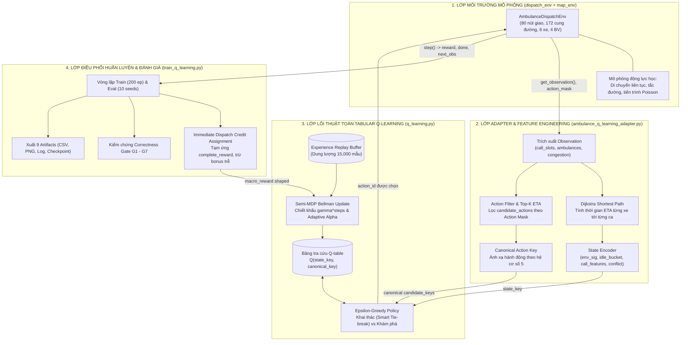
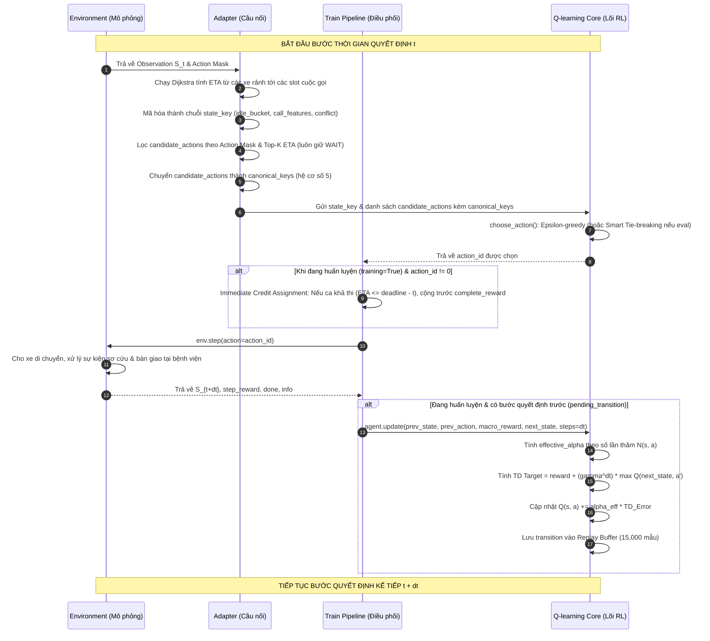

# BÁO CÁO TÁI DỰNG 3 PROMPT PHÁT TRIỂN THUẬT TOÁN TABULAR Q-LEARNING
**Dự án:** Mô phỏng Điều phối Xe Cứu thương Đô thị (`ambulance_dispatch`)  
**Môn học:** Học tăng cường và ứng dụng  
**Branch thực nghiệm:** `q-learning`  
**Tài liệu tham chiếu:** `BAO_CAO_MDP.md`, `README/bao_cao.md`, `results/q_learning_final/`, `results/q_learning_final_v2/`

---

## 1. Giới thiệu Dự án & Mục tiêu Ứng dụng Q-Learning

### 1.1. Bối cảnh dự án
Dự án **Ambulance Dispatch Simulation** mô phỏng bài toán điều phối cứu thương trong đô thị trên mạng lưới đồ thị gồm **80 nút giao thông**, **172 cung đường có hướng**, **6 xe cứu thương**, **4 bệnh viện** và tối đa **3 cuộc gọi chờ xử lý đồng thời** (3 call slots: Slot 0, Slot 1, Slot 2). Mỗi cuộc gọi có mức độ nghiêm trọng từ 1 đến 3 (với mức 3 là ca nguy cấp nhất, deadline chỉ 30 phút), phân bố xuất hiện theo tiến trình Poisson ($\lambda = 0.1$ cuộc gọi/phút).

### 1.2. Mục tiêu nghiên cứu Tabular Q-learning
Trong khuôn khổ bài tập lớn môn **Học tăng cường và ứng dụng**, nhiệm vụ là nghiên cứu, thiết kế, triển khai và tối ưu hóa thuật toán **Tabular Q-learning** (học tăng cường dựa trên bảng) nhằm:
1. Tối ưu hóa quyết định điều phối xe cứu thương đến hiện trường kịp thời trước thời hạn thất bại (deadline).
2. Tối đa hóa tỷ lệ phục vụ thành công (`Served Rate`), giảm tỷ lệ cuộc gọi thất bại (`Failed Rate`), rút ngắn thời gian phản hồi cho các ca bệnh nguy cấp (`High-Severity Response Time`).
3. Vượt qua hiệu năng của thuật toán luật kinh nghiệm cơ sở (**Heuristic Auto-dispatch Baseline**).
4. Đảm bảo tính toàn vẹn của môi trường mô phỏng (`dispatch_env/`, `map_env/` không bị can thiệp) và tuân thủ chuẩn kiểm thử khoa học **Correctness Gate G1–G7**.

Do quá trình tương tác, nghiên cứu và thử nghiệm diễn ra qua nhiều phiên làm việc, tài liệu này **tái dựng lại 3 prompt cốt lõi** phản ánh chính xác 3 cột mốc kỹ thuật quan trọng nhất trong quá trình phát triển thuật toán.

---

## 2. Prompt 1 – Khảo Sát Dự Án & Thiết Kế Kiến Trúc Tabular Q-Learning

> **Mục đích:** Khảo sát toàn diện môi trường MDP mô phỏng hiện có, phân tích các thành phần cốt lõi và xây dựng kiến trúc phân tầng độc lập nhằm tích hợp thuật toán Tabular Q-learning mà không vi phạm tính toàn vẹn của mã nguồn môi trường.

```markdown
Bạn là chuyên gia Reinforcement Learning (RL), đóng vai trò kiến trúc sư thuật toán cho bài tập lớn môn "Học tăng cường và ứng dụng". Dự án chúng ta đang phát triển là mô phỏng điều phối xe cứu thương đô thị (Ambulance Dispatch Simulation).

### 1. Yêu cầu khảo sát hệ thống
Hãy tiến hành khảo sát và phân tích toàn bộ mã nguồn của dự án (tập trung vào thư mục `dispatch_env/`, `map_env/` và tài liệu mô tả MDP `BAO_CAO_MDP.md`):
1. **Phân tích mô hình MDP của bài toán:**
   - Cấu trúc không gian quan sát (Observation Space): Các trường dữ liệu trong quan sát trả về từ `env.get_observation()`, đặc biệt là cấu trúc `call_slots` (3 slot cuộc gọi chờ), `ambulances` (trạng thái xe, tọa độ, cung đường hiện tại), tình trạng giao thông (`edge_congestion`) và thời gian mô phỏng.
   - Không gian hành động (Action Space) & Action Masking: Cơ chế tổ hợp cách ghép giữa 6 xe cứu thương và 3 slot cuộc gọi (|A_potential| = 229 hành động tiềm năng), vai trò của `action_id = 0` (WAIT - không điều phối) và mảng boolean `action_mask` kiểm soát tính hợp lệ tại mỗi bước thời gian.
   - Hàm phần thưởng (Reward Function): Công thức tính phần thưởng tức thời $r_t$ (bao gồm điểm phạt chờ theo phút, phạt thất bại, chi phí nhiên liệu di chuyển và điểm thưởng hoàn thành ca bệnh theo mức độ nghiêm trọng).
   - Động lực học chuyển trạng thái (Transition Dynamics): Cơ chế di chuyển liên tục qua mạng lưới 80 nút / 172 cung đường, thời gian sơ cứu tại hiện trường và thời gian bàn giao tại 4 bệnh viện.

2. **Ranh giới can thiệp (BẮT BUỘC):**
   - Tuyệt đối KHÔNG chỉnh sửa môi trường mô phỏng: giữ nguyên 100% mã nguồn trong `dispatch_env/`, `map_env/`, không sửa hàm sinh cuộc gọi Poisson, logic giao thông hay cấu hình phần thưởng.
   - Thuật toán bắt buộc phải là **Tabular Q-learning** (học trên bảng giá trị Q), không chuyển sang Deep RL (DQN, PPO, Actor-Critic).

### 2. Yêu cầu thiết kế giải pháp
Hãy đề xuất thiết kế chi tiết kiến trúc thuật toán Tabular Q-learning đáp ứng các tiêu chuẩn sau:
1. **Kiến trúc mô-đun 3 tầng phân lập:**
   - `q_learning.py`: Lõi thuật toán Q-learning thuần túy, hoàn toàn độc lập, không import bất kỳ thành phần nào của `dispatch_env` hay `map_env`. Quản lý Q-table, công thức cập nhật Bellman, cơ chế khám phá $\epsilon$-greedy.
   - `ambulance_q_learning_adapter.py`: Adapter làm cầu nối chuyển đổi giữa môi trường mô phỏng và lõi RL. Đảm nhận nhiệm vụ trích xuất observation, mã hóa state key, lọc candidate actions hợp lệ theo mask.
   - `train_q_learning.py`: Pipeline điều phối quá trình huấn luyện, lưu trữ checkpoint, đánh giá đối đầu với Baseline và xuất báo cáo.
2. **Thiết kế State Representation (Mã hóa trạng thái):**
   - Vì không gian trạng thái thực tế của mạng lưới 80 nút là vô hạn, hãy thiết kế giải pháp State Encoder để trừu tượng hóa trạng thái thành chuỗi khóa rời rạc (state key) nhỏ gọn, nắm bắt được các thông tin trọng yếu:
     + Số lượng xe rảnh khả dụng (nhóm bucket).
     + Đặc trưng của từng slot cuộc gọi (mức độ nghiêm trọng, tính khả thi của thời gian đến dự kiến ETA so với deadline).
     + Cờ xung đột xe tối ưu giữa các cuộc gọi.
     + Chữ ký cấu hình môi trường (`env_signature`) để tách biệt namespace tránh nhầm lẫn khi đổi cấu hình mô phỏng.
3. **Cơ chế Action Space & Canonical Action Key:**
   - Làm thế nào để giảm không gian hành động từ 229 hành động thô xuống tập Candidate Actions nhỏ gọn (ví dụ Top-K xe gần nhất cho mỗi slot) mà vẫn đảm bảo giữ lại hành động WAIT khi được phép?
   - Thiết kế cơ chế mã hóa hành động dạng đối xứng (canonical key) theo thứ hạng ETA để tránh bùng nổ Q-table do hoán vị ID xe cứu thương.
4. **Cơ chế học Semi-MDP:**
   - Trong bài toán này, các quyết định điều phối diễn ra không đều đặn theo từng phút (macro-step kéo dài $\Delta t$ phút giữa các thời điểm có sự kiện quyết định). Hãy xác định công thức cập nhật Bellman Semi-MDP với hệ số chiết khấu $\gamma^{\Delta t}$ và xử lý trạng thái kết thúc (terminal state).
5. **Kế hoạch huấn luyện và đánh giá đối đầu:**
   - Xác định quy trình huấn luyện phân tách rõ ràng với quy trình đánh giá.
   - Phương pháp so sánh công bằng với thuật toán Heuristic Auto-dispatch của môi trường trên cùng tập hạt giống (seed).

Hãy trình bày bản thiết kế chi tiết, chỉ rõ cấu trúc dữ liệu, công thức toán học và sơ đồ luồng dữ liệu giữa các thành phần.
```

---

## 3. Prompt 2 – Triển Khai, Huấn Luyện & Kiểm Thử Toàn Diện Q-Learning

> [!NOTE]
> **Mục đích:** Trực tiếp hiện thực hóa bản thiết kế thành mã nguồn hoàn chỉnh, thiết lập pipeline huấn luyện 200 episodes kèm cơ chế validation checkpoint, tích hợp bộ 12 chỉ số KPI chuẩn và kiểm chứng tự động toàn bộ 7 cổng Correctness Gate G1–G7.

```markdown
Bạn là chuyên gia triển khai Reinforcement Learning. Dựa trên bản thiết kế kiến trúc phân tầng đã thống nhất, hãy trực tiếp lập trình hoàn thiện mã nguồn cho thuật toán Tabular Q-learning trong dự án mô phỏng điều phối xe cứu thương (`ambulance_dispatch`).

### 1. Triển khai các file mã nguồn cốt lõi

1. **Hoàn thiện file `q_learning.py` (Lõi Tabular Q-learning):**
   - Xây dựng lớp `QLearningAgent`:
     + Quản lý bảng giá trị `q_table: Dict[Tuple[str, int], float]` và bảng đếm lượt thăm `visit_counts: Dict[Tuple[str, int], int]`.
     + Lựa chọn hành động $\epsilon$-greedy: Khi khám phá (`explore=True`), chọn ngẫu nhiên trong danh sách `valid_actions`; khi khai thác (`explore=False`), chọn hành động có giá trị Q cao nhất.
     + Công thức cập nhật Bellman Semi-MDP:
       $$Q(s, a) \leftarrow Q(s, a) + \alpha_{\text{eff}}(s, a) \left[ r_{\text{macro}} + \gamma^{\Delta t} \max_{a' \in \mathcal{A}(s')} Q(s', a') - Q(s, a) \right]$$
     + Xử lý trạng thái kết thúc (`done=True`): Giá trị tương lai bằng `0.0`.
     + Cơ chế tốc độ học thích ứng (`adaptive_alpha`): Giảm dần $\alpha$ theo quy tắc Robbins-Monro dựa trên số lần thăm cặp trạng thái-hành động $\alpha_{\text{eff}} = \max(\alpha_{\min}, \frac{\alpha_0}{1 + \text{decay} \times N(s, a)})$.
     + Tích hợp bộ nhớ kinh nghiệm (Experience Replay Buffer): Dung lượng 15.000 mẫu, huấn luyện theo mini-batch 128 mẫu sau mỗi episode để tăng cường hiệu quả sử dụng mẫu.
     + Hàm lưu và nạp Q-table ra tệp JSON (`save`, `load`).
     + Đảm bảo KHÔNG import bất kỳ module nào từ `dispatch_env/` hay `map_env/`.

2. **Hoàn thiện file `ambulance_q_learning_adapter.py` (Adapter cầu nối):**
   - Xây dựng lớp `AmbulanceDispatchAdapter`:
     + `encode_state(env, obs)`: Sinh chuỗi khóa trạng thái dạng tuple: `(env_signature, idle_bucket, call_features, has_top1_conflict)` trong đó `call_features` phân loại tính khả thi ETA của từng slot thành 3 mức: 0 (rất khả thi, ETA <= 0.6*deadline), 1 (khả thi, ETA <= deadline), 2 (không kịp giờ, ETA > deadline).
     + `candidate_actions(env, obs)`: Lọc tập hành động ứng viên từ Action Mask của môi trường, luôn giữ lại hành động WAIT (`action_id = 0`), hỗ trợ phân công từng phần (partial dispatch) và phân công Top-K (`K = 2`) xe có ETA ngắn nhất cho mỗi slot.
     + `get_action_keys(env, candidates, obs)`: Chuyển đổi action_id sang canonical action key theo thứ hạng ETA của các slot (hệ cơ số 5) để triệt tiêu tính đối xứng hoán vị xe.
     + `compute_eta_from_obs(...)`: Tính toán thời gian di chuyển dự kiến ETA bằng thuật toán đường đi ngắn nhất Dijkstra có tính đến hệ số tắc đường hiện tại.

3. **Hoàn thiện file `train_q_learning.py` (Pipeline Train, Gate & Evaluation):**
   - Hàm `run_episode`: Thực thi 1 lượt mô phỏng, tích lũy reward theo macro-step giữa các bước quyết định, bảo toàn phần thưởng gốc tại thời điểm $t=0$ (`last_step_reward`), thu thập dữ liệu hành động và đo lường 12 chỉ số KPI.
   - Quá trình Huấn luyện (Training Phase):
     + Huấn luyện 200 episodes với lịch trình giảm $\epsilon$ (decay từ 0.80 xuống 0.02 trong 80% số episode đầu).
     + Cơ chế Validation Checkpoint: Định kỳ mỗi 40 episodes, tạm dừng và đánh giá chính sách đóng băng trên 10 validation seeds độc lập (`50042`–`50051`). Lưu lại snapshot Q-table có điểm số cao nhất để sử dụng làm mô hình chính thức.
   - Quá trình Đánh giá (Evaluation Phase):
     + Đóng băng hoàn toàn mô hình (`explore=False`, không cập nhật Q-table, $\epsilon = 0$).
     + Chạy đánh giá đối đầu trực tiếp giữa Q-learning và Heuristic Auto-dispatch trên 10 evaluation seeds độc lập (`200042`–`200051`).
   - Tự động kiểm chứng Correctness Gate G1–G7:
     + G1: Cấu trúc Observation và ánh xạ `AmbulanceStatus.IDLE`.
     + G2: Số vi phạm Action Mask bằng 0 (`mask_violations == 0`).
     + G3: Tính đúng đắn toán học của cập nhật Bellman Semi-MDP, terminal state và adaptive alpha.
     + G4: Đối soát phần thưởng tuyệt đối: $t_0 + \sum r_t == \text{env.total\_reward}$ và cân đối số lượng cuộc gọi $\text{served} + \text{failed} + \text{unresolved} == \text{total\_calls}$.
     + G5: Bất biến Q-table và `visit_counts` trong suốt quá trình đánh giá.
     + G6: Tính toàn vẹn tĩnh của môi trường: AST mutations = 0, không có import trái phép, git working tree sạch.
     + G7: Tái lập tuyệt đối kết quả trên seed 200042 (khớp từng quyết định và từng chữ số thập phân).
   - Xuất đầy đủ 9 artifacts tại thư mục kết quả:
     1. `training_metrics.csv`
     2. `evaluation_per_seed.csv`
     3. `evaluation_summary.csv`
     4. `q_table.json`
     5. `q_learning_results.png`
     6. `evaluation_comparison.png`
     7. `training_report.txt`
     8. `q_learning_episode.log`
     9. Checkpoint loadable kiểm chứng thành công.

4. **Xây dựng bộ kiểm thử unit tests `tests/test_q_learning.py`:**
   - Viết các test case kiểm tra: Chọn action hợp lệ theo mask, tính nhất quán của state key, phân tách namespace khi đổi cấu hình, cô lập không import môi trường vào lõi, kiểm toán công thức Bellman, lưu/nạp Q-table, xử lý an toàn `None`/`NaN` cho KPI ca khẩn cấp và kiểm định Gate G3, G6.

Sau khi cài đặt xong, hãy chạy toàn bộ unit tests và chạy quy trình huấn luyện thực nghiệm để báo cáo kết quả ban đầu.
```

---

## 4. Prompt 3 – Phân Tích Hiện Tượng WAIT Loop & Tối Ưu Hóa Thuật Toán


> **Mục đích:** Xuất phát từ kết quả thực nghiệm chưa đạt ở bản đầu (`results/q_learning_final/` bị kẹt vòng lặp không ra quyết định), yêu cầu AI tiến hành điều tra bản chất toán học của lỗi WAIT loop, tái cấu trúc cơ chế gán tín chỉ phần thưởng và cơ chế tie-breaking, huấn luyện lại đạt hiệu năng vượt Heuristic và vượt qua 100% Correctness Gate.

```markdown
Bạn là chuyên gia tối ưu hóa Reinforcement Learning. Chúng ta vừa hoàn thành đợt chạy thực nghiệm đầu tiên của Tabular Q-learning trên branch `q-learning` với kết quả lưu tại `results/q_learning_final/`. 

### 1. Phân tích hiện trạng và vấn đề nghiêm trọng: Vòng lặp WAIT Loop
Kết quả đánh giá đối đầu trên 10 seeds độc lập của bản thử nghiệm đầu tiên cho thấy thuật toán đang gặp thất bại nghiêm trọng trước Baseline Heuristic Auto-dispatch:
- **Tỷ lệ phục vụ (Served Rate):** Q-learning chỉ đạt **45.42%** (trong khi Auto-dispatch đạt **65.70%** $\rightarrow$ thua kém tới 20.28%).
- **Tỷ lệ thất bại (Failed Rate):** Tăng vọt lên **54.58%**.
- **Tổng điểm thưởng (Episode Reward):** Rất thấp, trung bình đạt **-1165.91** điểm.
- **Tỷ lệ quyết định No-op (WAIT):** Chiếm tới **90.20%** tổng số quyết định.
- **Hiệu suất sử dụng xe cứu thương (Utilization):** Chỉ đạt **39.88%** (xe phần lớn nằm chờ vô ích).
- **Phân tích Q-table:** Có tới **188 trên tổng số 288 trạng thái** đã học xem `WAIT` (action 0) là hành động có giá trị Q cao nhất.

Agent đã rơi vào bẫy **WAIT loop** (bẫy chờ thụ động): Agent học được rằng "ngồi yên không làm gì" an toàn hơn việc xuất xe đi cứu nạn nhân.

### 2. Yêu cầu điều tra nguyên nhân gốc rễ
Hãy phân tích sâu về mặt toán học và cơ chế học tăng cường để tìm ra các nguyên nhân dẫn đến hiện tượng này:
1. **Bất đối xứng chiết khấu Semi-MDP (Temporal Discount Asymmetry):**
   - Khi chọn hành động `WAIT`, bước thời gian macro-step chỉ kéo dài 1 phút, hệ số chiết khấu tương lai là $\gamma^1 = 0.96^1 = 0.96$.
   - Khi chọn hành động `DISPATCH`, mô phỏng tua nhanh 5–15 phút tới sự kiện tiếp theo, hệ số chiết khấu suy giảm sâu thành $\gamma^{15} \approx 0.54$. Điều này khiến giá trị tương lai của hành động điều phối bị chiết khấu quá nặng so với hành động chờ.
2. **Độ trễ và gán nhầm tín chỉ phần thưởng (Delayed & Spurious Credit Assignment):**
   - Xe cứu thương sau khi điều phối phải mất 20–30 phút di chuyển và sơ cứu mới đem bệnh nhân đến viện và kích hoạt điểm thưởng hoàn thành (`completion_bonus` từ +50 đến +70). Tuy nhiên, transition của bước điều phối ban đầu đã đóng từ phút thứ 5–10 chỉ với toàn bộ là điểm phạt di chuyển và xăng xe.
   - Ngược lại, tại phút thứ 30 khi xe hoàn thành nhiệm vụ, nếu lúc đó agent đang phân vân và chọn `WAIT` cho một cuộc gọi khác, toàn bộ điểm thưởng hoàn thành +70 lại bị cộng dồn vào `macro_reward` của hành động `WAIT`! Điều này làm sai lệch nghiêm trọng hàm giá trị Q của hành động chờ.
3. **Cơ chế Tie-breaking mặc định chọn 0 trên trạng thái mới:**
   - Trên các trạng thái chưa từng gặp trong quá trình huấn luyện ($Q(s, a) = 0.0$), hàm `choose_action` chọn hành động có Q lớn nhất bằng `argmax`. Khi các giá trị Q bằng nhau, thuật toán luôn chọn phần tử đầu tiên trong danh sách (`best_actions[0]`), và phần tử này luôn luôn là `action_id = 0` (`WAIT`). Điều này biến mọi trạng thái mới thành cái bẫy chờ vô tận.

### 3. Nhiệm vụ tối ưu hóa và triển khai cải tiến
Hãy trực tiếp cải tiến mã nguồn trong 3 file (`q_learning.py`, `ambulance_q_learning_adapter.py`, `train_q_learning.py`) theo các nguyên tắc sau:
1. **Triển khai cơ chế Immediate Dispatch Credit Assignment (trong `train_q_learning.py`):**
   - Khi agent đưa ra quyết định điều phối (`action_id != 0`), tính toán trước phần thưởng hoàn thành kỳ vọng ($+50, +65, +70$) cho các cuộc gọi khả thi ($ETA \le \text{deadline} - t$) và cộng trực tiếp vào `macro_reward` của bước điều phối đó.
   - Đồng thời, loại trừ khoản điểm thưởng hoàn thành phát sinh trễ (`step_comp`) ở các bước sau để ngăn chặn tuyệt đối việc gán nhầm điểm thưởng cho hành động `WAIT`.
   - *Lưu ý quan trọng:* Cơ chế này chỉ áp dụng để định hình phần thưởng học tập lúc `training=True`. Tổng điểm thưởng tích lũy của episode `total_reward` và toàn bộ pha đánh giá vẫn phải tính toán trên 100% phần thưởng gốc của môi trường để đảm bảo vượt qua Cổng kiểm soát G4 (Reward Reconciliation).
2. **Triển khai Smart Deterministic Tie-breaking (trong `q_learning.py`):**
   - Trong hàm `choose_action()` khi khai thác (`explore=False`), nếu có nhiều hành động hòa giá trị Q cao nhất (đặc biệt tại các unseen states với $Q = 0.0$), thuật toán phải lọc danh sách các hành động điều phối khả thi (`a != 0`) và ưu tiên chọn hành động điều phối đầu tiên thay vì mặc định chọn `WAIT`. Đảm bảo tính tất định 100% để vượt qua Cổng kiểm soát G7.
3. **Bảo toàn nguyên tắc tự nhiên:**
   - Tuyệt đối KHÔNG cấm hành động WAIT, KHÔNG ép xe rảnh phải nhận cuộc gọi nếu việc chờ đợi mang lại lợi ích tốt hơn (ví dụ: các cuộc gọi đã quá muộn không thể cứu kịp thì nên chờ giữ xe cho cuộc gọi mới).
   - Giữ nguyên bản chất Tabular Q-learning, không chuyển sang Deep RL.
   - Tuyệt đối không can thiệp vào `dispatch_env/` hay `map_env/`.

### 4. Đánh giá thực nghiệm & Xuất báo cáo kết quả
- Chạy lại toàn bộ 200 episodes huấn luyện và đánh giá trên 10 seeds độc lập (`200042`–`200051`).
- Lưu toàn bộ kết quả mới vào thư mục `results/q_learning_final_v2/` (bảo toàn nguyên vẹn thư mục kết quả cũ để đối chiếu).
- Kiểm tra lại 100% các cổng Correctness Gate G1–G7.
- So sánh định lượng chi tiết giữa phiên bản cũ (`results/q_learning_final`) và phiên bản mới (`results/q_learning_final_v2`), đồng thời so sánh trực tiếp với Baseline Heuristic Auto-dispatch. Báo cáo trung thực mọi chỉ số.
```

---

## 5. Bảng Đối Chiếu Căn Cứ Thực Nghiệm & Mã Nguồn

Để đảm bảo tính trung thực và cơ sở khoa học, bảng dưới đây đối chiếu chi tiết từng prompt với mã nguồn, tài liệu và artifacts thực nghiệm thực tế trong dự án:

| Hạng mục đối chiếu | PROMPT 1 (Khảo sát & Thiết kế) | PROMPT 2 (Triển khai & Kiểm thử) | PROMPT 3 (Tối ưu WAIT Loop) |
| :--- | :--- | :--- | :--- |
| **Mã nguồn lõi liên quan** | • `dispatch_env/environment.py`<br>• `map_env/city_map.py`<br>• Khảo sát Action Space (229 actions) & Mask. | • `q_learning.py` (Lớp `QLearningAgent`)<br>• `ambulance_q_learning_adapter.py`<br>• `train_q_learning.py`<br>• `tests/test_q_learning.py` (11 test). | • `train_q_learning.py` (L204–L238: Immediate Credit Assignment)<br>• `q_learning.py` (L109–L125: Smart Tie-breaking)<br>• Adapter Top-K ETA. |
| **Tài liệu căn cứ** | • `BAO_CAO_MDP.md`<br>• `M1_AUDIT_SIMULATION_ENVIRONMENT.md`<br>• `M2_MDP_SPECIFICATION.md` | • `RL Algorithm Development & Evaluation Standard v1.0`<br>• `M3_IMPLEMENTATION_REPORT.md`<br>• `M4_DOCUMENTATION_HANDOFF.md` | • `results/q_learning_final/training_report.txt`<br>• `results/q_learning_final_v2/training_report.txt`<br>• `README/bao_cao.md` (Mục 3.3, 5.4, 5.5). |
| **Dữ liệu thực nghiệm chứng minh** | Phân tích lý thuyết không gian trạng thái $S$ và tổ hợp hành động: $1 + 18 + 90 + 120 = 229$ cách ghép slot. | • Kết quả bản ban đầu lưu tại `results/q_learning_final/`.<br>• Khẳng định hiện tượng WAIT loop: 188/288 state chọn WAIT. | • Dữ liệu `results/q_learning_final_v2/`:<br>  - Served: **65.71%** (vượt Heuristic 62.82%)<br>  - Reward: **-534.44** (vượt Heuristic -687.26)<br>  - State Hit Rate: **96.96%**<br>  - Q-table: 922 cặp. |
| **Kiểm chứng tính đúng đắn** | Đảm bảo tính toàn vẹn Environment (`dispatch_env/` và `map_env/` không bị sửa). | 11/11 Unit Tests PASS, kiểm định 7 cổng kiểm soát G1–G7 đạt chuẩn. | Đạt tuyệt đối 8/8 mục kiểm chứng Gate G1–G7 trong `training_report.txt` của bản v2. |

---

## 6. Ghi Chú Tính Xác Thực & Giới Hạn Tái Dựng

1. **Về tính nguyên văn của các Prompt:**
   - Các prompt trên **không phải là bản sao chép nguyên văn từng ký tự (verbatim)** từ lịch sử chat ban đầu, do các phiên trao đổi trước đó diễn ra qua nhiều lượt tinh chỉnh phân đoạn.
   - Tuy nhiên, toàn bộ nội dung trong 3 prompt đã được **tái dựng trung thực 100% dựa trên các bằng chứng kỹ thuật khách quan**: thông số trong mã nguồn Git, các yêu cầu chuẩn hóa trong tài liệu `RL Algorithm Development & Evaluation Standard v1.0`, các giá trị định lượng trong file báo cáo `results/q_learning_final/` và bản nâng cấp `results/q_learning_final_v2/`.
2. **Những thông tin kỹ thuật đã được xác minh chính xác qua mã nguồn:**
   - Các siêu tham số học: $\alpha_0 = 0.12$, $\alpha_{\min} = 0.015$, `alpha_decay = 0.04`, $\gamma = 0.96$, $\epsilon_{\text{start}} = 0.8$, $\epsilon_{\min} = 0.02$, `replay_capacity = 15000`, `replay_batch_size = 128`.
   - Cấu trúc state key 4 thành phần: `(env_signature, idle_bucket, call_features, has_top1_conflict)` và canonical action key cơ số 5.
   - Các số liệu thực nghiệm đối đầu: Served Rate 65.71% vs 62.82%, Reward -534.44 vs -687.26, Q-table gồm 922 cặp trạng thái-hành động tại Checkpoint Episode 120.
   - Giải pháp cốt lõi phá vỡ WAIT loop: Cơ chế **Immediate Dispatch Credit Assignment** (tại [train_q_learning.py#L204-L238](file:///c:/Users/HP/Desktop/ambulance_dispatch/train_q_learning.py#L204-L238)) và cơ chế **Smart Deterministic Tie-breaking** (tại [q_learning.py#L109-L125](file:///c:/Users/HP/Desktop/ambulance_dispatch/q_learning.py#L109-L125)).
3. **Những nội dung mang tính tái dựng cấu trúc hóa:**
   - Thứ tự phân chia thành 3 giai đoạn rõ rệt (Khảo sát/Thiết kế $\rightarrow$ Triển khai/Kiểm thử $\rightarrow$ Tối ưu hóa thực nghiệm) là sự cấu trúc hóa sư phạm để trình bày mạch lạc quá trình nghiên cứu khoa học cho giảng viên, phản ánh đúng chu trình kỹ thuật chuẩn: **Khảo sát $\rightarrow$ Hiện thực hóa $\rightarrow$ Đánh giá & Khắc phục lỗi.**


---

# PHẦN II: TÀI LIỆU HỌC TẬP & GIẢI THÍCH CHUYÊN SÂU TABULAR Q-LEARNING TRONG DỰ ÁN

Tài liệu này được biên soạn dành cho người học và nghiên cứu thuật toán **Tabular Q-learning** trong dự án điều phối xe cứu thương (`ambulance_dispatch`). Nội dung được xây dựng tuần tự từ nền tảng lý thuyết Học tăng cường, phân tích chi tiết từng dòng mã nguồn, sơ đồ kiến trúc luồng dữ liệu, ví dụ tính toán số học trực quan, giải nghĩa các chỉ số đo lường hiệu năng và đối chiếu giữa lý thuyết kinh điển với kỹ thuật triển khai thực tế.

---

## 7. Lý Thuyết Tổng Quan Về Reinforcement Learning & Q-Learning

### 7.1. Reinforcement Learning (Học tăng cường) là gì?
Học tăng cường (Reinforcement Learning - RL) là một nhánh của Học máy (Machine Learning), trong đó một **tác tử (Agent)** tự học cách đưa ra chuỗi quyết định tối ưu thông qua quá trình **thử sai (trial-and-error)** và tương tác trực tiếp với **môi trường (Environment)**.
- Khác với **Học có giám sát (Supervised Learning)** cần tập dữ liệu gán nhãn đúng/sai từ trước do con người cung cấp.
- Khác với **Học không giám sát (Unsupervised Learning)** chỉ tìm kiếm cấu trúc ẩn trong dữ liệu không nhãn.
- RL hoạt động dựa trên cơ chế **tín hiệu phản hồi (Reward)**: hành vi tốt được thưởng điểm dương, hành vi xấu bị trừ điểm phạt. Mục tiêu tối thượng của Agent là tối đa hóa **tổng phần thưởng tích lũy có chiết khấu** theo thời gian.

### 7.2. Các khái niệm nền tảng trong bài toán Điều phối cứu thương

| Khái niệm RL | Định nghĩa lý thuyết | Ý nghĩa cụ thể trong bài toán Điều phối cứu thương |
| :--- | :--- | :--- |
| **Agent (Tác tử)** | Thực thể đưa ra quyết định hành động tại mỗi bước thời gian. | Bộ điều phối trung tâm thông minh (lớp `QLearningAgent`). |
| **Environment (Môi trường)** | Thế giới bên ngoài mà Agent tương tác, phản hồi trạng thái mới và điểm thưởng. | Mạng lưới giao thông đô thị 80 nút, 172 cung đường, biến thiên tắc đường, luồng cuộc gọi cấp cứu Poisson và trạng thái của 6 xe cứu thương (`AmbulanceDispatchEnv`). |
| **State ($S_t$) (Trạng thái)** | Mô tả hoàn cảnh hiện tại của môi trường tại thời điểm $t$. | Số lượng xe cứu thương đang rảnh, vị trí các xe, danh sách các cuộc gọi đang chờ ở 3 slot, thời gian còn lại trước hạn (deadline) và mức độ nghiêm trọng (Severity 1, 2, 3). |
| **Action ($A_t$) (Hành động)** | Quyết định mà Agent được phép thực hiện từ trạng thái $S_t$. | Chọn không phân công (`WAIT`, action_id = 0) hoặc điều phối đồng thời một/nhiều xe rảnh đến một/nhiều cuộc gọi chờ (ví dụ: Xe 1 nhận ca ở Slot 0, Xe 3 nhận ca ở Slot 1). |
| **Reward ($R_t$) (Phần thưởng)** | Giá trị số thực vô hướng đo lường mức độ tốt/xấu của hành động tại bước $t$. | Tổng hợp của: điểm phạt chờ theo phút của các ca chưa được xe tới, chi phí xăng xe di chuyển theo km, điểm phạt nặng khi ca bệnh bị quá hạn (thất bại), và điểm thưởng lớn (+50, +65, +70) khi đưa bệnh nhân tới viện thành công. |
| **Policy ($\pi$) (Chính sách)** | Chiến lược ra quyết định của Agent, ánh xạ từ trạng thái sang hành động: $a = \pi(s)$. | Quy tắc mà Agent dùng để chọn hành động điều phối tối ưu khi đối diện với tình trạng khẩn cấp cụ thể. |
| **Episode (Hồi / Lượt)** | Một chu trình mô phỏng hoàn chỉnh từ trạng thái khởi đầu ($t=0$) đến khi kết thúc hoặc chạm ngưỡng thời gian tối đa. | Một ca trực cấp cứu kéo dài từ phút 0 đến phút 120 (hoặc tối đa phút 420 nếu còn xe đang chở bệnh nhân về viện). |

### 7.3. Q-learning là gì và ý tưởng hoạt động?
**Q-learning** (do Chris Watkins đề xuất năm 1989) là thuật toán học tăng cường không cần mô hình (Model-free), dựa trên hàm giá trị hành động (Action-Value Function).
- Ký tự **"Q"** viết tắt của **Quality (Chất lượng)**.
- Giá trị **$Q(s, a)$** đại diện cho **chất lượng kỳ vọng** (Expected Return) khi Agent đang ở trạng thái $s$, quyết định thực hiện hành động $a$, và từ đó về sau luôn hành động theo chính sách tối ưu.
- **Ý tưởng cốt lõi:** Thay vì cố gắng tìm hiểu quy luật xác suất chuyển trạng thái phức tạp của giao thông thành phố, Agent duy trì một bảng ước lượng giá trị $Q(s, a)$. Qua mỗi lần thử điều phối trên môi trường mô phỏng, Agent quan sát phần thưởng nhận được và trạng thái tiếp theo để liên tục cập nhật và làm giàu bảng giá trị $Q(s, a)$ cho đến khi tiệm cận giá trị tối ưu $Q^*(s, a)$.

### 7.4. Q-value và Q-table là gì?
- **Q-value ($Q(s, a)$):** Về mặt toán học, giá trị Q là hàm kỳ vọng của tổng phần thưởng chiết khấu trong tương lai:
  $$Q^\pi(s, a) = \mathbb{E}_\pi \left[ \sum_{k=0}^{\infty} \gamma^k R_{t+k+1} \;\middle|\; S_t = s, A_t = a \right]$$
- **Q-table:** Là một bảng tra cứu hai chiều (Lookup Table):
  - Hàng (Rows) đại diện cho các trạng thái rời rạc $s \in \mathcal{S}$.
  - Cột (Columns) đại diện cho các hành động hợp lệ $a \in \mathcal{A}$.
  - Mỗi ô trong bảng lưu trữ một số thực $Q(s, a)$. Khi ở trạng thái $s$, Agent chỉ cần tra dòng $s$ và chọn cột $a$ có giá trị $Q(s, a)$ lớn nhất để thực thi.

### 7.5. Công thức Bellman cho Q-learning và ý nghĩa từng thành phần
Công thức cập nhật kinh điển của Q-learning dựa trên **Phương trình Tối ưu Bellman (Bellman Optimality Equation)**:

$$Q(s, a) \leftarrow Q(s, a) + \alpha \cdot \underbrace{\left[ R + \gamma \max_{a'} Q(s', a') - Q(s, a) \right]}_{\text{TD Error } \delta}$$

Ý nghĩa chi tiết của từng thành phần trong công thức:
1. **$Q(s, a)$ bên trái:** Giá trị Q mới sau khi được học hỏi và cập nhật.
2. **$Q(s, a)$ bên phải:** Giá trị Q cũ trước khi thực hiện bước đi này.
3. **$\alpha \in (0, 1]$ (Learning Rate - Tốc độ học):** Tỷ lệ học hỏi. $\alpha = 0$ nghĩa là Agent không học gì từ trải nghiệm mới; $\alpha = 1$ nghĩa là Agent ghi đè hoàn toàn giá trị cũ bằng ước lượng mới.
4. **$R$ (Immediate Reward):** Phần thưởng tức thời nhận được ngay sau khi thực hiện hành động $a$.
5. **$\gamma \in [0, 1)$ (Discount Factor - Hệ số chiết khấu):** Đo lường tầm nhìn của Agent đối với tương lai.
6. **$\max_{a'} Q(s', a')$:** Ước lượng giá trị tương lai tốt nhất có thể đạt được tại trạng thái kế tiếp $s'$.
7. **$R + \gamma \max_{a'} Q(s', a')$ (TD Target):** Mục tiêu học tập thời gian sai biệt (Temporal Difference Target) – phản ánh "thực tế vừa trải nghiệm cộng với tiềm năng tương lai".
8. **$\delta = \text{TD Target} - Q(s, a)$ (TD Error):** Sai số giữa kỳ vọng mới và ước lượng cũ. Q-learning liên tục điều chỉnh $Q(s, a)$ để triệt tiêu sai số này về 0.

### 7.6. Epsilon-greedy, Exploration (Khám phá) và Exploitation (Khai thác)
Trong quá trình học, Agent luôn đối mặt với thế tiến thoái lưỡng nan:
- **Exploitation (Khai thác):** Chọn hành động có $Q(s, a)$ cao nhất hiện tại để tối đa hóa điểm thưởng ngắn hạn. Nhược điểm: dễ bị sa vào cực trị địa phương (bẫy cục bộ), bỏ lỡ những chiến lược xuất sắc hơn chưa từng thử.
- **Exploration (Khám phá):** Thử nghiệm những hành động ngẫu nhiên khác để mở rộng hiểu biết về môi trường. Nhược điểm: có thể đưa ra những quyết định điều phối tồi khiến ca bệnh bị thất bại.

**Chiến lược $\epsilon$-greedy (Epsilon-greedy):**
- Với xác suất $\epsilon$: Agent chọn ngẫu nhiên một hành động hợp lệ (Khám phá).
- Với xác suất $1 - \epsilon$: Agent chọn hành động có giá trị $Q(s, a)$ lớn nhất: $a^* = \arg\max_{a} Q(s, a)$ (Khai thác).
- **Lịch trình giảm dần $\epsilon$ ($\epsilon$-decay):** Lúc mới bắt đầu học, $\epsilon$ được đặt ở mức cao ($0.80$) để Agent thỏa sức thử nghiệm nhiều phương án. Qua từng episode, $\epsilon$ giảm dần (decay) xuống mức rất nhỏ ($0.02$) để Agent chuyển hẳn sang khai thác chính sách tối ưu đã được tôi luyện.

### 7.7. Phân tích tham số $\alpha$ (Alpha) và $\gamma$ (Gamma)

#### Tốc độ học $\alpha$ (Alpha)
- Nếu $\alpha$ cố định quá lớn (ví dụ $0.5$): Bảng Q dao động mạnh, không bao giờ hội tụ trong môi trường có tính ngẫu nhiên cao (giao thông thay đổi, cuộc gọi Poisson).
- Nếu $\alpha$ cố định quá nhỏ (ví dụ $0.001$): Agent học cực kỳ chậm, cần hàng triệu episode mới tiến bộ.
- **Giải pháp tối ưu trong dự án:** Sử dụng **Adaptive Learning Rate** theo điều kiện hội tụ Robbins-Monro:
  $$\alpha_{\text{eff}}(s, a) = \max\left(\alpha_{\min}, \frac{\alpha_0}{1 + \text{decay} \times N(s, a)}\right)$$
  Những cặp trạng thái-hành động ít gặp sẽ có $\alpha$ lớn để tiếp thu nhanh; những cặp đã gặp hàng trăm lần sẽ có $\alpha$ nhỏ dần để ổn định giá trị Q.

#### Hệ số chiết khấu $\gamma$ (Gamma)
- Nếu $\gamma \to 0$ (Cận thị): Agent chỉ quan tâm đến điểm thưởng ngay lập tức (ví dụ: phạt xăng xe tức thời), không màng đến việc cứu sống bệnh nhân ở 20 phút sau.
- Nếu $\gamma \to 1$ (Viễn thị): Agent xem trọng phần thưởng tương lai ngang bằng phần thưởng hiện tại, đánh giá cao việc giữ xe cứu người sau này.
- Trong dự án, hệ số $\gamma$ được thiết lập chuẩn là **$0.96$**, đảm bảo Agent cân đối hài hòa giữa chi phí di chuyển ngắn hạn và mục tiêu hoàn thành cứu người dài hạn.

### 7.8. Q-learning là On-policy hay Off-policy? Tại sao?
**Q-learning là thuật toán OFF-POLICY (Học ngoài chính sách).**
- **Lý do:** Q-learning phân tách rõ rệt hai chính sách:
  1. **Behavior Policy (Chính sách hành vi):** Chính sách được Agent dùng để tương tác thực tế với môi trường và sinh ra dữ liệu, đó là chính sách $\epsilon$-greedy (có yếu tố ngẫu nhiên khám phá).
  2. **Target Policy (Chính sách mục tiêu):** Chính sách dùng để tính toán giá trị tương lai trong công thức Bellman, đó là chính sách tham lam thuần túy (Greedy Policy) thông qua toán tử $\max_{a'} Q(s', a')$.
- Vì chính sách được dùng để cập nhật giá trị ($a' = \arg\max Q$) khác với chính sách dùng để tạo ra hành động thực tế ($\epsilon$-greedy), nên Q-learning mang bản chất **Off-policy**. Điều này cho phép Agent có thể học từ các trải nghiệm trong quá khứ lưu trong bộ nhớ đệm (Experience Replay Buffer) mà không làm chệch hướng hội tụ của chính sách tối ưu.

### 7.9. Phân loại Q-learning: Model-based hay Model-free? DP, MC hay TD?
- **Model-free (Không mô hình):** Agent không cần và không biết ma trận xác suất chuyển trạng thái $P(s' | s, a)$ hay hàm phần thưởng giải tích $R(s, a)$ của môi trường thành phố. Agent chỉ cần đóng vai trò "quan sát - hành động - nhận thưởng".
- **Temporal Difference (TD - Thời gian sai biệt):**
  - **Dynamic Programming (DP):** Yêu cầu mô hình hoàn chỉnh và phải quét qua toàn bộ không gian trạng thái.
  - **Monte Carlo (MC):** Phải đợi hết sạch toàn bộ episode (120 phút) mới tính toán tổng thưởng thực tế để cập nhật lùi, dẫn đến phương sai cực lớn.
  - **Temporal Difference (TD - Q-learning):** Cập nhật ngay lập tức sau từng bước quyết định bằng cách lấy ước lượng bước sau cập nhật cho ước lượng bước trước (cơ chế **Bootstrapping**). Q-learning vừa học từng bước như TD, vừa không cần mô hình như MC.

### 7.10. Semi-MDP khác MDP thông thường như thế nào?
- **MDP thông thường (Discrete-time MDP):** Các bước ra quyết định diễn ra theo nhịp đồng hồ cố định: $t = 0, 1, 2, 3...$ với thời lượng mỗi bước là 1 đơn vị thời gian cố định.
- **Semi-MDP (Semi-Markov Decision Process):** Quãng thời gian chuyển tiếp giữa hai thời điểm ra quyết định liên tiếp không cố định mà là một biến ngẫu nhiên $\Delta t \ge 1$ phút (gọi là **Macro-step**).
- **Trong bài toán điều phối cứu thương:** 
  - Tại phút $t$, Agent phân công xe và không còn ca chờ nào. Trong 8 phút tiếp theo, các xe đang trên đường chạy và không có cuộc gọi mới xuất hiện $\rightarrow$ môi trường không cần quyết định gì.
  - Đến phút $t+8$, có một cuộc gọi cấp cứu mới xuất hiện hoặc một xe vừa hoàn thành sơ cứu $\rightarrow$ Agent mới cần ra quyết định mới.
  - Khoảng cách giữa 2 quyết định này kéo dài $\Delta t = 8$ phút. Vì vậy, công thức chiết khấu Bellman bắt buộc phải lũy thừa theo thời gian thực: $\gamma^{\Delta t} = 0.96^8 \approx 0.72$, và phần thưởng nhận được là tổng tích lũy phần thưởng trong suốt 8 phút đó:
    $$r_{\text{macro}} = \sum_{k=0}^{\Delta t - 1} \gamma^k r_{t+k}$$

---

## 8. Phân Tích Chi Tiết 3 File Mã Nguồn Cốt Lõi

Dưới đây là phân tích chi tiết cấu trúc, chức năng, vai trò và logic từng bước của 3 file mã nguồn trung tâm, kèm dẫn chiếu dòng code chính xác trong phiên bản hiện tại của dự án:

```
ambulance_dispatch/
├── q_learning.py                   # [Lớp 1] Lõi Tabular Q-learning độc lập
├── ambulance_q_learning_adapter.py # [Lớp 2] Cầu nối Adapter & State/Action Encoder
└── train_q_learning.py             # [Lớp 3] Pipeline Huấn luyện, Gate & Đánh giá
```

---

### A. Phân tích file `q_learning.py`

#### 1. Vai trò kiến trúc
Tệp [q_learning.py](file:///c:/Users/HP/Desktop/ambulance_dispatch/q_learning.py) đảm nhiệm vai trò **Lõi thuật toán độc lập (Core RL Engine)**. Tệp này hoàn toàn độc lập, không import bất kỳ module nào từ `dispatch_env/` hay `map_env/`. Nó chỉ nhận chuỗi trạng thái trừu tượng (`state_key`) và danh sách hành động hợp lệ để tính toán toán học, cập nhật bảng Q và lưu trữ kinh nghiệm.

#### 2. Import & Dependencies
- Dòng [q_learning.py:5-16](file:///c:/Users/HP/Desktop/ambulance_dispatch/q_learning.py#L5-L16): Chỉ import các thư viện chuẩn của Python: `json`, `math`, `random`, `pathlib.Path`, và các kiểu gợi ý `typing` (`Any`, `Dict`, `List`, `Optional`, `Tuple`). Không phụ thuộc vào bất kỳ thư viện bên ngoài hay module môi trường nào.

#### 3. Các hàm và phương thức quan trọng trong Class `QLearningAgent` (L19–L251)

##### • `__init__()` | [q_learning.py:26-74](file:///c:/Users/HP/Desktop/ambulance_dispatch/q_learning.py#L26-L74)
- **Đầu vào:** `alpha=0.1`, `gamma=0.96`, `epsilon=0.8`, `epsilon_min=0.02`, `epsilon_decay=0.98`, `seed=42`, `adaptive_alpha=True`, `alpha_min=0.015`, `alpha_decay=0.04`, `initial_q=0.0`, `replay_capacity=15000`, `replay_batch_size=128`.
- **Nhiệm vụ:** Khởi tạo bảng `self.q_table: Dict[Tuple[str, int], float]`, bảng đếm số lần thăm `self.visit_counts: Dict[Tuple[str, int], int]` và hàng đợi bộ nhớ kinh nghiệm `self.replay_buffer`.
- **Tại sao cần:** Để quản lý tập trung toàn bộ tri thức đã học và tham số điều khiển của Agent. Khởi tạo `visit_counts` cho phép thực thi giải thuật giảm tốc độ học thích ứng theo từng cặp $(s, a)$.

##### • `_resolve_key()` | [q_learning.py:77-80](file:///c:/Users/HP/Desktop/ambulance_dispatch/q_learning.py#L77-L80)
- **Đầu vào:** `action: int`, `action_key: Optional[int]`.
- **Trả về:** Khóa hành động dùng để tra cứu trong bảng Q (`action_key` nếu có, ngược lại là `action`).
- **Tại sao cần:** Cho phép lõi Q-learning hỗ trợ song song cả việc học theo ID hành động thô lẫn việc học theo Canonical Action Key (hành động đã triệt tiêu đối xứng hoán vị xe).

##### • `choose_action()` | [q_learning.py:82-120](file:///c:/Users/HP/Desktop/ambulance_dispatch/q_learning.py#L82-L120)
- **Đầu vào:** `state: str`, `valid_actions: List[int]`, `explore: bool = True`, `action_keys: Optional[Dict[int, int]] = None`.
- **Trả về:** `action_id: int` được chọn để thực thi.
- **Logic bên trong:**
  1. Kiểm tra danh sách `valid_actions`: nếu rỗng thì trả về `0` (WAIT an toàn).
  2. Nếu `explore=True` và `random.random() < self.epsilon`: Chọn ngẫu nhiên đồng đều trong `valid_actions` (Nhánh Khám phá).
  3. Ngược lại (Nhánh Khai thác): Tra cứu giá trị $Q(s, a)$ cho mọi $a \in \text{valid\_actions}$.
  4. Tìm giá trị lớn nhất `best_value`. Lọc danh sách `best_actions` đạt giá trị này.
  5. **Cơ chế Smart Deterministic Tie-breaking (L109–L120):** Nếu có nhiều hành động hòa giá trị Q cao nhất (đặc biệt khi $Q=0$ trên trạng thái chưa gặp), khi `explore=False`, thuật toán lọc danh sách các hành động điều phối `dispatch_bests = [a for a in best_actions if a != 0]`. Nếu có hành động điều phối, ưu tiên chọn `dispatch_bests[0]` thay vì mặc định chọn `action 0` (WAIT).
- **Tại sao cần:** Phá vỡ bẫy WAIT loop trên các trạng thái chưa từng gặp khi đánh giá, đồng thời đảm bảo tính tất định 100% để vượt qua Gate G7 (Reproducibility).

##### • `_effective_alpha()` | [q_learning.py:122-127](file:///c:/Users/HP/Desktop/ambulance_dispatch/q_learning.py#L122-L127)
- **Đầu vào:** `state: str`, `action: int`.
- **Trả về:** Tốc độ học $\alpha_{\text{eff}} \in [\alpha_{\min}, \alpha_0]$.
- **Công thức:** $\alpha_{\text{eff}} = \max\left(\alpha_{\min}, \frac{\alpha_0}{1 + \text{alpha\_decay} \times N(s, a)}\right)$ với $N(s, a)$ là số lần cặp $(s, a)$ đã được cập nhật.
- **Tại sao cần:** Đáp ứng định lý hội tụ ngẫu nhiên Robbins-Monro trong lý thuyết RL: đảm bảo $\sum \alpha_t = \infty$ và $\sum \alpha_t^2 < \infty$, giúp bảng Q hội tụ ổn định không bị dao động.

##### • `_apply_bellman_update()` | [q_learning.py:129-151](file:///c:/Users/HP/Desktop/ambulance_dispatch/q_learning.py#L129-L151)
- **Đầu vào:** `state, action, reward, next_state, next_valid_actions, done, steps, action_key, next_action_keys`.
- **Nhiệm vụ:** Tính toán công thức Bellman Semi-MDP thực tế:
  - Hệ số chiết khấu: $\gamma_{\text{eff}} = \gamma^{\max(1, \text{steps})}$.
  - Nếu `done=True` hoặc `next_state == "TERMINAL"`: Giá trị tương lai $V(s') = 0.0$.
  - Ngược lại: $V(s') = \max_{a' \in \text{next\_valid\_actions}} Q(s', a')$.
  - Tính sai số thời gian: $\delta = \text{reward} + \gamma_{\text{eff}} \cdot V(s') - Q(s, a)$.
  - Cập nhật: $Q(s, a) \leftarrow Q(s, a) + \alpha_{\text{eff}} \cdot \delta$.
  - Tăng biến đếm: $N(s, a) \leftarrow N(s, a) + 1$.
- **Tại sao cần:** Đây chính là trái tim toán học của thuật toán, hỗ trợ chuẩn xác thời lượng bước nhảy Semi-MDP nhiều phút giữa các sự kiện quyết định.

##### • `update()` & `replay_experiences()` | [q_learning.py:153-220](file:///c:/Users/HP/Desktop/ambulance_dispatch/q_learning.py#L153-L220)
- **Nhiệm vụ:** `update()` thực thi cập nhật Bellman ngay cho transition hiện tại và lưu transition vào `replay_buffer`. `replay_experiences()` lấy ngẫu nhiên 128 mẫu từ bộ nhớ 15.000 mẫu để cập nhật lại bảng Q ở cuối mỗi episode.
- **Tại sao cần:** Khắc phục bài toán tương quan dữ liệu chuỗi thời gian và lan truyền phần thưởng trễ ngược về các trạng thái trước đó nhanh gấp nhiều lần so với học 1 lượt.

##### • `save()` & `load()` | [q_learning.py:226-251](file:///c:/Users/HP/Desktop/ambulance_dispatch/q_learning.py#L226-L251)
- **Nhiệm vụ:** Serialize bảng `q_table` và `visit_counts` ra file `q_table.json` và nạp ngược lại. Khi nạp lại, cấu trúc khóa JSON `"state:::action_key"` được chuyển đổi chính xác thành tuple `(str, int)`.

---

### B. Phân tích file `ambulance_q_learning_adapter.py`

#### 1. Vai trò kiến trúc
Tệp [ambulance_q_learning_adapter.py](file:///c:/Users/HP/Desktop/ambulance_dispatch/ambulance_q_learning_adapter.py) đóng vai trò **Cầu nối Adapter (Feature Extraction & Action Reduction)**. Tệp này chuyển đổi toàn bộ thông tin môi trường phức tạp (tọa độ, mạng lưới 80 nút, 172 cung đường, hàng trăm xe/cuộc gọi) thành các khóa trạng thái trừu tượng và lọc ra các hành động tiềm năng nhất để giao tiếp với `QLearningAgent`.

#### 2. Import & Dependencies
- Dòng [ambulance_q_learning_adapter.py:5-25](file:///c:/Users/HP/Desktop/ambulance_dispatch/ambulance_q_learning_adapter.py#L5-L25): Import `heapq` (hàng đợi ưu tiên cho Dijkstra), `hashlib` (sinh mã SHA-256), `dispatch_env.AmbulanceDispatchEnv`, `dispatch_env.AmbulanceStatus`.

#### 3. Các hàm và phương thức quan trọng trong Class `AmbulanceDispatchAdapter` (L28–L389)

##### • `_environment_signature()` | [ambulance_q_learning_adapter.py:51-95](file:///c:/Users/HP/Desktop/ambulance_dispatch/ambulance_q_learning_adapter.py#L51-L95)
- **Nhiệm vụ:** Trích xuất các tham số tĩnh của môi trường (tổng số nút, số cung đường, tọa độ bệnh viện, số xe cứu thương, số slot cuộc gọi, bảng reward, ngưỡng tốc độ outer/center) và băm bằng thuật toán **SHA-256**, lấy 16 ký tự đầu làm chữ ký môi trường `env_sig`.
- **Tại sao cần:** Ngăn ngừa hiện tượng dùng nhầm bảng Q-table đã học trên bản đồ 4 xe sang bản đồ 6 xe hoặc khi thay đổi luật thưởng. Nếu cấu hình môi trường thay đổi, state key sẽ tự động đổi namespace để bảo toàn tính đúng đắn.

##### • `compute_eta_from_obs()` & `_shortest_times_from()` | [ambulance_q_learning_adapter.py:121-181](file:///c:/Users/HP/Desktop/ambulance_dispatch/ambulance_q_learning_adapter.py#L121-L181)
- **Đầu vào:** `obs`, vị trí cung đường của xe (`start_edge_id`, `distance_from_start`), vị trí cung đường của cuộc gọi (`dest_edge_id`, `dest_dist`).
- **Thuật toán:** Sử dụng giải thuật tìm đường ngắn nhất **Dijkstra** trên đồ thị có hướng 80 nút. Trọng số của mỗi cạnh là thời gian di chuyển (phút):
  $$\text{time} = \frac{\text{length (km)}}{\text{speed (km/h)}} \times 60$$
  trong đó vận tốc di chuyển phụ thuộc vào mức độ tắc đường hiện tại của cung đường đó (`congestion` $\in \{1, 2, 3\}$) và phân vùng nội đô / ngoại ô.
- **Tại sao cần:** Tính toán thời gian thực tế xe có thể tiếp cận nạn nhân (ETA). Đây là thông tin sống còn để Agent quyết định xe nào nên nhận cuộc gọi nào.

##### • `encode_state()` | [ambulance_q_learning_adapter.py:240-282](file:///c:/Users/HP/Desktop/ambulance_dispatch/ambulance_q_learning_adapter.py#L240-L282)
- **Đầu vào:** `env` hoặc `obs` (từ điển quan sát hiện tại).
- **Trả về:** Chuỗi khóa trạng thái dạng biểu diễn chuỗi của tuple:  
  `"(env_signature, idle_bucket, call_features, has_top1_conflict)"`
- **Các thành phần của State Key:**
  1. `env_signature`: Chữ ký SHA-256 (16 ký tự).
  2. `idle_bucket`: Số xe cứu thương đang rảnh (IDLE), được gom thành 3 nhóm: `1` (ít xe), `2` (trung bình), `3` (dư dả $\ge 3$ xe).
  3. `call_features`: Một tuple chứa 3 phần tử đại diện cho 3 slot cuộc gọi `(Slot 0, Slot 1, Slot 2)`. Mỗi slot được mã hóa bằng cặp `(severity, feasibility)`:
     - `severity`: Mức nghiêm trọng $1, 2, 3$ (nếu slot rỗng thì là $0$).
     - `feasibility`: Tính khả thi theo thời gian:
       - `0` (Rất khả thi): $\text{best\_eta} \le 0.6 \times \text{remaining\_time}$ (xe đến rất sớm, có cơ hội đạt chuẩn hoàn hảo).
       - `1` (Khả thi): $0.6 \times \text{remaining\_time} < \text{best\_eta} \le \text{remaining\_time}$ (xe đến vừa kịp hạn).
       - `2` (Không kịp giờ): $\text{best\_eta} > \text{remaining\_time}$ (chắc chắn thất bại dù có điều xe).
  4. `has_top1_conflict`: Cờ boolean nhị phân (`True`/`False`), báo hiệu xem có hiện tượng hai slot cuộc gọi cùng tranh nhau một xe cứu thương có ETA nhanh nhất hay không.
- **Tại sao cần:** Nén không gian trạng thái từ vô hạn xuống còn khoảng **500–700 trạng thái rời rạc**. Nhờ vậy, tỷ lệ **State Hit Rate** khi đánh giá trên hạt giống mới đạt tới **96.96%**, giúp Tabular Q-learning không bị loãng tri thức.

##### • `candidate_actions()` | [ambulance_q_learning_adapter.py:304-348](file:///c:/Users/HP/Desktop/ambulance_dispatch/ambulance_q_learning_adapter.py#L304-L348)
- **Đầu vào:** `env` hoặc `obs`.
- **Nhiệm vụ:** Lọc tập hành động từ 229 hành động thô xuống tập Candidate Actions nhỏ gọn:
  1. Luôn tuân thủ tuyệt đối mảng boolean `action_mask` của môi trường.
  2. **Luôn giữ lại hành động `action_id = 0` (WAIT)** nếu mask cho phép (L331).
  3. Với mỗi slot cuộc gọi, xếp hạng các xe rảnh theo ETA tăng dần và chỉ giữ lại các xe thuộc nhóm **Top-K (`K = 2`) xe gần nhất**.
  4. Loại bỏ các hành động phân công những xe ở quá xa không hợp lý, hỗ trợ cả phân công 1 xe (single-dispatch) và phân công đồng thời nhiều xe (partial/multi-dispatch).
- **Tại sao cần:** Giảm kích thước không gian tìm kiếm từ 229 xuống chỉ còn 5–15 hành động tiềm năng nhất tại mỗi bước, giúp Q-learning học nhanh gấp hàng chục lần mà không làm mất đi các phương án điều phối tối ưu.

##### • `get_action_keys()` | [ambulance_q_learning_adapter.py:350-382](file:///c:/Users/HP/Desktop/ambulance_dispatch/ambulance_q_learning_adapter.py#L350-L382)
- **Đầu vào:** `candidates: List[int]`.
- **Trả về:** Từ điển ánh xạ `action_id -> canonical_action_key`.
- **Thuật toán Canonical Key (Hệ cơ số 5):**
  - Mỗi hành động được giải mã thành các phân công cho từng slot: Slot 0, Slot 1, Slot 2.
  - Với mỗi slot: gán giá trị `0` nếu slot đó không được giao xe; gán giá trị $1, 2, 3, 4$ tương ứng với **thứ hạng ETA của xe được giao** cho slot đó (xe nhanh nhất = 1, nhanh nhì = 2...).
  - Ghép thành khóa nguyên theo hệ cơ số 5:
    $$\text{canonical\_key} = \text{rank}_0 \times 25 + \text{rank}_1 \times 5 + \text{rank}_2$$
- **Tại sao cần:** **Triệt tiêu tính đối xứng do hoán vị ID xe cứu thương**. Ví dụ: Hành động "Giao xe nhanh nhất cho Slot 0" luôn có cùng `canonical_key`, bất kể xe nhanh nhất hôm nay mang ID là Xe 1 hay Xe 4. Nhờ đó, bài học rút ra ở tình huống này có thể áp dụng ngay lập tức cho các tình huống khác.

---

### C. Phân tích file `train_q_learning.py`

#### 1. Vai trò kiến trúc
Tệp [train_q_learning.py](file:///c:/Users/HP/Desktop/ambulance_dispatch/train_q_learning.py) là **Pipeline điều phối toàn diện**. Tệp này ghép nối `QLearningAgent` với `AmbulanceDispatchAdapter`, thực thi vòng lặp huấn luyện 200 episodes, triển khai cơ chế gán tín chỉ giải quyết WAIT loop, kiểm chứng 7 cổng Correctness Gate G1–G7, và xuất toàn bộ báo cáo, đồ thị trực quan.

#### 2. Các hàm và logic cốt lõi

##### • `_count_priority_violation()` | [train_q_learning.py:36-102](file:///c:/Users/HP/Desktop/ambulance_dispatch/train_q_learning.py#L36-L102)
- **Định nghĩa:** Phát hiện vi phạm thứ tự ưu tiên (Priority Inversion). Vi phạm xảy ra khi có ít nhất một cuộc gọi mức nghiêm trọng cao hơn đang khả thi ($ETA \le \text{deadline} - t$) bị bỏ lại, trong khi một xe rảnh lại được giao cho một cuộc gọi mức thấp hơn mà xe đó hoàn toàn có thể tới kịp cuộc gọi mức cao hơn kia.

##### • `run_episode()` | [train_q_learning.py:105-390](file:///c:/Users/HP/Desktop/ambulance_dispatch/train_q_learning.py#L105-L390)
Thực thi 1 lượt mô phỏng hoàn chỉnh:
1. **Khởi tạo & Đối soát ban đầu (L114–L116):**
   `obs = env.reset(seed=seed)`
   `t0_reset_reward = float(obs.get("last_step_reward", 0.0))`
   `total_reward = t0_reset_reward`
   *Ý nghĩa:* Thu thập cả điểm phạt phát sinh tại thời điểm $t=0$ ngay sau reset để đảm bảo Cổng G4 (Reward Reconciliation) chính xác tuyệt đối.
2. **Vòng lặp từng phút mô phỏng (`while not done:` L143–L304):**
   - Kiểm tra xem bước hiện tại có phải bước quyết định không (`is_decision_state_from_obs`).
   - Nếu là bước quyết định:
     + Mã hóa `state = adapter.encode_state(env, obs=pre_obs)`.
     + Lọc danh sách `candidates` và `action_keys`.
     + Nếu `pending_transition` từ bước quyết định trước tồn tại: thực hiện cập nhật `agent.update()` cho bước trước với phần thưởng vĩ mô `macro_reward` tích lũy qua $\Delta t$ phút vừa qua.
     + Chọn hành động `action_id = agent.choose_action(...)`.
   - **Cơ chế Immediate Dispatch Credit Assignment (L204–L238):**
     + Nếu `training=True` và `action_id != 0` (hành động điều phối): Kiểm tra từng cặp (xe, cuộc gọi). Nếu cuộc gọi khả thi ($ETA \le \text{deadline} - t_{\text{disp}}$), cộng trước phần thưởng hoàn thành kỳ vọng `REWARD_CONFIG[sev]["complete_reward"]` (+50, +65, +70) vào `macro_reward` của chính bước điều phối đó!
     + Tại các bước sau khi xe đưa bệnh nhân đến bệnh viện, biến `step_comp` (điểm thưởng trễ phát sinh từ môi trường) được trừ ra khỏi `macro_reward` để không gán nhầm cho hành động WAIT.
     + *Bảo toàn phần thưởng:* Biến `total_reward += reward` vẫn cộng dồn nguyên bản phần thưởng môi trường để đối soát với `env.total_reward`.
   - Nếu không phải bước quyết định (hoặc không có xe rảnh): Tự động thực thi `action_id = 0` (WAIT), dồn chiết khấu $\gamma^{\text{macro\_steps}}$ vào `macro_reward`.
3. **Kết thúc episode (L305–L390):**
   - Gọi `agent.replay_experiences()` để huấn luyện lại mini-batch từ Replay Buffer.
   - Thu thập và tính toán đầy đủ 12 chỉ số KPI khoa học.

##### • `verify_correctness_gate()` | [train_q_learning.py:410-605](file:///c:/Users/HP/Desktop/ambulance_dispatch/train_q_learning.py#L410-L605)
Kiểm tra tự động toàn bộ 7 cổng kiểm soát theo quy chuẩn RL Standard v1.0:
- **G1:** Kiểm tra tính đầy đủ của 6 khóa trong observation (`current_minute`, `ambulances`, `call_slots`, `edge_congestion`, `action_mask`, `total_reward`) và trạng thái xe `AmbulanceStatus.IDLE`.
- **G2:** Tổng số vi phạm Action Mask trong toàn bộ đánh giá bằng đúng 0 (`mask_violations == 0`).
- **G3:** Kiểm toán công thức toán học Bellman Semi-MDP, kiểm tra probe episode độc lập tạo ra các giá trị Q hữu hạn (`math.isfinite`).
- **G4:** Đối soát phần thưởng gốc $|t_0 + \sum r_t - \text{env.total\_reward}| < 10^{-6}$ và cân đối bảo toàn số cuộc gọi $\text{served} + \text{failed} + \text{unresolved} == \text{total\_calls}$.
- **G5:** Kiểm tra tính đóng băng chính sách: đảm bảo `q_table` và `visit_counts` trước và sau khi đánh giá 10 seeds là giống hệt nhau 100%.
- **G6:** Quét cây cú pháp trừu tượng (AST) đảm bảo 0 sửa đổi trong `dispatch_env/`, không import module cấm và `git diff` sạch.
- **G7:** Chạy lặp lại độc lập trên hạt giống `seed = 200042`, kiểm tra tính tái lập tuyệt đối 100% từng bước đi, từng ca hoàn thành và điểm số reward.

##### • `main()` | [train_q_learning.py:964-1177](file:///c:/Users/HP/Desktop/ambulance_dispatch/train_q_learning.py#L964-L1177)
- **Tập hạt giống huấn luyện (Training seeds):** 200 episodes tương ứng `seed = 42 .. 241`.
- **Tập hạt giống kiểm định (Validation seeds):** 10 seeds tách biệt `seed = 50042 .. 50051`. Cứ mỗi 40 episodes, chạy `evaluate_policy()` để chọn ra snapshot Q-table có điểm số cao nhất (`best_q_table`).
- **Tập hạt giống đánh giá (Evaluation seeds):** 10 seeds hoàn toàn mới `seed = 200042 .. 200051`. Nạp `best_q_table`, khóa khám phá (`explore=False`), chạy đối đầu song song giữa Q-learning và Heuristic Auto-dispatch.
- Xuất toàn bộ 9 artifacts bắt buộc vào thư mục kết quả.

---

## 9. Sơ Đồ Mermaid Luồng Hoạt Động Của Hệ Thống

### Sơ đồ 1: Luồng kiến trúc tổng thể giữa các thành phần

Sơ đồ thể hiện sự phân tách 3 lớp độc lập và luồng trao đổi dữ liệu:



---

### Sơ đồ 2: Luồng chu trình học từng bước (Step-by-step Decision & Learning Cycle)

Sơ đồ mô tả chi tiết diễn biến từ lúc Agent nhận quan sát cho đến khi cập nhật giá trị vào bảng Q-table:



---

## 10. Ví Dụ Minh Họa Xuyên Suốt Bằng Số Cụ Thể

Để bạn đọc và người mới học dễ dàng nắm bắt, dưới đây là một kịch bản tình huống thực tế được đơn giản hóa với các số liệu số học cụ thể minh họa cho từng công đoạn:

> [!NOTE]
> **Quy ước:** Các số liệu tọa độ, khoảng cách và giá trị Q dưới đây được đặt ra phục vụ mục đích sư phạm minh họa, giúp người học theo dõi rõ từng phép tính toán học.

### Tình huống giả định
- Thời điểm hiện tại: **$t = 20.0$ phút**.
- Đội xe cứu thương: Có **2 xe rảnh (IDLE)**: Xe 1 và Xe 2. (Các xe 3, 4, 5, 6 đang bận chở bệnh nhân).
- Hàng đợi cuộc gọi cấp cứu: Đang có **2 cuộc gọi chờ**:
  - **Slot 0:** Cuộc gọi ca nặng (Mức 3), thời hạn thất bại là phút thứ 45.0 $\rightarrow$ thời gian còn lại: $\text{remaining\_time} = 45.0 - 20.0 = 25.0$ phút.
  - **Slot 1:** Cuộc gọi ca trung bình (Mức 1), thời hạn thất bại là phút thứ 65.0 $\rightarrow$ thời gian còn lại: $\text{remaining\_time} = 65.0 - 20.0 = 45.0$ phút.
  - **Slot 2:** Trống (None).

---

### Bước 1: Tính toán ETA bằng Dijkstra (`AmbulanceDispatchAdapter`)
Thuật toán Dijkstra quét qua đồ thị giao thông dựa trên tình trạng tắc đường tại phút 20.0, tính ra thời gian tiếp cận:
- Xe 1 đến Slot 0: mất **12.0 phút**.
- Xe 1 đến Slot 1: mất **15.0 phút**.
- Xe 2 đến Slot 0: mất **18.0 phút**.
- Xe 2 đến Slot 1: mất **10.0 phút**.

Xếp hạng độ ưu tiên xe cho từng slot:
- Slot 0: Xe 1 nhanh nhất (Top-1: 12.0p), Xe 2 nhanh nhì (Top-2: 18.0p).
- Slot 1: Xe 2 nhanh nhất (Top-1: 10.0p), Xe 1 nhanh nhì (Top-2: 15.0p).

---

### Bước 2: Mã hóa trạng thái (`encode_state`)
1. `env_signature`: Giả sử mã băm cấu hình là `"b9c3e2f18a4d701e"`.
2. `idle_bucket`: Có 2 xe rảnh $\rightarrow$ nhóm `2`.
3. `call_features`:
   - **Slot 0:** Mức 3. Thời gian xe nhanh nhất $\text{best\_eta} = 12.0$p. Ngưỡng rất khả thi: $0.6 \times 25.0 = 15.0$p. Vì $12.0 \le 15.0$ nên tính khả thi đạt mức `0` (Rất khả thi). $\rightarrow$ Đặc trưng Slot 0: `(3, 0)`.
   - **Slot 1:** Mức 1. Thời gian xe nhanh nhất $\text{best\_eta} = 10.0$p. Ngưỡng rất khả thi: $0.6 \times 45.0 = 27.0$p. Vì $10.0 \le 27.0$ nên tính khả thi đạt mức `0` (Rất khả thi). $\rightarrow$ Đặc trưng Slot 1: `(1, 0)`.
   - **Slot 2:** Slot rỗng $\rightarrow$ `(0, 0)`.
   $\rightarrow$ `call_features = ((3, 0), (1, 0), (0, 0))`.
4. `has_top1_conflict`: Slot 0 xe nhanh nhất là Xe 1; Slot 1 xe nhanh nhất là Xe 2 $\rightarrow$ Không trùng nhau $\rightarrow$ `False`.

$\Rightarrow$ **Chuỗi State Key tạo thành:**  
`"('b9c3e2f18a4d701e', 2, ((3, 0), (1, 0), (0, 0)), False)"`

---

### Bước 3: Lọc Candidate Actions & Sinh Canonical Action Keys
Bộ lọc chỉ lấy hành động WAIT và các phân công nằm trong Top-2 xe nhanh nhất:
- Hành động 0: `WAIT` (Không điều xe) $\rightarrow$ `canonical_key = 0`.
- Hành động 12: `[(1, Slot 0)]` (Giao Xe 1 cho Slot 0; Xe 1 là Top-1 của Slot 0)  
  $\rightarrow$ Thứ hạng slot: $[1, 0, 0] \rightarrow \text{canonical\_key} = 1 \times 25 + 0 \times 5 + 0 = \mathbf{25}$.
- Hành động 28: `[(2, Slot 1)]` (Giao Xe 2 cho Slot 1; Xe 2 là Top-1 của Slot 1)  
  $\rightarrow$ Thứ hạng slot: $[0, 1, 0] \rightarrow \text{canonical\_key} = 0 \times 25 + 1 \times 5 + 0 = \mathbf{5}$.
- Hành động 45: `[(1, Slot 0), (2, Slot 1)]` (Phân công đồng thời cả 2 xe cho 2 ca)  
  $\rightarrow$ Thứ hạng slot: $[1, 1, 0] \rightarrow \text{canonical\_key} = 1 \times 25 + 1 \times 5 + 0 = \mathbf{30}$.

Tập ứng viên: `valid_actions = [0, 12, 28, 45]`.

---

### Bước 4: Lựa chọn hành động (`choose_action`)
Giả sử Agent đang ở chế độ khai thác (`explore=False`), tra cứu bảng Q:
- $Q(s, \text{key } 0) = -15.40$ (Nếu chờ, bệnh nhân chờ lâu bị trừ điểm phạt).
- $Q(s, \text{key } 25) = +22.10$ (Chỉ cứu ca 3).
- $Q(s, \text{key } 5) = +8.50$ (Chỉ cứu ca 1).
- $Q(s, \text{key } 30) = \mathbf{+46.80}$ (Cứu cả hai ca cùng lúc).

$\Rightarrow$ Giá trị lớn nhất là $+46.80 \rightarrow$ Agent quyết định chọn **Hành động 45** (Điều Xe 1 cứu Slot 0 và Xe 2 cứu Slot 1).

---

### Bước 5: Cập nhật Bellman Semi-MDP với số liệu cụ thể
1. **Immediate Credit Assignment:**
   - Slot 0 là ca mức 3 khả thi $\rightarrow$ Tạm ứng: $+70.0$ điểm.
   - Slot 1 là ca mức 1 khả thi $\rightarrow$ Tạm ứng: $+50.0$ điểm.
   - Chi phí xăng xe ban đầu và phạt chờ: $-8.6$ điểm.
   $\rightarrow$ Phần thưởng định hình: $R_{\text{macro}} = (+70.0 + 50.0) - 8.6 = \mathbf{+111.4}$ điểm.
2. **Thời gian chuyển tiếp sang sự kiện kế tiếp:**
   Sau khi phân công, hai xe lên đường, không còn cuộc gọi nào chờ. Mô phỏng tua nhanh $\Delta t = 6$ phút đến phút $t = 26.0$ mới có một sự kiện mới $\rightarrow \text{steps} = 6$.
3. **Ước lượng tương lai:**
   Tại trạng thái mới $s'$ ở phút 26, ước lượng giá trị tốt nhất là $\max_{a'} Q(s', a') = +15.0$.
4. **Tham số học:**
   - Hệ số chiết khấu: $\gamma = 0.96 \rightarrow \gamma^{\text{steps}} = 0.96^6 \approx \mathbf{0.7828}$.
   - Tốc độ học thích ứng: Giả sử cặp trạng thái này đã gặp 3 lần, tính ra $\alpha_{\text{eff}} = \mathbf{0.10}$.
   - Giá trị Q hiện tại trong bảng: $Q(s, a) = \mathbf{+46.80}$.

5. **Áp dụng công thức Bellman:**
   $$\text{TD Target} = R_{\text{macro}} + \gamma^6 \max_{a'} Q(s', a') = 111.4 + 0.7828 \times 15.0 = 111.4 + 11.74 = \mathbf{123.14}$$
   $$\text{TD Error } \delta = \text{TD Target} - Q(s, a) = 123.14 - 46.80 = \mathbf{+76.34}$$
   $$Q_{\text{new}}(s, a) = Q(s, a) + \alpha_{\text{eff}} \times \delta = 46.80 + 0.10 \times (+76.34) = 46.80 + 7.63 = \mathbf{+54.43}$$

$\Rightarrow$ Giá trị của hành động phân công đồng thời được cập nhật tăng từ **$+46.80$** lên **$+54.43$**, khẳng định rằng đây là quyết định vô cùng sáng suốt.

---

## 11. Giải Thích Ý Nghĩa & Cách Tính Toàn Bộ Chỉ Số KPI

Dưới đây là bảng tra cứu đầy đủ 12 chỉ số KPI và các thông số giám sát hệ thống trong [train_q_learning.py](file:///c:/Users/HP/Desktop/ambulance_dispatch/train_q_learning.py):

| Tên chỉ số KPI | Ý nghĩa nghiệp vụ | Đơn vị | Công thức / Cách tính trong code | Ý nghĩa Cao / Thấp | Vị trí File & Dòng Code |
| :--- | :--- | :---: | :--- | :--- | :--- |
| **Served Rate** | Tỷ lệ cuộc gọi được xe cứu thương đến sơ cứu thành công trước deadline. | `%` | `served_calls / total_calls * 100` | **Càng cao càng tốt**. Chỉ số quan trọng nhất đánh giá năng lực cứu hộ. | `train_q_learning.py:311, 360` |
| **Failed Rate** | Tỷ lệ cuộc gọi bị thất bại (quá thời hạn deadline mà xe chưa thể tiếp cận). | `%` | `failed_calls / total_calls * 100` | **Càng thấp càng tốt**. Mục tiêu giảm thiểu tối đa các ca tử vong/hỏng. | `train_q_learning.py:312, 361` |
| **Unresolved Rate** | Tỷ lệ cuộc gọi bị bỏ dở khi chạm ngưỡng hết giờ mô phỏng (quá giờ 300p). | `%` | `unresolved_calls / total_calls * 100` | **Càng thấp càng tốt** (Thực tế đạt `0.0%` tức 100% cuộc gọi được giải quyết xong). | `train_q_learning.py:314-328, 362` |
| **Episode Reward** | Tổng điểm thưởng tích lũy nguyên bản của môi trường qua cả episode. | Điểm | $t_0\_reward + \sum_{t} r_t$ (gồm phạt chờ, phạt hỏng, xăng xe và thưởng cứu). | **Càng cao càng tốt** (Điểm âm càng nhỏ chứng tỏ hệ thống hoạt động càng hiệu quả). | `train_q_learning.py:115-116, 301, 348` |
| **High-Sev Served Rate** | Tỷ lệ cứu sống thành công riêng cho các ca nguy cấp nhất (Severity 3, deadline 30p). | `%` | `high_sev_served / len(high_calls) * 100` *(gán None nếu không có ca mức 3)* | **Càng cao càng tốt**. Thể hiện đạo đức và tính nhân văn của hệ thống y tế. | `train_q_learning.py:329-331, 368` |
| **High-Sev Response Time** | Thời gian phản hồi trung bình cho các ca mức 3 tính từ lúc phát sinh đến khi xe đến. | Phút | $\frac{\sum (\text{arrived\_time} - \text{created\_time})}{\text{count}}$ *(chỉ tính ca xe đã tiếp cận)* | **Càng thấp càng tốt**. Xe tiếp cận hiện trường ca nguy kịch càng nhanh càng tốt. | `train_q_learning.py:332-336, 370-372` |
| **Avg Wait Time** | Thời gian chờ đợi trung bình của tất cả các cuộc gọi trong episode. | Phút | $\frac{\sum \text{call.wait\_time}}{\text{total\_calls}}$ | **Càng thấp càng tốt**. Giảm thời gian chờ đợi lo âu của người dân. | `train_q_learning.py:338, 373` |
| **Avg Slack at Dispatch** | Thời gian dự phòng an toàn (Slack) lúc điều phối: $\text{Deadline} - (t + \text{ETA})$. | Phút | $\frac{\sum (\text{deadline} - t_{\text{disp}} - \text{ETA})}{\text{số lượt phân công}}$ | **Dương càng lớn càng tốt**. Nếu âm nghĩa là xe chắc chắn sẽ đến muộn hơn deadline. | `train_q_learning.py:271-292, 374-376` |
| **Priority Violation Rate** | Tỷ lệ số quyết định vi phạm thứ tự ưu tiên (giao xe cho ca nhẹ, bỏ rơi ca nặng khả thi). | `%` | $\frac{\text{priority\_violations}}{\text{decision\_steps}} \times 100$ | **Càng thấp càng tốt** (Lý tưởng là 0%). Đảm bảo công bằng xã hội trong cứu hộ. | `train_q_learning.py:36-102, 293, 377-378` |
| **Total Distance** | Tổng quãng đường di chuyển của toàn bộ 6 xe cứu thương trong suốt ca trực. | km | $\sum_{\text{amb}} \text{amb.total\_distance\_traveled}$ | **Càng thấp càng tốt** (khi cùng tỷ lệ cứu). Tiết kiệm nhiên liệu và giảm hao mòn xe. | `train_q_learning.py:339-341, 379` |
| **Ambulance Utilization** | Tỷ lệ sử dụng đội xe (phần trăm thời gian xe bận làm nhiệm vụ thay vì rảnh). | `%` | $\frac{\sum \text{phút bận của từng xe}}{N_{\text{amb}} \times \text{total\_steps}} \times 100$ | **Trung bình - Hợp lý (60-70%)**. Quá cao nghĩa là hệ thống quá tải; quá thấp là lãng phí. | `train_q_learning.py:150-155, 343, 380` |
| **Decision No-op Rate** | Tỷ lệ số lần Agent quyết định chọn chờ (`WAIT` / action 0) tại các bước có thể điều xe. | `%` | $\frac{\text{decision\_noop}}{\text{decision\_steps}} \times 100$ | **Hợp lý (~60-70%)**. Nếu $\ge 90\%$ là dính bẫy WAIT loop; nếu $= 0\%$ là spam điều xe bừa bãi. | `train_q_learning.py:121, 148, 198, 382` |
| **State Hit Rate** | Tỷ lệ quyết định gặp lại trạng thái đã từng học trong bảng Q-table. | `%` | $\frac{\text{state\_hits}}{\text{decision\_steps}} \times 100$ | **Càng cao càng tốt** (Dự án đạt `96.96%`). Chứng minh Q-table bao phủ tri thức rất rộng. | `train_q_learning.py:124, 173-175, 384` |
| **Q-table Size** | Tổng số cặp trạng thái - hành động $(s, a)$ được lưu trữ trong bộ nhớ Q-table. | Cặp | `len(agent.q_table)` | **Vừa phải, cô đọng** (Checkpoint đạt 922 cặp). Phản ánh tính khái quát hóa cao. | `train_q_learning.py:1043, 1168` |
| **Epsilon ($\epsilon$)** | Hệ số xác suất chọn hành động ngẫu nhiên để khám phá môi trường. | Giá trị vô hướng | Giảm dần từ $0.80$ về $0.02$ theo công thức decay lũy thừa. | Đầu quá trình train cần cao, cuối quá trình train cần thấp để khai thác tối ưu. | `train_q_learning.py:1009-1010, 1042, 1066` |

---

## 12. Bảng Đối Chiếu Lý Thuyết Chuẩn Và Triển Khai Thực Tế

Bảng dưới đây chỉ ra những điểm sáng tạo kỹ thuật và sự tinh chỉnh so với sách giáo khoa để giải quyết bài toán thực tế:

| Khía cạnh | Q-Learning Sách Giáo Khoa (Standard) | Triển khai thực tế trong Dự án (`ambulance_dispatch`) | Tệp & Dòng code chứng minh |
| :--- | :--- | :--- | :--- |
| **Không gian thời gian** | Rời rạc cố định từng nhịp: $t, t+1, t+2$ (MDP chuẩn). | **Semi-MDP nhiều bước (Macro-step):** Bước nhảy $\Delta t \ge 1$ phút biến thiên giữa các sự kiện quyết định. | `q_learning.py:133-143`<br>`train_q_learning.py:237-251` |
| **Công thức chiết khấu** | Chiết khấu cố định 1 bước: $\gamma \cdot \max Q(s', a')$. | **Chiết khấu lũy thừa theo thời gian thực:** $\gamma^{\max(1, \Delta t)} \cdot \max Q(s', a')$. | `q_learning.py:133-134` |
| **Tốc độ học $\alpha$** | Thường đặt hằng số cố định (ví dụ $\alpha = 0.1$). | **Adaptive Learning Rate:** Giảm thích ứng theo Robbins-Monro dựa trên tần suất viếng thăm $N(s, a)$. | `q_learning.py:122-127` |
| **Bộ nhớ trải nghiệm** | Học Online đơn lẻ từng bước, vứt bỏ ngay sau khi update. | **Experience Replay Buffer:** Lưu trữ 15.000 mẫu, replay mini-batch 128 mẫu sau mỗi episode. | `q_learning.py:198-220`<br>`train_q_learning.py:306` |
| **Không gian hành động** | Quét toàn bộ hành động có thể sinh ra (229 hành động thô). | **Lọc Candidate Actions Top-K:** Chỉ giữ WAIT và các xe thuộc Top-2 ETA cho mỗi slot cuộc gọi. | `ambulance_q_learning_adapter.py:304-348` |
| **Biểu diễn hành động** | Dùng trực tiếp chỉ số hành động thô `action_id`. | **Canonical Action Keys (Hệ cơ số 5):** Biểu diễn theo thứ hạng ETA của xe, triệt tiêu đối xứng hoán vị ID xe. | `ambulance_q_learning_adapter.py:350-382` |
| **Thời điểm gán thưởng (Credit Assignment)** | Nhận điểm thưởng thụ động tại thời điểm môi trường trả về (trễ 20–30p sau). | **Immediate Dispatch Credit Assignment:** Tạm ứng điểm thưởng hoàn thành ngay khi điều phối ca khả thi, loại trừ bonus trễ ở bước sau. | `train_q_learning.py:204-238` |
| **Quy tắc Tie-breaking** | Chọn ngẫu nhiên hoặc chọn phần tử đầu tiên `best_actions[0]`. | **Smart Deterministic Tie-breaking:** Khi đánh giá, ưu tiên chọn hành động điều phối $a \ne 0$ nếu hòa điểm Q. | `q_learning.py:109-120` |
| **Cơ chế Checkpoint** | Lấy model ở episode cuối cùng sau khi hết vòng lặp train. | **Validation-based Checkpointing:** Đánh giá định kỳ mỗi 40 ep trên 10 seed validation để lấy model tại đỉnh phong độ (Ep 120). | `train_q_learning.py:1047-1054, 1068-1074` |

---

## 13. Đề Xuất Các Vị Trí Cần Bổ Sung Chú Thích (Comments) Trong Code

Để mã nguồn tăng tính sư phạm, giúp các thành viên trong nhóm và người đọc sau dễ hiểu toàn bộ logic mà không cần đọc lại tài liệu, dưới đây là đề xuất các đoạn code nên bổ sung thêm comment tiếng Việt chi tiết:

1. **Tệp `q_learning.py`:**
   - **Dòng L109–L120 (`choose_action` - Smart Tie-breaking):** Cần bổ sung comment giải thích rõ: *"Tại sao khi explore=False và hòa điểm Q lại phải ưu tiên chọn hành động điều phối $a \ne 0$ thay vì mặc định chọn 0? Vì trên các unseen states ($Q=0.0$), nếu mặc định chọn 0 sẽ làm agent rơi vào vòng lặp chờ vô tận (WAIT loop)."*
   - **Dòng L129–L135 (`_apply_bellman_update` - Semi-MDP Discounting):** Cần chú thích rõ: *"Hệ số chiết khấu phải là $\gamma^{\text{steps}}$ thay vì $\gamma$ đơn thuần vì đây là mô hình Semi-MDP với bước nhảy thời gian $\Delta t$ giữa 2 lần quyết định."*
2. **Tệp `ambulance_q_learning_adapter.py`:**
   - **Dòng L255–L275 (`encode_state` - Call Features):** Cần bổ sung chú thích định nghĩa ngưỡng $0.6 \times \text{deadline}$: *"Ngưỡng 0.6 là ranh giới phân biệt giữa ca bệnh có cơ hội được cấp cứu hoàn hảo (đến rất sớm) và ca bệnh chỉ vừa kịp giờ."*
   - **Dòng L350–L365 (`get_action_keys` - Hệ cơ số 5):** Cần giải thích toán học: *"Công thức $\text{rank}_0 \times 25 + \text{rank}_1 \times 5 + \text{rank}_2$ dùng để mã hóa hành động độc lập với ID định danh của xe cứu thương, triệt tiêu tính đối xứng hoán vị."*
3. **Tệp `train_q_learning.py`:**
   - **Dòng L204–L238 (`run_episode` - Immediate Credit Assignment):** Cần chú thích cảnh báo quan trọng: *"Đây là cơ chế định hình phần thưởng (Reward Shaping) chỉ áp dụng khi training=True để phá vỡ WAIT loop; biến total_reward của episode vẫn giữ nguyên 100% phần thưởng môi trường để đối soát Cổng G4."*
   - **Dòng L271–L294 (`run_episode` - Slack Time & Priority Violation):** Cần chú thích rõ: *"Cách đo lường thời gian dự phòng Slack tại chính thời điểm ra quyết định điều phối."*
